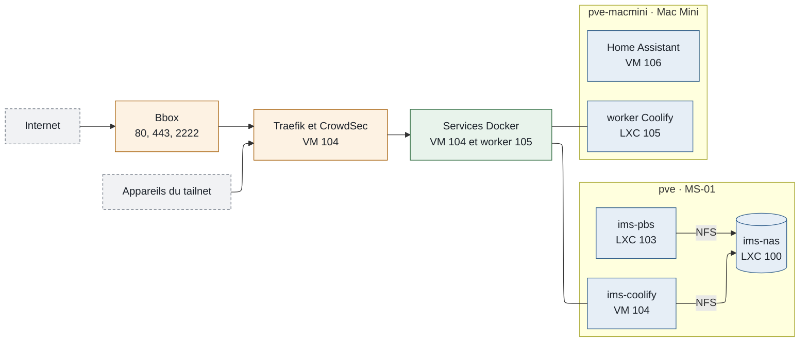

## Principes

| Principe | Application |
| --- | --- |
| Auto-hébergé par défaut | Les services tournent sur du matériel possédé. Les services externes sont listés et justifiés : DNS et certificats (OVH, Let's Encrypt), VPN de téléchargement (ProtonVPN), relais de courriels (Resend). |
| Sobriété | Chaque brique ajoutée doit se justifier. Pas d'outil pour un usage rare : une procédure suffit. |
| Rien d'exposé sans protection | Tout accès public passe par Traefik et CrowdSec, avec une authentification. L'administration n'est joignable que depuis le LAN ou le tailnet. |
| État décrit et reproductible | La configuration des hôtes est décrite dans le dépôt [ims-ops](/procedures/administration-ims-ops) ; les choix sont consignés dans les [décisions d'architecture](/history/adr/index). |

## Architecture

## Composants

| Composant | Rôle | Page |
| --- | --- | --- |
| Labrax | Rack 10 pouces imprimé en 3D, switch, alimentation | [Labrax](/infrastructure/labrax) |
| `pve` (Minisforum MS-01) | Nœud principal du cluster `ims-cluster` | [MS-01](/infrastructure/proxmox-host) |
| `pve-macmini` (Mac Mini Late 2012) | Second nœud : worker Coolify et Home Assistant | [Mac Mini](/infrastructure/mac-mini) |
| Raspberry Pi 3B+ | Écrans du rack (éteint) | [Raspberry Pi](/infrastructure/rpi-monitor) |
| `ims-nas` (LXC 100) | Stockage : NFS pour les invités, SMB pour le LAN | [ims-nas](/infrastructure/ims-nas) |
| `ims-pbs` (LXC 103) | Proxmox Backup Server | [ims-pbs](/infrastructure/ims-pbs) |
| `ims-coolify` (VM 104) | Coolify, Traefik et la plupart des services | [VM 104](/infrastructure/vm-coolify) |
| `ims-coolify-worker` (LXC 105) | Nœud d'exécution Docker distant de Coolify | [Worker 105](/infrastructure/lxc-coolify-worker) |
| Home Assistant (VM 106) | Domotique | [Home Assistant](/infrastructure/vm-home-assistant) |

Les services sont classés par usage dans la navigation : identité et accès, supervision, médias, outils.

## Points d'entrée

<CardGroup cols={2}>
  <Card title="Dépanner" icon="wrench" href="/procedures/depannage-courant">
    Pièges déjà rencontrés et leur solution.
  </Card>
  <Card title="Accès de secours" icon="life-ring" href="/procedures/commandes-urgence">
    Tailnet ou Termix indisponible, commandes d'urgence.
  </Card>
  <Card title="Administrer le parc" icon="terminal" href="/procedures/administration-ims-ops">
    Configurer un hôte, créer une VM, gérer les sauvegardes.
  </Card>
  <Card title="Exposition des services" icon="shield-halved" href="/reseau/matrice-securite-exposition">
    Qui accède à quoi, et par quel chemin.
  </Card>
  <Card title="Plan de reprise" icon="rotate-left" href="/procedures/plan-reprise-activite-pra">
    Reconstruction après la perte d'un nœud ou d'un disque.
  </Card>
  <Card title="Feuille de route" icon="list-check" href="/roadmap">
    Chantiers ouverts et réalisés.
  </Card>
</CardGroup>
