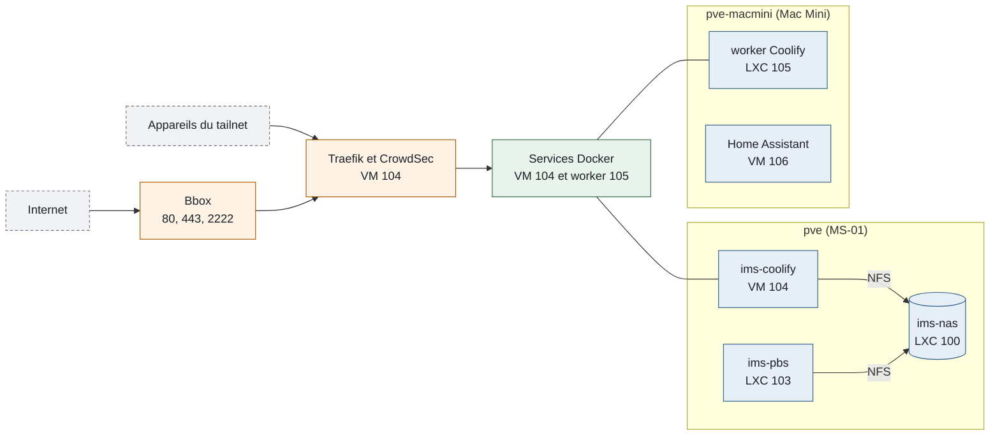

## Principes

Quatre règles guident chaque choix du homelab.

<CardGroup cols={2}>
  <Card title="Auto-hébergé par défaut" icon="house-laptop" color="#16A34A">
    Les services tournent sur du matériel possédé. Les services externes sont listés et justifiés : DNS et certificats (OVH, Let's Encrypt), VPN de téléchargement (ProtonVPN), relais de courriels (Resend).
  </Card>
  <Card title="Sobriété" icon="feather" color="#64748B">
    Chaque brique ajoutée doit se justifier. Pas d'outil pour un usage rare : une procédure suffit.
  </Card>
  <Card title="Rien d'exposé sans protection" icon="shield-halved" color="#FF6B00">
    Tout accès public passe par Traefik et CrowdSec, avec une authentification. L'administration n'est joignable que depuis le LAN ou le tailnet.
  </Card>
  <Card title="État décrit et reproductible" icon="code-branch" color="#3B82F6">
    La configuration des hôtes est décrite dans le dépôt [ims-ops](/procedures/administration-ims-ops) ; les choix sont consignés dans les [décisions d'architecture](/history/adr/index).
  </Card>
</CardGroup>

## Architecture

## Composants

Le matériel tient dans le rack Labrax ; les invités se répartissent sur les deux nœuds Proxmox. Les services sont classés par usage dans la navigation : identité et accès, supervision, médias, outils.

### Matériel

<CardGroup cols={2}>
  <Card title="MS-01 (pve)" icon="server" color="#3B82F6" href="/infrastructure/proxmox-host">Nœud principal du cluster `ims-cluster`.</Card>
  <Card title="Mac Mini (pve-macmini)" icon="server" color="#3B82F6" href="/infrastructure/mac-mini">Second nœud : worker Coolify et Home Assistant.</Card>
  <Card title="Labrax" icon="cube" color="#3B82F6" href="/infrastructure/labrax">Rack 10 pouces imprimé en 3D, switch, alimentation.</Card>
  <Card title="Raspberry Pi 3B+" icon="microchip" color="#64748B" href="/infrastructure/rpi-monitor">Écrans du rack (éteint).</Card>
</CardGroup>

### Invités

<CardGroup cols={3}>
  <Card title="ims-nas · LXC 100" icon="hard-drive" color="#8B5CF6" href="/infrastructure/ims-nas">Stockage : NFS pour les invités, SMB pour le LAN.</Card>
  <Card title="ims-pbs · LXC 103" icon="box-archive" color="#8B5CF6" href="/infrastructure/ims-pbs">Proxmox Backup Server.</Card>
  <Card title="ims-coolify · VM 104" icon="cubes" color="#3B82F6" href="/infrastructure/vm-coolify">Coolify, Traefik et la plupart des services.</Card>
  <Card title="Worker · LXC 105" icon="cubes" color="#3B82F6" href="/infrastructure/lxc-coolify-worker">Nœud d'exécution Docker distant de Coolify.</Card>
  <Card title="Home Assistant · VM 106" icon="house-signal" color="#3B82F6" href="/infrastructure/vm-home-assistant">Domotique.</Card>
</CardGroup>

## Points d'entrée

Les pages à ouvrir en premier, selon la situation.

<CardGroup cols={2}>
  <Card color="#64748B" title="Dépanner" icon="wrench" href="/procedures/depannage-courant">
    Pièges déjà rencontrés et leur solution.
  </Card>
  <Card color="#64748B" title="Accès de secours" icon="life-ring" href="/procedures/commandes-urgence">
    Tailnet ou Termix indisponible, commandes d'urgence.
  </Card>
  <Card color="#64748B" title="Administrer le parc" icon="terminal" href="/procedures/administration-ims-ops">
    Configurer un hôte, créer une VM, gérer les sauvegardes.
  </Card>
  <Card color="#FF6B00" title="Exposition des services" icon="shield-halved" href="/reseau/matrice-securite-exposition">
    Qui accède à quoi, et par quel chemin.
  </Card>
  <Card color="#8B5CF6" title="Plan de reprise" icon="rotate-left" href="/procedures/plan-reprise-activite-pra">
    Reconstruction après la perte d'un nœud ou d'un disque.
  </Card>
  <Card color="#64748B" title="Feuille de route" icon="list-check" href="/roadmap">
    Chantiers ouverts et réalisés.
  </Card>
</CardGroup>
