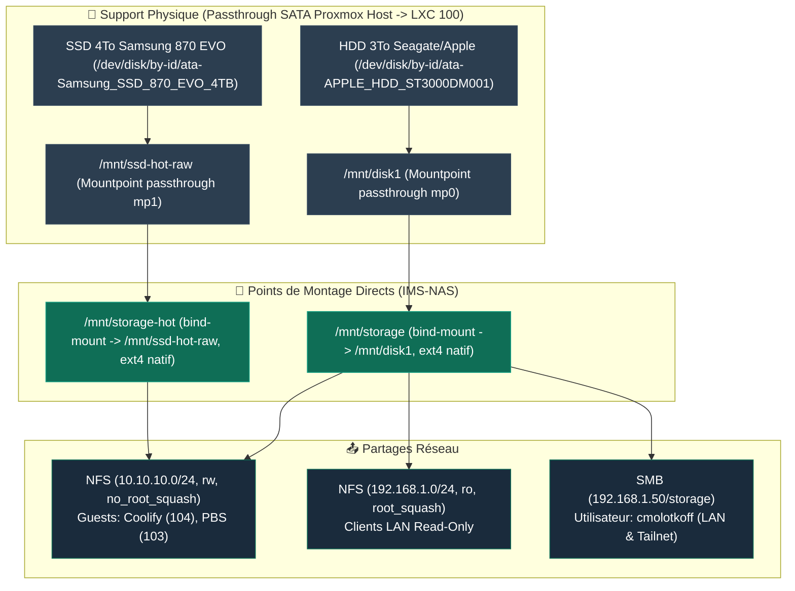

import { ips, hardware } from "/snippets/variables.mdx";

<Badge color="green">🟢 Production Active (LXC 100)</Badge>

<Note>
📦 **Type d'Instance** : **Conteneur LXC 100** (Debian 12 Privilégié) — Partage le noyau Linux directement avec l'hôte Proxmox VE.
</Note>

## Rôle

Centralise le stockage de l'infrastructure : documents, photos, backups, et médias. Sert en NFS aux guests internes (réseau isolé) et en SMB au LAN.

<Info>
**Capacité & Évolution** : Architecture multi-disques hybride composée d'un **HDD capacitif 3To** (Tier `/mnt/storage`) et d'un **SSD 4To dédié** (Tier `/mnt/storage-hot`). L'infrastructure reste évolutive pour accueillir de futurs disques durs HDD supplémentaires dans les slots caddies Dell 3.5" du rack [Labrax](/infrastructure/labrax).
</Info>

## Fiche technique

<Info>
**Architecture "Fait Maison"** : Ce NAS n'est pas un boîtier commercial (Synology/QNAP), mais une solution sur-mesure combinant un conteneur LXC Debian 12 et des montages directs ext4. Les disques physiques sont logés dans le **4-Pack Hard Drive Tray Caddy 3,5" pour DELL** du rack [Labrax](/infrastructure/labrax) et raccordés au MS-01 via la carte {hardware.sataCard}.
</Info>

| Propriété | Valeur |
|---|---|
| **VMID** | 100 |
| **Type** | LXC Debian 12, **privilégié** (requis pour NFS + passthrough disque) |
| **CPU / RAM** | 2 cores / 1024 MB |
| **Réseau** | `vmbr0` ({ips.nasLan}/24, LAN) + `vmbr1` (10.10.10.1/24, isolé, sans gateway) + `tailscale0` ({ips.nas}) |
| **Carte SATA** | {hardware.sataCard} |
| **Emplacement disques** | 4-Pack Hard Drive Tray Caddy 3.5" pour DELL (baie évolutive multi-disques) |
| **Accès distant** | Tailscale ({ips.nas}), hostname `ims-pve-100-nas`, utilisateur Headscale `infra` |
| **Statut** | <Badge color="green">🟢 Production Active</Badge> |

<Note>
`vmbr1` est un bridge isolé sans port physique ni gateway, dédié au trafic NFS interne entre guests (NAS ↔ PBS ↔ VM Coolify). Le LAN (`vmbr0`) sert le SMB et l'accès humain. L'interface `tailscale0` ({ips.nas}) assure l'administration à distance via le tunnel VPN Headscale.
</Note>

## Disques physiques & Évolutivité

| Disque | Référence Matérielle | Capacité / Type | Affectation NAS | Passthrough Proxmox |
|---|---|---|---|---|
| **Disque 1 (Capacitif)** | Seagate/Apple ST3000DM001 (`Z1F3N0NZ`) | 3 To HDD 7200rpm (ext4) | Tier `/mnt/storage` (Documents, HomeFlix, Backups, PhotoPrism) | `mp0` → `/mnt/disk1` |
| **Disque 2 (Hot/Performant)** | Samsung SSD 870 EVO (`S758NX0W713130Z`) | 4 To SSD SATA (ext4) | Tier `/mnt/storage-hot` (Immich, Forgejo) | `mp1` → `/mnt/ssd-hot-raw` |

<Warning>
Le disque Seagate ST3000DM001 est issu d'un ancien Apple AirPort Time Capsule (usage modéré, SMART OK). L'intégration ultérieure de nouveaux disques durs dans le NAS permettra d'étendre la volumétrie.
</Warning>

## Stockage — architecture des points de montage directs



```
/mnt/disk1        ext4, passthrough mp0 (HDD 3 To)
/mnt/storage      bind mount → /mnt/disk1 (ext4 natif)
                  ├── documents/
                  ├── backups/
                  ├── homeflix/
                  └── photoprism-data/
/mnt/ssd-hot-raw  ext4, passthrough mp1 (SSD SATA 4 To)
/mnt/storage-hot  bind mount → /mnt/ssd-hot-raw (ext4 natif)
                  ├── immich-data/
                  └── forgejo-data/
```

<Warning>
**Règle d'or — Ne jamais exporter de système de fichiers FUSE en NFS** :
Le montage MergerFS sur `/mnt/storage` a été définitivement supprimé au profit d'un **bind-mount direct ext4**. Les systèmes FUSE régénèrent leurs identifiants internes à chaque redémarrage, ce qui invalidait immédiatement tous les descripteurs NFS des clients (`ESTALE: Stale file handle`). Les exports NFS portent désormais directement sur un système `ext4` natif, garantissant la persistance des handles NFS au reboot du NAS.
</Warning>

### Logique de Découpage : Stockage Capacitif vs Données Chaudes

| Montage NFS (VM Coolify) | Point de Montage NAS (LXC 100) | Usage & Types de Données | Objectif & Comportement Matériel |
|---|---|---|---|
| **`/mnt/nas-storage`** | `/mnt/storage` | **Stockage Capacitif / Froid** : Médias HomeFlix (films, séries), archives photo, documents personnels et sauvegardes PBS (`/mnt/storage/backups`). | Optimisé pour le **stockage de masse** et la lecture séquentielle sur HDD. |
| **`/mnt/nas-hot`** | `/mnt/storage-hot` | **Données Chaudes / I/O Intensif** : Assets Immich (`immich-data`), dépôts Git Forgejo (`forgejo-data`). *(Remarque : Les bases de données Postgres/MariaDB résident directement sur le SSD NVMe local de la VM Coolify)*. | Optimisé pour la **latence et les IOPS** sur le **SSD SATA 4To dédié** (`/mnt/ssd-hot-raw`). |

<Info>
**Succès d'Architecture** : En isolant le réseau NFS dès le départ (`/mnt/nas-hot` vs `/mnt/nas-storage`), la bascule physique de `/mnt/storage-hot` vers le SSD 4To dédié puis le passage de `/mnt/storage` en bind-mount direct se sont effectués sur le LXC NAS **sans aucune modification des volumes Docker** dans la VM Coolify.
</Info>

## NFS

```
/mnt/storage      10.10.10.0/24(rw,no_root_squash)   # guests internes
/mnt/storage      192.168.1.0/24(ro,root_squash)      # LAN, lecture seule
/mnt/storage-hot  10.10.10.0/24(rw,no_root_squash)    # guests internes uniquement
```

## SMB & Compte d'Administration (cmolotkoff)

| Propriété | Valeur |
|---|---|
| **Partage SMB** | `smb://`{ips.nasLan}`/storage` (LAN) ou `smb://`{ips.nas}`/storage` (Tailnet) |
| **Utilisateur système & SMB** | `cmolotkoff` (UID `1000`, GID `1000`) |
| **Shell système** | `/bin/bash` |
| **Droits sudo** | `NOPASSWD: ALL` dans `/etc/sudoers.d/cmolotkoff` |
| **Mot de passe système** | Verrouillé (`passwd -l`), authentification exclusive par clé SSH Ed25519 |

<Warning>
**Règle d'Or — Intégrité de l'UID 1000 Samba** :
Le compte d'administration `cmolotkoff` est **strictement identique** à l'utilisateur propriétaire du partage Samba. Son shell a été passé de `/sbin/nologin` à `/bin/bash` pour permettre les connexions SSH et l'exécution d'Ansible, tout en conservant son mot de passe système verrouillé. **Ne jamais modifier son UID (1000) ni supprimer ce compte**, sous peine de corrompre l'ensemble des permissions POSIX du pool de stockage MergerFS.
</Warning>

## Accès Distant & Client Tailscale

Le conteneur LXC 100 est enrôlé dans le Tailnet sous le hostname `ims-pve-100-nas` avec l'adresse IP `{ips.nas}` (utilisateur Headscale `infra`).

<Steps>
  <Step title="Pass-through du périphérique TUN">
    L'accès au périphérique `/dev/net/tun` est déclaré dans la configuration Proxmox du conteneur (`/etc/pve/lxc/100.conf`) :
    ```ini
    lxc.cgroup2.devices.allow: c 10:200 rwm
    lxc.mount.entry: /dev/net/tun dev/net/tun none bind,create=file
    ```
  </Step>
  <Step title="Raccordement au Tailnet Headscale">
    ```bash
    tailscale up --login-server=https://vpn.ims-world.fr --hostname=ims-pve-100-nas --accept-routes
    ```
  </Step>
</Steps>

## Monitoring

<Warning>
**`smartd` et `hd-idle` ne peuvent PAS tourner dans ce LXC** — le passthrough mountpoint ne donne pas accès au device bloc brut nécessaire à ces outils. Les deux tournent sur le **host**. Voir [Dépannage courant](/procedures/depannage-courant) pour le détail de cette découverte.
</Warning>

## Sauvegardes & Stratégie d'Exclusion Proxmox (vzdump)

<Info>
**Stabilisation post-retrait de MergerFS** :
Historiquement, chaque redémarrage ou arrêt de la LXC 100 réinitialisait l'instance FUSE MergerFS et invalidait les descripteurs NFS des clients (`ESTALE`). Le passage au **bind-mount direct ext4** le 23/10/2026 a résolu ce comportement à la racine (voir le [Post-Mortem du 23/10/2026](/history/incidents/2026-10-23-estale-nfs-mergerfs-backups-et-homeflix)).
</Info>

### 1. Sauvegarde en Mode Stop
La sauvegarde du LXC 100 s'effectue en `--mode stop` vers le stockage `local` NVMe de l'hôte :
```bash
vzdump 100 --mode stop --compress zstd --storage local
```

### 2. Directive `backup=0` Obligatoire
Les deux points de montage doivent impérativement conserver la directive `backup=0` sur l'hôte MS-01 pour éviter d'embarquer les téraoctets de données dans le stockage système `local-lvm` lors des sauvegardes :
```bash
# Vérification / Correction sur le host MS-01
sudo pct set 100 -mp0 /mnt/disk1,mp=/mnt/disk1,backup=0
sudo pct set 100 -mp1 /dev/disk/by-id/ata-Samsung_SSD_870_EVO_4TB_S758NX0W713130Z,mp=/mnt/ssd-hot-raw,backup=0
```

### 3. Procédure Post-Redémarrage ou Sauvegarde du NAS (LXC 100)
En dehors d'un redémarrage complet de l'hôte MS-01 (où l'ordre de boot PVE gère la séquence), tout redémarrage isolé ou sauvegarde manuelle de la LXC 100 exige l'enchaînement suivant :
1. **Sauvegarde Manuelle Préalable** : `vzdump 100 --mode stop --compress zstd --storage local`.
2. **Exécution des modifications / Redémarrage LXC 100**.
3. **Reboot Obligatoire de Proxmox Backup Server (LXC 103)** :
   ```bash
   # Redémarrage obligatoire pour réinitialiser le datastore NFS PBS
   pct reboot 103
   ```
4. **Redémarrage Recommandé de la VM IMS-Coolify (VM 104)** :
   - *Idéalement* : Redémarrer proprement la VM Coolify (`qm reboot 104` ou `sudo reboot` dans la VM).
   - *A minima* : Redémarrer les conteneurs clients du NAS (`docker restart jellyfin sonarr radarr prowlarr photoprism`).

## Documents associés

<CardGroup cols={2}>
  <Card title="Dépannage IMS-NAS" icon="wrench" href="/procedures/depannage-courant">
    Tous les problèmes réseau/FUSE/monitoring rencontrés sur ce nœud.
  </Card>
  <Card title="Ajout d'un disque" icon="hard-drive" href="/procedures/ajout-nouveau-disque">
    Procédure pour l'intégration de nouveaux disques dans MergerFS.
  </Card>
</CardGroup>
