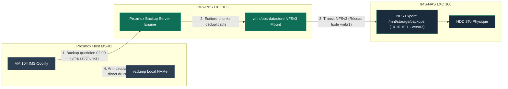
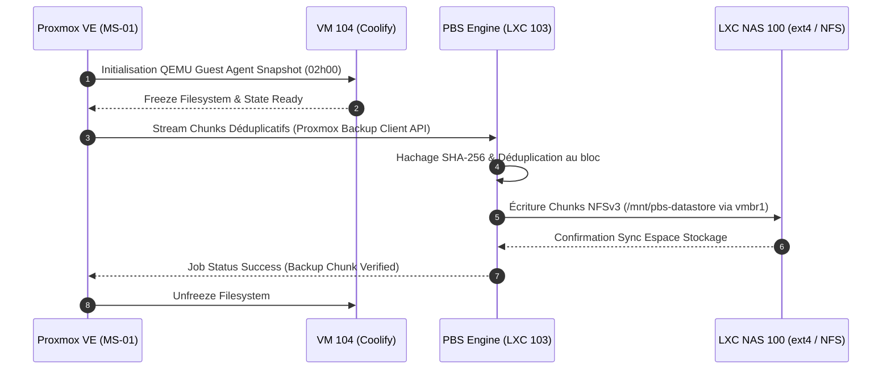

import { ips } from "/snippets/variables.mdx";

<Badge color="green">🟢 Production Active (LXC 103)</Badge>

<Note>
📦 **Type d'Instance** : **Conteneur LXC 103** (Debian 12 Privilégié) — Partage le noyau Linux directement avec l'hôte Proxmox VE.
</Note>

## Rôle

Datastore de sauvegarde déduplicée pour les VM/LXC applicatifs (VM Coolify en premier lieu). Stocke les backups sur le HDD du NAS via NFS.

<Warning>
**Ne sauvegarde PAS la donnée brute du NAS.** Principe anti-circularité : le NAS et PBS eux-mêmes sont sauvegardés séparément (`vzdump` vers le NVMe local du host), jamais dans le datastore qu'ils hébergent/gèrent. Voir la [Politique de Sauvegarde & Tâches Planifiées](/procedures/politique-sauvegardes).
</Warning>

## Fiche technique

| Propriété | Valeur |
|---|---|
| **VMID** | 103 |
| **Type** | LXC Debian 12, **privilégié** (requis pour montage NFS direct) |
| **CPU / RAM** | 2 cores / 1024 MB |
| **Réseau** | `vmbr0` ({ips.pbsLan}/24) + `vmbr1` (10.10.10.3/24) + client Tailscale dédié |
| **Accès Tailscale** | {ips.pbs}, hostname `ims-pve-103-pbs` |
| **Compte admin** | `cmolotkoff` (Port 22, clé SSH Ed25519 réparée le 22/10/2026, `sudo NOPASSWD`) |
| **Statut** | <Badge color="green">🟢 Production Active</Badge> |

<Note>
**Contrainte Technique LXC** : Le conteneur LXC 103 est configuré en mode **privilégié** avec la feature `mount=nfs`. Ce mode est techniquement obligatoire pour autoriser le montage direct du stockage réseau NFS sans restriction par les user namespaces du noyau Linux.
</Note>

## Accès distant — client Tailscale dédié

PBS dispose de son propre client Tailscale enrôlé sur le control plane Headscale (`ims-pve-103-pbs`). Le compte d'administration `cmolotkoff` a été réparé le 22/10/2026 (la clé SSH était refusée) : il permet la gestion directe en SSH et l'exécution d'Ansible.

<Steps>
  <Step title="Device TUN requis dans la config LXC">
    ```ini
    lxc.cgroup2.devices.allow: c 10:200 rwm
    lxc.mount.entry: /dev/net/tun dev/net/tun none bind,create=file
    ```
    <Warning>À ne pas oublier en cas de recréation du CT — sans ces lignes, Tailscale ne démarre pas.</Warning>
  </Step>
  <Step title="Installation & Enregistrement">
    ```bash
    curl -fsSL https://tailscale.com/install.sh | sh
    tailscale up --login-server=https://vpn.ims-world.fr --hostname=ims-pbs --accept-routes
    ```
  </Step>
</Steps>

## Datastore





| Propriété | Valeur |
|---|---|
| **Nom** | `pve-backups` |
| **Backing path** | `/mnt/pbs-datastore` |
| **Source NFS** | `10.10.10.1:/mnt/storage/backups` (HDD du NAS) |

<Note>
Le datastore est nommé **`pve-backups`**. Il sert d'espace de stockage déduplicatif pour les sauvegardes automatisées des machines virtuelles du cluster Proxmox.
</Note>

## Jobs configurés

| Job | Schedule | Détail |
|---|---|---|
| Garbage Collection | `sat 03:00` | Libère les chunks non référencés |
| Prune | quotidien | Rétention 7 daily / 4 weekly / 3 monthly |
| Verify | `sun 04:00` | Détecte la corruption silencieuse |
| **Backup VM Coolify** | `02:00` quotidien | Configuré côté Proxmox host (Datacenter → Backup) |

<Check>
Sauvegarde de la VM Coolify (104) opérationnelle et validée en production (snapshots quotidiens récurrents à 02:00).
</Check>

<Info>
**Montage NFS du datastore (`vers=3`)** :
Le montage est actuellement configuré en NFS `vers=3` (`/etc/fstab`) :
```ini
# fstab du CT PBS
10.10.10.1:/mnt/storage/backups  /mnt/pbs-datastore  nfs  defaults,nofail,_netdev,vers=3  0 0
```
Ce forçage en version 3 avait été appliqué pour contourner des blocages d'invalidation de handles (`ESTALE`) spécifiques à l'interaction entre NFSv4.2 et MergerFS FUSE. Depuis le retrait de MergerFS et le passage en ext4 natif sur le NAS (23/10/2026), le montage NFS repose sur un système de fichiers stable. Le retour en `vers=4.2` ou le passage du datastore en bind-mount Proxmox direct (`mp`) sont des évolutions identifiées.
</Info>

## Résumé de la Configuration Système & Sécurité

Pour assurer le fonctionnement fiable et sécurisé du conteneur LXC 103 :

1. **LXC privilégié & NFS** : conteneur en privilège root avec feature `mount=nfs` pour autoriser les syscalls de montage NFS vers le NAS (`ext4` natif).
2. **Socle SSH & Accès Admin** : configuration `/etc/ssh/sshd_config.d/00-ims-ops.conf` posée (`PasswordAuthentication no`, `PermitRootLogin prohibit-password`). Le compte `cmolotkoff` dispose de `sudo` journalisé (`log_subcmds`).
3. **Accès Termix Opérationnel** : compte dédié non-root `termix-usr` avec nouvelle clé Ed25519 déployée le 24/10/2026 restreinte à Traefik (`from="192.168.1.52"`) et sudo journalisé dans Loki via Alloy.
4. **Supervision Alloy** : agent systemd actif (log level `info`), avec collecteur `hwmon` désactivé pour éviter les erreurs d'accès capteurs dans le LXC.
5. **Fail2ban** : déployé avec les jails `sshd` et `recidive`, alertes Ntfy envoyées vers `192.168.1.52`.
6. **Mises à Jour Automatiques** : patches de sécurité appliqués automatiquement via `unattended-upgrades`, sans redémarrage automatique.

Voir aussi le [Post-Mortem du 23/10/2026](/history/incidents/2026-10-23-estale-nfs-mergerfs-backups-et-homeflix).
