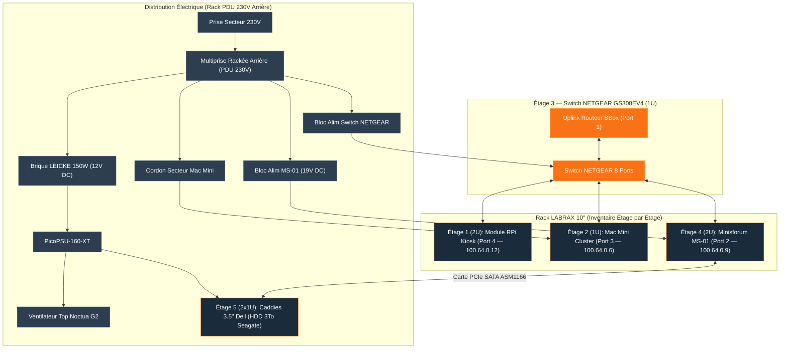

## Châssis

<Tabs>
  <Tab title="Face avant">
    
  </Tab>
  <Tab title="Arrière et alimentation">
    
  </Tab>
</Tabs>

### Caractéristiques

| Élément | Détail |
| --- | --- |
| **Modèle Original 3D** | Projet [Lab Rax — A 3D Printable Modular 10" Rack System (The DIY Life)](https://the-diy-life.com/introducing-lab-rax-a-3d-printable-modular-10-rack-system/) |
| **Structure** | Châssis modulable 10" 3D-printé (PETG/PLA\+ gris renforcé avec poignées supérieures) |
| **Impression 3D** | Terminée le 20/08/2026 |
| **Panneaux Latéraux** | Acrylique teinté noir profond (encastré dans les fentes intérieures du plastique) |
| **Refroidissement Supérieur** | Ventilateur Noctua NF-A12x25 G2 PWM chromax.black (extraction d'air chaud par le haut) |
| **Distribution Électrique** | Multiprise rackée à l'arrière (PDU 230V) alimentant : (1) PicoPSU-160-XT \+ LEICKE 150W 12V (disques & ventilateur Noctua G2), (2) bloc d'alimentation Switch NETGEAR, (3) bloc d'alimentation MS-01, (4) alim secteur Mac Mini |

---

## Inventaire par étage

| Étage | Hauteur | Équipement | Connexion | Fiche |
| --- | --- | --- | --- | --- |
| **Étage 1** | **2U** | Module 2U avec écran Wisecoco 7.84" LCD, OLED 0.91", bouton GPIO & RPi 3B\+ | Port Switch #4 (100M) • IP `100.64.0.12` | [Raspberry Pi](/infrastructure/rpi-monitor) |
| **Étage 2** | **1U** | Mac Mini Late 2012 (`pve-macmini`) | Port Switch #3 (1G) • IP `100.64.0.6` | [Mac Mini](/infrastructure/mac-mini) |
| **Étage 3** | **1U** | Switch NETGEAR GS308EV4 (8p Gérés) \+ Patch Panel RJ45 12p | Ports 1 à 4 câblés • Uplink Bbox | _(Voir câblage ci-dessous)_ |
| **Étage 4** | **2U** | Minisforum MS-01 (Carte SATA PCIe Tbest ASM1166 6 ports) | Port Switch #2 (2.5G) • IP `100.64.0.9` | [MS-01](/infrastructure/proxmox-host) |
| **Étage 5** | **2 x 1U** | 4-Pack Hard Drive Tray Caddy 3.5" Dell (HDD 3To Seagate \+ adaptateur 2.5" SSD) | Nappe SATA via carte PCIe MS-01 | [ims-nas](/infrastructure/ims-nas) |

---

## Câblage du switch

| Port Switch NETGEAR | Équipement Raccordé | Vitesse & Câblage |
| --- | --- | --- |
| **Port 1 (Uplink WAN)** | Routeur Bbox | RJ45 Cat 6 |
| **Port 2 (Compute)** | Minisforum MS-01 (Hyperviseur PVE) | RJ45 Cat 6 (2.5G) |
| **Port 3** | Mac Mini | RJ45 Cat 6 (1G) |
| **Port 4 (Kiosk)** | Raspberry Pi 3B\+ (Module 2U Écran) | RJ45 Cat 6 (100M) |
| **Port SFP\+** | Port SFP\+ 10G | Réservé pour évolution réseau 10G |

---

## Alimentation et réseau

