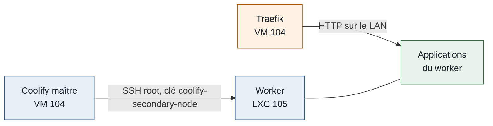

import { ips } from "/snippets/variables.mdx";

## Fiche

Le worker exécute des applications pour le compte du Coolify de la VM 104. Il décharge le MS-01 et n'a pas d'interface propre.

| Propriété | Valeur |
| --- | --- |
| Type | Conteneur LXC non privilégié |
| Nœud et VMID | `pve-macmini`, 105 |
| Noms | Proxmox `pve-macmini-worker_LXC-105` · système `coolify` · inventaire `ims-coolify-worker` · tailnet `ims-pve-105-coolify-worker` |
| OS | Debian 13 |
| CPU et RAM | 2 cœurs · 4 Go, 512 Mo d'échange |
| Disques | 30 Go (disque racine) |
| IP LAN | `192.168.1.198` attendue ; le conteneur est en DHCP et a obtenu `192.168.1.177` (à remettre en IP fixe) |
| IP tailnet | <code>{ips.coolifyWorker}</code> |
| Sauvegarde | Pool `backup`, chaque nuit vers le PBS |
| Statut | En service |

## Ce qui tourne dessus

Le moteur Docker et un proxy local (`coolify-proxy`) pour les applications que Coolify y déploie. L'interface Coolify installée par défaut a été retirée pour économiser la RAM du Mac Mini :

```bash
docker stop coolify coolify-db coolify-realtime
docker rm coolify coolify-db coolify-realtime
```

## Fonctionnement

Le worker ne reçoit rien directement d'Internet : tout passe par la VM 104.



Tout le trafic entrant arrive sur le Traefik de la VM 104, qui le transmet aux applications du worker par le LAN. Le Coolify maître se connecte en root par clé (`coolify-secondary-node`, dans `/root/.ssh/authorized_keys`).

## Particularités

Ce qui distingue ce conteneur des autres hôtes du parc.

- Le nom système (`coolify`) diffère du nom d'inventaire : aucun rôle d'ims-ops ne renomme un hôte.
- SSH démarré par activation de socket (`ssh.socket`).
- Écarts au [socle commun](/infrastructure/socle-commun) : root par clé (Coolify), collecteur Alloy Docker.

## Sauvegarde et reprise

Sauvegardé chaque nuit dans le PBS. Les applications du worker se redéploient aussi depuis Coolify.

## Supervision

Agent Alloy : système, journaux, métriques et journaux Docker (étiquette `host: ims-coolify-worker`), envoyés vers `192.168.1.52`.

## Voir aussi

<CardGroup cols={2}>
  <Card title="VM 104" icon="server" href="/infrastructure/vm-coolify">Coolify maître, Traefik et services.</Card>
  <Card title="Mac Mini" icon="server" href="/infrastructure/mac-mini">Second nœud du cluster.</Card>
</CardGroup>
