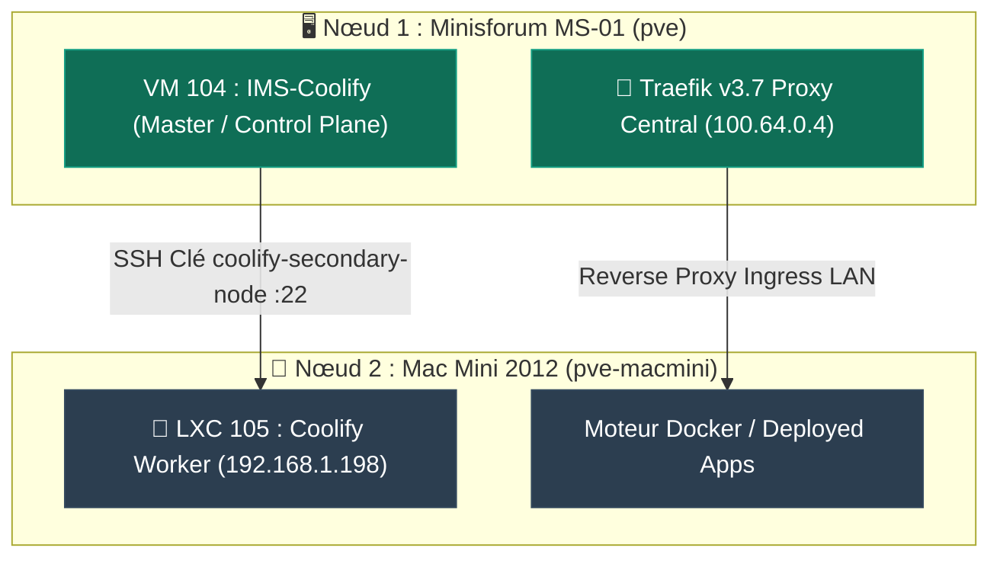

import { ips, domains } from "/snippets/variables.mdx";

<Badge color="green">🟢 Production Active (Nœud Worker Coolify v4.3.14)</Badge>

---

## Fiche Technique & Métadonnées

| Propriété | Valeur |
|---|---|
| **Hostname / Conteneur** | `pve-macmini-worker_LXC-105` (ID `105`) |
| **Hôte d'Hébergement** | Proxmox VE Nœud 2 (`pve-macmini.ims-world.fr`) |
| **OS / Distribution** | Debian 13 (Trixie) LXC Unprivileged |
| **Adresse IP LAN** | `192.168.1.198` |
| **Accès VPN / Tailnet** | Tailscale ({ips.coolifyWorker}), hostname `ims-pve-105-coolify-worker`, utilisateur Headscale `infra` |
| **Accès SSH Master** | Clé publique `coolify-secondary-node` (Port 22, User `root`, socket activation `ssh.socket`) |
| **Accès SSH Admin** | Compte `cmolotkoff` (Port 22, clé SSH Ed25519, `sudo` journalisé `log_subcmds`) |
| **Supervision Alloy** | Agent Grafana Alloy installé (`host: ims-coolify-worker`, métriques + journald + logs Docker vers `192.168.1.52`) |
| **Sécurité & Maintenance** | Fail2ban (jails `sshd` + `recidive`), Mises à jour de sécurité auto (`unattended-upgrades`, sans reboot) |
| **Version Coolify** | `v4.3.14` |
| **Rôle dans l'Architecture** | **Nœud Worker Distant** (Moteur d'exécution Docker autonome) |
| **Statut** | <Badge color="green">🟢 Opérationnel & Enrôlé</Badge> |

---

## Architecture Multi-Nœuds Coolify

Le homelab s'appuie sur une **topologie distribuée Control Plane / Worker** :



### 1. Ingress & Routage Réseau
- Tout le trafic HTTP/HTTPS entrant (WAN et VPN Tailnet) continue d'arriver exclusivement sur le **Traefik principal de la VM 104** (`100.64.0.4`).
- Traefik réachemine ensuite les requêtes vers les conteneurs applicatifs exécutés sur le Worker LXC 105 via le réseau LAN local `192.168.1.198`.

### 2. Authentification & Accès SSH
- **Activation par Socket** : Le serveur SSH est lancé par activation sur socket systemd (`ssh.socket`).
- **Enrôlement Master Coolify** : Le Master VM 104 s'authentifie sur le LXC 105 via la clé publique `coolify-secondary-node` inscrite dans `/root/.ssh/authorized_keys` (droits `600`).
- **Configuration sshd (`/etc/ssh/sshd_config.d/00-ims-ops.conf` & `01-coolify.conf`)** :
  ```text
  PermitRootLogin prohibit-password
  PasswordAuthentication no
  PubkeyAuthentication yes
  ```
- **Compte d'Administration (`cmolotkoff`)** : Droits `sudo NOPASSWD` configurés dans `/etc/sudoers.d/cmolotkoff` avec directive `Defaults log_subcmds` pour la traçabilité des commandes.

### 3. Enrôlement Tailscale & TUN Device
Pour autoriser Tailscale à opérer dans le conteneur LXC 105 Unprivileged, le périphérique `/dev/net/tun` a été configuré sur le nœud Proxmox Mac Mini (`/etc/pve/nodes/pve-macmini/lxc/105.conf`) :
```ini
lxc.cgroup2.devices.allow: c 10:200 rwm
lxc.mount.entry: /dev/net/tun dev/net/tun none bind,create=file
```
Le conteneur est enrôlé sous l'utilisateur Headscale `infra` avec le hostname `ims-pve-105-coolify-worker`.

---

## 📊 Supervision & Agent Grafana Alloy

L'agent **Grafana Alloy** est déployé en tant que service systemd sur le conteneur LXC 105 (niveau de log `info`) :
- **Métriques système** : Node exporter intégré (CPU, mémoire, disque, réseau) remonté vers Prometheus (`192.168.1.52:9090`). Le collecteur `hwmon` est désactivé pour éviter les erreurs d'accès aux capteurs matériels physiques inaccessibles dans le LXC.
- **Logs système** : Collecte du journal systemd acheminée vers Loki (`192.168.1.52:3100`).
- **Métriques & Logs Docker** : Découverte automatique des conteneurs applicatifs déployés par Coolify avec l'étiquette `host: ims-coolify-worker`.

---

## 🧹 Optimisation & Nettoyage de la RAM du Worker

Le conteneur LXC 105 étant un simple **nœud d'exécution distant**, l'interface d'administration autonome instanciée par le script `install.sh` a été arrêtée et supprimée pour libérer la mémoire RAM DDR3 du Mac Mini :

```bash
# Arrêt et suppression des services d'IHM autonome inutiles sur le Worker
docker stop coolify coolify-db coolify-realtime
docker rm coolify coolify-db coolify-realtime
```

<Info>
**Conteneurs Conservés sur le Worker** :
Seul le moteur Docker Engine et le conteneur local `coolify-proxy` (Traefik d'exécution) restent actifs sur `192.168.1.198` pour assurer le relais local des applications déployées.
</Info>
