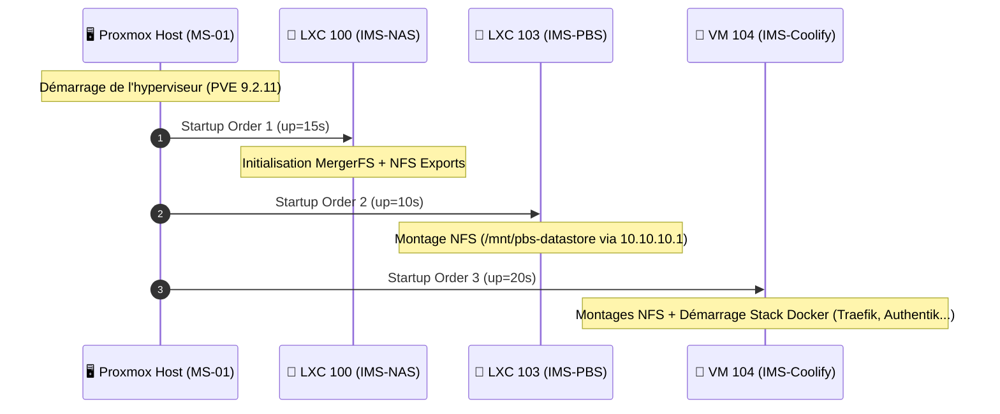

import { ips, hardware } from "/snippets/variables.mdx";

<Badge color="green">🟢 Production Active (Hyperviseur Principal)</Badge>

## Fiche matériel

| Propriété | Valeur |
| --- | --- |
| **Modèle** | Minisforum MS-01 |
| **CPU** | {hardware.ms01Cpu} (iGPU Iris Xe intégrée) |
| **RAM** | {hardware.ms01Ram} |
| **Stockage NVMe** | {hardware.ms01Storage} (LVM-Thin `local-lvm`) |
| **Disques SATA** | HDD 3To Apple/Seagate (Passthrough `mp0`) \+ SSD 4To (Passthrough `mp1` — `storage-hot`) |
| **OS** | **Proxmox VE 9.2.11** (Aligné avec Mac Mini) |
| **Cluster Proxmox** | Leader Nœud 1 du cluster **`ims-cluster`** (2/2 votes, Quorate: Yes) |
| **Accès Admin GUI** | <code>https://{ips.pveLan}:8006</code> |
| **Accès SSH** | Clé uniquement (`PasswordAuthentication no`, `PermitRootLogin prohibit-password`, port 22) |
| **Comptes** | `cmolotkoff` (sudo NOPASSWD journalisé `log_subcmds`), `root` par clé (cluster) |
| **Supervision Alloy** | Agent bare-metal (étiquette `host: ms01-pve`, log level `info`) |

## Topologie Matérielle & Allocation

```mermaid
graph TD
    subgraph HW ["💻 Hardware MS-01 (Intel i5-12600H, 31 GiB RAM)"]
        CPU["12 Cores / 16 Threads"]
        RAM["31 GiB RAM"]
        NVME["930 Go NVMe (LVM-Thin: local-lvm)"]
        HDD["HDD 3To SATA Apple/Seagate (Passthrough mp0)"]
        SSD["SSD 4To SATA (Passthrough mp1 — storage-hot)"]
    end

    subgraph PVE ["🖥️ Proxmox VE 9.2.11 (pve — Nœud 1 Cluster ims-cluster)"]
        subgraph LXC100 ["IMS-NAS (LXC 100)"]
            NAS_RES["2 Cores | 1 Go RAM | mp0 HDD + mp1 SSD 4To"]
        end
        subgraph LXC103 ["IMS-PBS (LXC 103)"]
            PBS_RES["2 Cores | 1 Go RAM | Datastore NFS"]
        end
        subgraph VM104 ["IMS-Coolify (VM 104)"]
            COOL_RES["6 Cores | 18 Go RAM | 128 Go NVMe"]
        end
    end

    CPU --> PVE
    RAM --> PVE
    NVME --> VM104
    HDD -->|Passthrough mp0 (SATA)| LXC100
    SSD -->|Passthrough mp1 (SATA)| LXC100

    classDef hw fill:#2c3e50,stroke:#34495e,color:#fff;
    classDef vm fill:#0F6E56,stroke:#16A085,color:#fff;
    class CPU,RAM,NVME,HDD,SSD hw;
    class LXC100,LXC103,VM104 vm;
```

<Warning>
  Le firewall Proxmox 3 niveaux (node → datacenter → VM) n'est **pas encore configuré**. À faire avant toute exposition publique supplémentaire. Ordre impératif : règles niveau nœud d'abord, vérifier l'accès GUI\+SSH immédiatement après activation, garder la console web ouverte pendant l'opération.
</Warning>

## Repos APT

Le format `deb822` (`.sources`) est utilisé sur PVE9, pas l'ancien `pve-enterprise.list` :

```bash
# /etc/apt/sources.list.d/pve-enterprise.sources → Enabled: false
# /etc/apt/sources.list.d/proxmox.sources → pve-no-subscription, Enabled: true
```

## Guests hébergés

| VMID | Nom | Type | Statut | Rôle |
| --- | --- | --- | --- | --- |
| **100** | ims-nas | LXC privilégié | <Badge color="green">🟢 Actif</Badge> | Stockage NFS/SMB |
| **103** | ims-pbs | LXC privilégié | <Badge color="green">🟢 Actif</Badge> | Sauvegardes |
| **104** | ims-coolify | VM | <Badge color="green">🟢 Actif</Badge> | Orchestration Docker |
| **101** | vm-test | VM | <Badge color="green">🟢 Actif</Badge> | Banc de test & VM générique (Tailscale `100.64.0.13`, Alloy, socle `00-ims-ops`) |
| **102** | ims-windows | VM | <Badge>⚪ Inactif</Badge> | Environnement Windows |
| **8000** | ubuntu-2404-template | Template | <Badge color="blue">🔵 Template</Badge> | Base pour clonage de VM Ubuntu avec Tailscale automatique |

## Template de VM et création de VM

Les VM Linux sont créées depuis le template Ubuntu 24.04 `ubuntu-2404-ims-ops` (VMID `9001`), construit et utilisé par le dépôt ims-ops.

| Élément | Valeur |
| --- | --- |
| Construction | `just template`, depuis l'image cloud officielle Ubuntu 24.04, somme SHA256 vérifiée |
| Processeur | `x86-64-v2-AES`, pour rester migrable vers le second nœud |
| Disque | `virtio-scsi-single` avec `iothread`, sur `local-lvm` |
| Cloud-Init | Minimal : nom, compte `cmolotkoff`, clé SSH. Le reste est appliqué par Ansible |
| Création | `just vm <nom> [os] [taille] [mode]` : VMID et IP choisis par la commande, dans la plage `192.168.1.200-249` |
| Destruction | `just vm-destroy <nom>`, limitée aux VM créées par `just vm` |

L'enrôlement dans le tailnet ne passe plus par Cloud-Init : il est fait par le rôle Ansible `tailscale` (voir [Ajouter une machine au tailnet](/procedures/ajout-machine-headscale)).

<Warning>
L'ancien template (VMID 8000 dans la documentation, 9000 sur le cluster) et son snippet `vendor-data.yaml` ont été supprimés le 24/10/2026 : le snippet contenait une clé Headscale en clair. Ne pas recréer ce mécanisme.
</Warning>

## Autostart et ordre de boot



<Check>
  Validé par un reboot complet réel du host — les trois guests de production redémarrent automatiquement dans le bon ordre.
</Check>

```bash
# NAS en premier (les autres en dépendent via NFS)
pct set 100 -onboot 1 -startup order=1,up=15

# PBS ensuite
pct set 103 -onboot 1 -startup order=2,up=10

# Coolify en dernier
qm set 104 --onboot 1 --startup order=3,up=20
```

## Monitoring bas niveau & Mise en veille HDD (hd-idle)

<Warning>
  **Tout outil nécessitant un accès device bloc direct (ioctl ATA/SCSI) doit tourner sur le host, jamais dans un LXC avec passthrough mountpoint.** Le passthrough (`mp0`) donne accès au filesystem monté, pas au device brut. Concerne `smartd` et `hd-idle` — voir [Dépannage courant](/procedures/depannage-courant) pour le détail complet de cette découverte.
</Warning>

### Configuration hd-idle (Timeout 30 minutes)

Le daemon **`hd-idle`** s'exécute directement sur l'hyperviseur MS-01 afin de placer le disque dur Seagate 3To du NAS en veille mécanique (spin-down) après **30 minutes d'inactivité** I/O.

- Fichier de configuration sur le host : `/etc/default/hd-idle`
- Option activée : `HD_IDLE_OPTS="-i 1800 -a /dev/disk/by-id/ata-APPLE_HDD_ST3000DM001_Z1F3N0NZ"`

```bash
# Vérifier l'état d'exécution des services hd-idle et smartd sur le host
systemctl status hd-idle smartd --no-pager

# Contrôler l'état de veille en temps réel (doit afficher "drive state is: standby" après 30min d'inactivité)
hdparm -C /dev/disk/by-id/ata-APPLE_HDD_ST3000DM001_Z1F3N0NZ

# Vérifier le bilan de santé SMART
smartctl -H /dev/disk/by-id/ata-APPLE_HDD_ST3000DM001_Z1F3N0NZ
```

## GPU (iGPU Iris Xe) — Passthrough VM Coolify

L'iGPU Intel Iris Xe du processeur i5-12600H est attribuée en passthrough PCIe (`hostpci0`) à la VM IMS-Coolify (VM 104). Voir l'[ADR-008 — Passthrough GPU (iGPU Iris Xe)](/history/adr/adr-008-passthrough-gpu-igpu-iris-xe) pour le détail complet de la mise en place (IOMMU, VFIO, chipset q35, drivers).

### Statut de Validation des Services Applicatifs

- [**HomeFlix / Jellyfin**](/services/homeflix#accélération-matérielle-gpu-intel-quicksync-qsv--validé) : <Badge color="green">🟢 Validé en Production (29.7x)</Badge> — QuickSync QSV opérationnel (`hevc_qsv` / `h264_qsv`), transcodage à 29.7x le temps réel.
- [**PhotoPrism**](/services/photoprism#accélération-gpu-ffmpeg--statut-transcodage-igpu-iris-xe) : <Badge color="orange">⚠️ Transcodage Vidéo Partiel</Badge> — Variable `PHOTOPRISM_INIT: 'intel tensorflow'` requise pour installer les paquets VA-API/QSV (évite la retombée sur `libx264` CPU).
- [**Immich**](/services/immich#décision-darchitecture--accélération-gpu--openvino-ia--smart-search) : <Badge>⚙️ Écarté (Maintien CPU)</Badge> — Support OpenVINO écarté pour éviter la complexité de stack, l'indexation initiale du stock photo (61 880 assets) étant déjà achevée.

---

## 🛡️ Sécurité & Protection Host Bare-Metal (Fail2ban, SSH & Ntfy)

Le service **Fail2ban** (`fail2ban.service`) et le socle de configuration SSH `/etc/ssh/sshd_config.d/00-ims-ops.conf` sont déployés sur l'hôte physique MS-01 et harmonisés sur l'ensemble des 7 hôtes du homelab.

<Info>
  **Socle Système & Fail2ban (7 Hôtes)** : Fail2ban s'exécute avec les prisons `sshd` et `recidive` sur `/etc/fail2ban/jail.local`. L'escalade de ban est progressive (`1h` doublé à chaque récidive, plafond `1 semaine`). Les alertes instantanées sont envoyées au topic Ntfy **`ims-alerts`** directement par l'IP LAN de Traefik (`192.168.1.52`).
  
  **Durcissement SSH du Nœud Proxmox** :
  - `PasswordAuthentication no` : connexion par mot de passe bannie, clés uniquement.
  - `PermitRootLogin prohibit-password` : root accessible uniquement par clé SSH (nécessaire au cluster inter-nœuds et aux sauvegardes).
  - Suppression de la clé orpheline `audit@ims-world` sur le compte `cmolotkoff`.
  - Pas de mises à jour automatiques sur les nœuds Proxmox (maintien manuel).
</Info>

### Commandes CLI Usuelles d'Administration

```bash
# Vérifier le statut du service Fail2ban et les prisons actives (sshd + recidive)
sudo systemctl status fail2ban
sudo fail2ban-client status

# Inspecter les adresses IP actuellement bannies sur la prison SSH ou récidive
sudo fail2ban-client status sshd
sudo fail2ban-client status recidive

# Débannir manuellement une adresse IP (ex: auto-ban accidentel)
sudo fail2ban-client set sshd unbanip <ADRESSE_IP>
sudo fail2ban-client set recidive unbanip <ADRESSE_IP>
```
