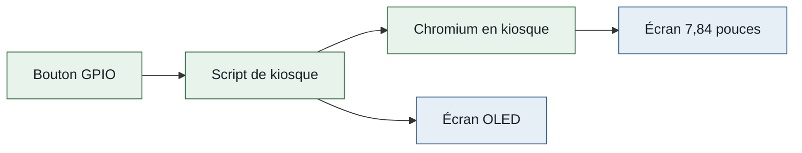

import { ips } from "/snippets/variables.mdx";

<Badge color="gray">Éteint</Badge>

## Fiche

Raspberry Pi du module d'écrans en façade du rack, éteint pour le moment.

| Propriété | Valeur |
| --- | --- |
| Type | Machine physique, Raspberry Pi 3B+ (BCM2837B0, 4 cœurs, 1 Go) |
| Nœud et VMID | — |
| Noms | tailnet `ims-rpi-monitor` |
| OS | Raspberry Pi OS (ARM) |
| CPU et RAM | 4 cœurs 1,4 GHz · 1 Go |
| Disques | Carte microSD |
| IP LAN | — |
| IP tailnet | <code>{ips.rpi}</code> |
| Sauvegarde | Aucune |
| Statut | Éteint (problème d'alimentation), hors gestion ims-ops |

## Rôle

Le Raspberry Pi pilote les écrans du module 2U en façade du rack [Labrax](/infrastructure/labrax), par un navigateur en mode kiosque. Ce n'est pas une sonde de supervision.

<CardGroup cols={3}>
  <Card title="Écran principal" icon="display">Wisecoco 7,84 pouces LCD, 1280×400. Rotation : bannière IMS, pages web en mode lecture.</Card>
  <Card title="Écran secondaire" icon="microchip">OLED 0,91 pouce, 128×32. Statut et temps de fonctionnement.</Card>
  <Card title="Bouton" icon="circle-dot">Poussoir GPIO avec LED. Appui court : source suivante ; appui long (3 s) : extinction de l'écran.</Card>
</CardGroup>

## Module 2U

<Card title="Module MakerWorld « Screen module for 10-inch rack - Raspberry Pi 2U »" icon="cube" href="https://makerworld.com/fr/models/2233953-screen-module-for-10-inch-rack-raspberry-pi-2u#profileId-2521672">
  Accueille les deux écrans, le bouton, deux prises RJ45 et le Raspberry Pi.
</Card>

<Tabs>
  <Tab title="Façade">
    <Frame caption="Façade 2U : écran Wisecoco 7,84 pouces et OLED 0,91 pouce">
      
    </Frame>
  </Tab>
  <Tab title="Vue intérieure">
    <Frame caption="Intégration du Raspberry Pi et du câblage">
      
    </Frame>
  </Tab>
</Tabs>

## Fonctionnement

Un script lit le bouton et pilote le navigateur et l'écran OLED.

## Particularités

- Architecture ARM : à prendre en compte pour tout logiciel ajouté.
- À sa remise en service : l'ajouter à l'inventaire ims-ops (socle, Alloy vers `192.168.1.52`), puis étudier le rôle de QDevice Corosync pour le quorum du cluster (voir la [feuille de route](/roadmap)).

## Sauvegarde et reprise

Aucune sauvegarde : la configuration se reconstruit.

## Supervision

Aucune tant qu'il est éteint.

## Voir aussi

<CardGroup cols={2}>
  <Card title="Labrax" icon="server" href="/infrastructure/labrax">Rack qui accueille le module d'écrans.</Card>
</CardGroup>
