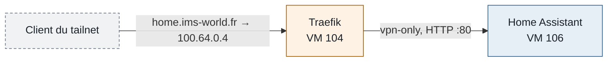

import { ips } from "/snippets/variables.mdx";

## Fiche

Home Assistant OS tourne en VM sur le Mac Mini, branché directement sur le LAN pour la découverte des appareils.

| Propriété | Valeur |
| --- | --- |
| Type | VM, Home Assistant OS (appliance, hors gestion ims-ops) |
| Nœud et VMID | `pve-macmini`, 106 |
| Noms | Proxmox `ims-haos` · tailnet `ims-pve-106-homeassistant` |
| OS | Home Assistant OS 18.2, Core 2026.9.2 |
| CPU et RAM | 2 cœurs · 4 Go ; chipset `q35`, UEFI (OVMF) |
| Disques | 32 Go sur `local-lvm` (`pve-macmini`), disque EFI de 4 Mo |
| IP LAN | <code>{ips.haLan}</code> (bail réservé sur la Bbox) |
| IP tailnet | <code>{ips.ha}</code> (module Tailscale) |
| Sauvegarde | Pool `backup`, chaque nuit vers le PBS |
| Statut | En service |

## Accès

L'accès normal passe par Traefik, depuis le tailnet ou le LAN. Les accès directs servent en dépannage, depuis le LAN.

<CardGroup cols={3}>
  <Card color="#FF6B00" title="Home Assistant" icon="house-signal" href="https://home.ims-world.fr">HTTPS, tailnet ou LAN (`vpn-only`).</Card>
  <Card color="#3B82F6" title="Accès direct" icon="ethernet">`http://192.168.1.92`, LAN.</Card>
  <Card color="#3B82F6" title="Observer" icon="stethoscope">`http://192.168.1.92:4357`, LAN.</Card>
</CardGroup>

```bash
# Depuis pve-macmini
qm status 106
qm terminal 106
qm reboot 106
```

## Pourquoi une VM

Home Assistant tournait d'abord en conteneur sur la VM 104. Plusieurs intégrations (Philips Hue, HomeKit, Google Cast) reposent sur la découverte multicast (mDNS, Bonjour), qui ne traverse pas les réseaux Docker. Une VM branchée sur `vmbr0` a une interface directe sur le LAN : la découverte fonctionne sans relais.

Autres avantages : image officielle avec gestion des modules et des mises à jour, passthrough USB direct pour une future clé radio, et domotique indépendante des interventions sur le MS-01.

## Accès HTTPS par Traefik

Home Assistant n'est pas sur Coolify : son routeur est déclaré à la main dans Traefik.



1. Headscale résout `home.ims-world.fr` vers l'IP tailnet de Traefik (`extra_records`).
2. Traefik termine le TLS, applique `vpn-only`, puis transmet à `http://192.168.1.92:80`.
3. Home Assistant fait confiance à l'en-tête `X-Forwarded-For` envoyé par Traefik.

Routeur dans `/data/coolify/proxy/dynamic/vpn-only.yaml` :

```yaml
http:
  routers:
    homeassistant-admin:
      rule: Host(`home.ims-world.fr`)
      entryPoints: [https]
      service: homeassistant-admin
      middlewares: [vpn-only, admin-gzip]
      tls: {certResolver: letsencrypt}
  services:
    homeassistant-admin:
      loadBalancer:
        servers:
          - url: 'http://192.168.1.92:80'
```

<Warning>
Depuis Home Assistant 2026, la section `http:` de `configuration.yaml` est ignorée. Les proxys de confiance se déclarent dans **Paramètres → Système → Réseau → Serveur HTTP → Proxy inverse** : activer **Faire confiance à X-Forwarded-For** et ajouter `192.168.1.52`, `192.168.1.0/24`, `100.64.0.0/10`, `172.16.0.0/12`, `10.0.0.0/8`.
</Warning>

## Module Tailscale

HAOS a un système de fichiers en lecture seule : Tailscale s'installe comme module.

<Steps>
  <Step title="Ajouter le dépôt de modules">
    **Paramètres → Modules complémentaires → Boutique**, menu **⋮ → Dépôts**, ajouter `https://github.com/hassio-addons/repository`.
  </Step>
  <Step title="Installer et configurer le module Tailscale">
    Dans l'onglet **Configuration**, modifier seulement `login_server: "https://vpn.ims-world.fr"`.
  </Step>
  <Step title="Se connecter">
    Démarrer le module, ouvrir son onglet et cliquer sur **Log In**, puis valider sur Headscale.
  </Step>
</Steps>

## Intégrations

État des intégrations prévues.

| Intégration | Type | État |
| --- | --- | --- |
| Philips Hue | Local (mDNS) | <Icon icon="clock" color="#FF6B00" /> À configurer |
| HomeKit Bridge | Local (Bonjour) | <Icon icon="clock" color="#FF6B00" /> À configurer |
| Samsung TV | Local (WebSocket) | <Icon icon="clock" color="#FF6B00" /> À configurer |
| Fire TV | Local (ADB) | <Icon icon="clock" color="#FF6B00" /> À configurer |
| Levoit (VeSync) | Cloud | <Icon icon="clock" color="#FF6B00" /> À configurer |
| Google Home | Cloud, sans Nabu Casa | <Icon icon="clock" color="#FF6B00" /> À configurer |
| Alexa | Cloud | <Icon icon="circle-pause" color="#64748B" /> Désactivée, en attente d'un correctif amont ([#154618](https://github.com/home-assistant/core/issues/154618)) |
| Xgimi Mogo 2 | Communautaire (HACS) | <Icon icon="circle-question" color="#64748B" /> À évaluer |

Les étapes domotiques suivantes sont suivies dans la [feuille de route](/roadmap).

## Particularités

Ce qui distingue cette VM des autres hôtes du parc.

- Les ports USB du Mac Mini sont en USB 3.0, qui perturbe la bande 2,4 GHz : une clé Zigbee doit passer par une rallonge USB 2.0 blindée d'au moins un mètre, et être transmise à la VM par son identifiant (`/dev/serial/by-id/…`).
- Création initiale par le script communautaire `community-scripts/ProxmoxVE` (`vm/haos-vm.sh`).

## Sauvegarde et reprise

Sauvegardée chaque nuit dans le PBS (pool `backup`). Home Assistant propose aussi ses propres sauvegardes, à télécharger avant une mise à jour majeure.

## Supervision

Sonde Uptime Kuma sur `https://home.ims-world.fr`. Pas d'agent Alloy (appliance).

## Voir aussi

<CardGroup cols={2}>
  <Card color="#3B82F6" title="Mac Mini" icon="server" href="/infrastructure/mac-mini">Second nœud du cluster.</Card>
  <Card color="#FF6B00" title="Restreindre un service au tailnet" icon="list-check" href="/procedures/securiser-service-vpn-only">Procédure de restriction au tailnet.</Card>
</CardGroup>
