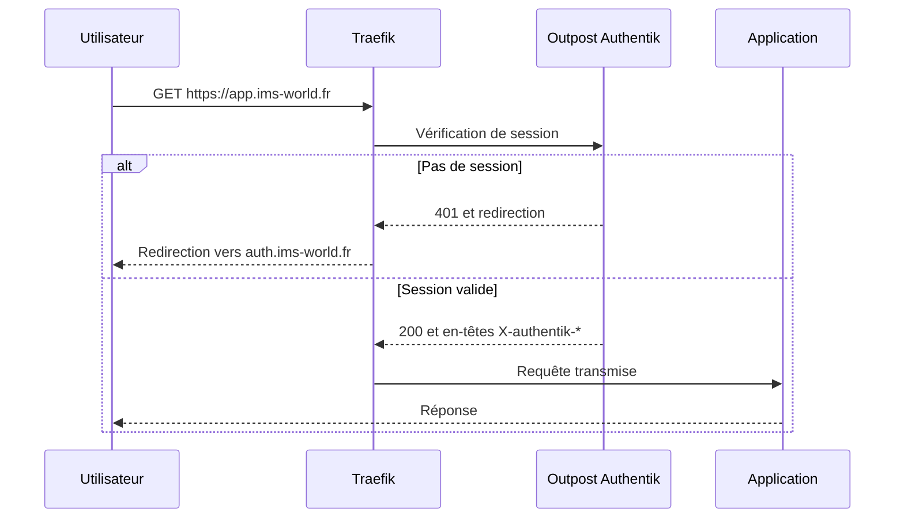

Durée : 20 minutes · Risque : faible · Interruption de service : quelques secondes au redéploiement

## Quand l'utiliser

Pour une application web exposée qui n'a ni authentification propre ni support OIDC (IT-Tools, Stirling PDF, Uptime Kuma, Dozzle). Le principe est décrit dans l'[ADR-002](/history/adr/adr-002-pattern-forward-auth-authentik). Si l'application gère OIDC, préférer l'[intégration OIDC](/procedures/integration-service-authentik-oidc).



## Prérequis

- Compte administrateur Authentik.
- Application déployée dans Coolify, attachée au réseau Docker `coolify`.

## Étapes

<Steps>
  <Step title="Créer le fournisseur proxy">
    Dans Authentik : **Applications → Providers → Create**, type **Proxy Provider** :
    - **Name** : `Provider - <application>` ;
    - **Authorization flow** : `default-authorization-flow` ;
    - mode **Forward auth (single application)** ;
    - **External host** : `https://<sous-domaine>.ims-world.fr`.
  </Step>
  <Step title="Créer l'application">
    **Applications → Applications → Create** : nom, slug, et le fournisseur créé.
  </Step>
  <Step title="Restreindre l'accès">
    Dans l'application, onglet **Policy / Group / User Bindings**, lier les groupes autorisés : administrateurs pour un outil d'administration, `membres` ou `invites` pour un outil partagé (voir la [matrice](/reseau/matrice-securite-exposition#droits-par-groupe-authentik)).
  </Step>
  <Step title="Rattacher l'application à l'outpost">
    **Applications → Outposts**, éditer `ak-outpost-ims-outpost`, ajouter l'application, **Update**.
  </Step>
  <Step title="Ajouter les labels Traefik au compose">
    Dans Coolify, compléter le compose du service :

    ```yaml
    labels:
      - traefik.enable=true
      - traefik.http.routers.<app>.rule=Host(`<sous-domaine>.ims-world.fr`)
      - traefik.http.routers.<app>.entrypoints=https
      - traefik.http.routers.<app>.tls=true
      - traefik.http.routers.<app>.tls.certresolver=letsencrypt
      - traefik.http.routers.<app>.middlewares=authentik-<app>@docker
      - traefik.http.middlewares.authentik-<app>.forwardauth.address=http://ak-outpost-ims-outpost:9000/outpost.goauthentik.io/auth/traefik
      - traefik.http.middlewares.authentik-<app>.forwardauth.trustForwardHeader=true
      - traefik.http.middlewares.authentik-<app>.forwardauth.authResponseHeaders=X-authentik-username,X-authentik-groups,X-authentik-email,X-authentik-name,X-authentik-uid
    ```

    Laisser le champ **Domains** de Coolify vide : sinon Coolify crée un second routeur, sans forward-auth. Redéployer.

    Si le service est aussi restreint au tailnet, son routeur vit dans `vpn-only.yaml` et les labels sont ignorés : y ajouter le middleware avec le suffixe `@docker` (voir [Restreindre un service au tailnet](/procedures/securiser-service-vpn-only)).
  </Step>
  <Step title="Mettre à jour la matrice">
    Ajouter le service dans la [matrice d'exposition](/reseau/matrice-securite-exposition).
  </Step>
</Steps>

## Vérification

1. En navigation privée, ouvrir `https://<sous-domaine>.ims-world.fr` : redirection vers `auth.ims-world.fr`.
2. Se connecter avec un compte autorisé : retour sur l'application.
3. Se connecter avec un compte non autorisé : page d'accès refusé d'Authentik.

## Retour arrière

Retirer les labels du compose et redéployer ; supprimer l'application et le fournisseur dans Authentik.

## Dépannage

| Symptôme | Cause | Solution |
| --- | --- | --- |
| Accès direct sans passer par Authentik | Un routeur de `vpn-only.yaml` ou un domaine Coolify prend la priorité | Voir l'[incident du 24/08/2026](/history/incidents/2026-08-24-bypass-sso-dozzle-traefik-file-provider) |
| Tous les services en forward-auth inaccessibles | Conteneur `ak-outpost-ims-outpost` arrêté | Le redémarrer depuis Coolify (voir [Authentik](/services/authentik)) |
