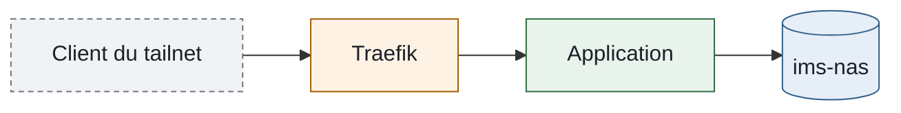

## Rôle de la documentation

Cette documentation décrit l'état du homelab IMS-WORLD et explique les choix qui y ont conduit. Elle répond à trois questions : ce qui existe, pourquoi c'est ainsi, comment l'exploiter.

Elle complète le dépôt ims-ops sans le répéter :

| Sujet | Emplacement |
| --- | --- |
| État attendu des hôtes (comptes, SSH, paquets, agents) | Inventaire du dépôt ims-ops |
| Commandes d'administration du parc | README du dépôt ims-ops |
| État actuel, accès, pièges d'un hôte ou d'un service | Fiches de cette documentation |
| Raisons d'un choix d'architecture | ADR |
| Intervention ponctuelle hors ims-ops | Procédures |

Une donnée n'est écrite qu'à un seul endroit. Les autres pages y renvoient par un lien.

## Organisation

| Emplacement | Contenu | Onglet |
| --- | --- | --- |
| `index.md` | Vue d'ensemble | Homelab |
| `infrastructure/` | Fiches des hôtes : matériel, nœuds Proxmox, VM et conteneurs | Homelab |
| `reseau/` | Architecture réseau, reverse proxy, matrice d'exposition, tailnet, CrowdSec | Homelab |
| `services/` | Fiches des applications | Homelab |
| `procedures/` | Urgence, administration, sécurisation, sauvegarde et reprise | Exploitation |
| `roadmap.md` | Feuille de route | Feuille de route |
| `history/adr/` | Décisions d'architecture et leur index | Décisions et historique |
| `history/incidents/` | Analyses d'incidents et leur index | Décisions et historique |
| `history/chronologie.md` | Journal des chantiers | Décisions et historique |
| `reference/` | Glossaire, ce guide | Référence |
| `snippets/` | Variables partagées (IP, domaines) | Non publié |
| `_modeles/` | Modèles vides par type de page | Non publié |

Un déplacement de page s'accompagne d'une redirection dans la section `redirects` de `docs.json`, pour que les anciens liens restent valides.

## Rédaction

### Voix et ton

- Écrire à la forme impersonnelle : ni « tu », ni « vous », ni « nous ».
- Rédiger les étapes à l'infinitif : « Ouvrir **Datacenter → Backup**. »
- Une idée par phrase, des phrases courtes.
- Rester factuel : pas de superlatifs ni de formules commerciales (« infaillible », « en 10 secondes »).
- Employer le terme français quand il existe (cause, correction, sauvegarde). Un terme technique consacré reste en anglais ; à sa première occurrence, le traduire entre parenthèses si besoin.

### Mise en forme

- Titres : majuscule au premier mot et aux noms propres seulement, en français.
- Aucun emoji : ni dans les titres, ni dans les onglets, les badges ou les schémas.
- Gras pour les éléments d'interface : cliquer sur **Save**.
- Police de code pour les fichiers, chemins, commandes, IP, ports et noms d'hôtes.
- Tableau pour toute donnée comparable sur plusieurs lignes.
- Paramètres à remplacer entre chevrons, en minuscules : `<hôte>`, `<vmid>`, `<outil>`.

### Données qui vieillissent

- Pas de chiffre d'état sans date : « 61 880 photos au 17/08/2026 ». Un lien vers le tableau de bord est préférable.
- La version d'une image n'apparaît que dans la fiche du service (ligne **Image**) et dans `app_version`.
- Pas de « en cours », « bientôt », « à venir » : décrire l'état actuel, et renvoyer vers la [feuille de route](/roadmap) pour la suite.

### Fichiers de configuration et secrets

- Au-delà de 20 lignes, citer un extrait commenté et indiquer l'emplacement du fichier complet.
- Aucun secret, même partiel : jetons, mots de passe et clés sont remplacés par `<jeton>`, `<mot-de-passe>`.

### Variables

Les IP et domaines communs sont définis dans `snippets/variables.mdx`.

| Contexte | Écriture |
| --- | --- |
| Texte et tableaux | `{ips.nasLan}` |
| Code en ligne | `<code>{ips.nasLan}:445</code>` : entre accents graves, la variable s'afficherait telle quelle |
| Bloc de code | Valeur réelle : les variables n'y sont pas interprétées |

## Plans par type de page

La `description` du frontmatter tient lieu d'introduction : une phrase qui dit ce qu'est l'élément et à quoi il sert. Mintlify l'affiche sous le titre.

Les sections obligatoires apparaissent dans l'ordre indiqué, sous ces intitulés exacts. Une page peut ajouter ses propres sections à l'emplacement prévu. Une section obligatoire sans contenu reste présente avec la mention « Sans objet. » ; une section facultative vide est omise.

Un modèle vide de chaque type se trouve dans `_modeles/`.

### Service

| Ordre | Section | Contenu |
| --- | --- | --- |
| 1 | Rôle | Facultative : seulement si la `description` ne suffit pas |
| 2 | Accès | Liens vers l'interface, commandes courantes |
| 3 | Fiche | Tableau aux lignes fixes ci-dessous |
| 4 | Fonctionnement | Composants, flux, schéma si plus de deux composants |
| 5 | Sections propres | Facultatives : tout sujet propre au service |
| 6 | Données et sauvegarde | Où vivent les données, comment elles sont sauvegardées et restaurées |
| 7 | Exploitation | Opérations courantes |
| 8 | Pièges connus | Symptôme, cause, solution |
| 9 | Voir aussi | Liens vers les pages liées |

Lignes du tableau **Fiche**, dans cet ordre : Domaine · Accès (zone et authentification) · Hôte · Coolify (UUID et chemin) · Image · Données · Sauvegarde · Supervision · Mise en service.

### Hôte

S'applique aux machines physiques, aux VM et aux conteneurs LXC.

| Ordre | Section | Contenu |
| --- | --- | --- |
| 1 | Rôle | Facultative |
| 2 | Fiche | Tableau aux lignes fixes ci-dessous |
| 3 | Ce qui tourne dessus | Invités, services, partages |
| 4 | Sections propres | Facultatives : matériel, stockage, passthrough… |
| 5 | Particularités | Écarts par rapport au socle commun des hôtes, pièges |
| 6 | Sauvegarde et reprise | Couverture, exclusions, renvoi vers le plan de reprise |
| 7 | Supervision | Agent, tableaux de bord, sondes |
| 8 | Voir aussi | Liens |

Lignes du tableau **Fiche** : Type · Nœud et VMID · Noms (Proxmox, système, inventaire) · OS · CPU et RAM · Disques · IP LAN · IP tailnet · Sauvegarde · Statut.

### Procédure

Sous la `description`, une ligne : « Durée : … · Risque : … · Interruption de service : … ».

Sections : Quand l'utiliser · Prérequis · Étapes · Vérification · Retour arrière · Dépannage (facultative).

Les étapes utilisent le composant `Steps`. Le nombre d'étapes ne figure pas dans les titres.

### ADR

Sections : Statut · Contexte · Décision · Alternatives écartées · Conséquences · Amendements (facultative).

Statuts possibles : Proposé, Accepté, Remplacé par ADR-xxx, Abandonné. Les numéros se suivent et ne sont jamais réutilisés.

### Incident

Nom de fichier : `AAAA-MM-JJ-<sujet>.md`.

Sections : Résumé · Chronologie · Cause · Correction · Actions · Leçons (facultative).

Le résumé est un tableau : Date · Durée · Impact · Détection · Statut. Les actions sont un tableau : Action · Statut · Lien.

### Chronologie

Un bloc `<Update>` par chantier, de trois à six lignes, avec des liens vers les fiches, ADR et incidents concernés. Les intentions vont dans la feuille de route, pas dans la chronologie.

## Composants

| Composant | Usage | À éviter |
| --- | --- | --- |
| `Badge` | Statut hors norme : en test, arrêté, remplacé | « Production » sur chaque page, versions, compteurs |
| `Warning` | Risque de perte de données, de coupure ou de blocage d'accès | Conseils, rappels |
| `Info`, `Note` | Contexte utile, conséquence à connaître | Contenu principal d'une section |
| `Tip` | Mesure, astuce ou raccourci qui mérite d'être vu | Plus de deux par page |
| `Check` | Résultat attendu dans une procédure | Statut d'un service |
| `Steps` | Séquence d'actions ordonnées | Liste sans ordre |
| `Tabs` | Variantes exclusives : option A ou B, LAN ou tailnet | Deux contenus sans rapport |
| `Card` | Accès, points d'entrée, composants d'un service, invités d'un hôte, « Voir aussi » ; toujours avec une icône | Données chiffrées à comparer |
| `Accordion` | Opérations d'exploitation, pièges connus (symptôme en titre, cause et solution dedans), contenu long et facultatif | Information que tout lecteur doit voir |

## Mise en page

Une page doit se parcourir d'un coup d'œil avant d'être lue.

- Une phrase d'introduction sous chaque titre de section, qui dit ce que contient la section.
- Tableau seulement pour des données courtes à comparer (Fiche, plan d'adressage, ports). Dès qu'une cellule contient une phrase, passer à des cartes, une liste ou des accordéons.
- Les accès, les composants et les liens « Voir aussi » sont des cartes avec icône (icônes Font Awesome, sans emoji).
- Les pièges connus sont des accordéons : symptôme en titre, puis **Cause** et **Solution**.
- Un réglage en plusieurs écrans est une suite `Steps`.
- Deux encadrés au plus par page, hors `Warning`.
- Un service de plus de deux composants a un schéma de son flux dans Fonctionnement.

### Code couleur

Les icônes de cartes (`color` de `Card`) suivent le domaine de la page visée, avec les mêmes teintes que les schémas.

| Couleur | Code | Domaine |
| --- | --- | --- |
| Bleu | `#3B82F6` | Hôtes et matériel |
| Vert | `#16A34A` | Services, accès public |
| Orange | `#FF6B00` | Réseau et sécurité, accès restreint au tailnet |
| Violet | `#8B5CF6` | Stockage et sauvegarde |
| Gris | `#64748B` | Procédures, décisions, référence |
| Rouge | `#DC2626` | Incidents, accès de secours |

### Statuts dans les tableaux

Les emojis sont exclus, y compris pour les statuts. Une cellule de statut commence par une icône `<Icon>`, suivie du mot, pour rester lisible sans la couleur :

| Statut | Icône | Couleur |
| --- | --- | --- |
| Oui, fait | `circle-check` | Vert |
| Non (refus, absence) | `circle-xmark` | Rouge |
| Non par choix (exclusion volontaire) | `circle-minus` | Gris |
| À faire, à configurer, en cours | `clock` | Orange |
| À évaluer | `circle-question` | Gris |
| Désactivé | `circle-pause` | Gris |

Exemple : `| lab-elo | <Icon icon="circle-minus" color="#64748B" /> Non (VM d'un tiers) |`.

## Schémas

- Mermaid uniquement, rendu nativement par Mintlify.
- Un schéma par idée, douze nœuds au plus.
- Libellés en texte, sans emoji, avec les noms réels (`ims-nas`, `VM 104`).
- Pas de directive `%%{init}%%` ni de moteur ELK : le rendu Mintlify échoue avec. Pour limiter les chevauchements, réduire le nombre de nœuds ou découper le schéma.
- Classes communes, à copier en fin de schéma :

```text
classDef hote fill:#e6eef6,stroke:#2f5d8a,color:#1b2129
classDef service fill:#e8f3eb,stroke:#2e6b3f,color:#1b2129
classDef reseau fill:#fdf2e3,stroke:#a35a00,color:#1b2129
classDef externe fill:#f1f2f4,stroke:#6b7480,color:#1b2129,stroke-dasharray:4 3
```

Exemple :



## Historique

- Les ADR, les incidents et la chronologie sont figés : ils décrivent ce qui était vrai au moment de leur rédaction.
- Une décision qui change s'ajoute en tête de l'ADR par un bloc `<Update label="JJ/MM/AAAA">`, sans effacer le texte d'origine. Si le changement est structurant, un nouvel ADR remplace l'ancien, dont le statut devient « Remplacé par ADR-xxx ».
- Une erreur factuelle, fausse dès sa rédaction, se corrige directement.
- Les fiches et les procédures décrivent toujours le présent : elles sont réécrites, et l'historique part dans la chronologie.

## Fraîcheur

- `last_reviewed` est présent sur toutes les pages. Il n'est mis à jour qu'après une relecture complète de la page, pas à chaque retouche.
- Une page relue il y a plus de six mois est à relire.
- `app_version` donne le tag réellement déployé, jamais `latest`.

## Avant de publier

- La fiche concernée est à jour.
- La [matrice d'exposition](/reseau/matrice-securite-exposition) est à jour si un domaine ou un accès change.
- La [feuille de route](/roadmap) est à jour si un chantier change d'état.
- La [chronologie](/history/chronologie) a un bloc si le changement est notable.
- Les commandes ont été testées par copier-coller.
- Les deux contrôles passent sans erreur (ils tournent aussi en CI) :

```bash
npx -y mint@4.2.997 validate
npx -y mint@4.2.997 broken-links
```

## Branches

- La branche `main` est publiée automatiquement.
- Une retouche sur une page peut être commitée directement sur `main`.
- Un chantier sur plusieurs pages, ou tout déplacement de fichier, passe par une branche et une pull request.
- Ces règles s'appliquent aussi à l'éditeur web Mintlify et aux sessions d'IA.
