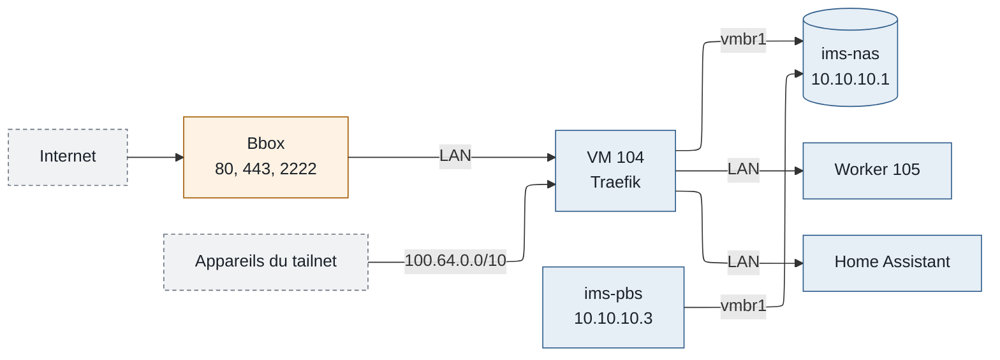

import { ips, domains } from "/snippets/variables.mdx";

## Réseaux

| Réseau | Plage | Rôle |
| --- | --- | --- |
| LAN (`vmbr0`) | `192.168.1.0/24`, passerelle Bbox `192.168.1.254` | Accès humain, SMB, interfaces d'administration, trafic Traefik vers le worker et Home Assistant |
| Réseau interne (`vmbr1`, sur `pve` seulement) | `10.10.10.0/24`, sans passerelle | NFS entre le NAS, le PBS et la VM 104 ; envoi Alloy de ces trois hôtes |
| Tailnet (Headscale) | `100.64.0.0/10`, `fd7a:115c:a1e0::/48` | Administration à distance, services restreints au tailnet |

## Plan d'adressage du LAN

| Plage | Usage | Attribution |
| --- | --- | --- |
| `192.168.1.1` à `.99` | Infrastructure : nœuds, conteneurs, VM permanentes | IP fixe ou bail réservé |
| `192.168.1.100` à `.190` | Appareils du foyer | DHCP de la Bbox |
| `192.168.1.191` à `.199` | IP fixes diverses | IP fixe |
| `192.168.1.200` à `.249` | VM créées par `just vm` | Attribuée par la commande |
| `192.168.1.254` | Bbox (passerelle) | — |

Le DNS des VM créées par ims-ops est `1.1.1.1`.

## Adresses des hôtes

| Hôte | LAN | `vmbr1` | Tailnet | Nom dans le tailnet |
| --- | --- | --- | --- | --- |
| [`pve`](/infrastructure/proxmox-host) | <code>{ips.pveLan}</code> | — | <code>{ips.ms01}</code> | `ims-pve-ms01` |
| [`pve-macmini`](/infrastructure/mac-mini) | <code>{ips.macminiLan}</code> | — | <code>{ips.macmini}</code> | `ims-pve-macmini` |
| [`ims-nas`](/infrastructure/ims-nas) (LXC 100) | <code>{ips.nasLan}</code> | `10.10.10.1` | <code>{ips.nas}</code> | `ims-pve-100-nas` |
| [`ims-pbs`](/infrastructure/ims-pbs) (LXC 103) | <code>{ips.pbsLan}</code> | `10.10.10.3` | <code>{ips.pbs}</code> | `ims-pve-103-pbs` |
| [`ims-coolify`](/infrastructure/vm-coolify) (VM 104) | <code>{ips.coolifyLan}</code> | `10.10.10.2` | <code>{ips.coolify}</code> | `ims-pve-104-coolify` |
| [`ims-coolify-worker`](/infrastructure/lxc-coolify-worker) (LXC 105) | <code>{ips.coolifyWorkerLan}</code> | — | <code>{ips.coolifyWorker}</code> | `ims-pve-105-coolify-worker` |
| [Home Assistant](/infrastructure/vm-home-assistant) (VM 106) | <code>{ips.haLan}</code> | — | <code>{ips.ha}</code> | `ha-macmini` |
| `lab-elo` (VM 107) | <code>{ips.labEloLan}</code> | — | <code>{ips.labElo}</code> | — |
| [Raspberry Pi](/infrastructure/rpi-monitor) | — | — | <code>{ips.rpi}</code> | `ims-rpi-monitor` |

Headscale réattribue d'anciennes adresses : une alerte de clé d'hôte SSH peut être légitime après la création d'une machine. Vérifier l'empreinte sur l'hôte avant d'effacer l'ancienne entrée (`ssh-keygen -R`).

## Redirections de la Bbox

| Règle | Port externe | Cible | Usage |
| --- | --- | --- | --- |
| `Coolify_HTTP` | 80 | <code>{ips.coolifyLan}:80</code> | Traefik (redirection vers HTTPS) |
| `Coolify_HTTPS` | 443 | <code>{ips.coolifyLan}:443</code> | Traefik |
| `Forgejo_SSH` | 2222 | <code>{ips.coolifyLan}:2222</code> | Git en SSH ([ADR-006](/history/adr/adr-006-exposition-port-ssh-forgejo-bbox)) |

Aucun port SSH d'administration n'est redirigé : l'administration se fait depuis le LAN ou le tailnet.

## DNS

| Zone | Fonctionnement |
| --- | --- |
| Publique (OVH) | Enregistrement générique `*.ims-world.fr` vers l'IP publique de la Bbox : un nouveau sous-domaine fonctionne sans créer d'enregistrement. Certificats Let's Encrypt par défi DNS-01 (API OVH) |
| Tailnet (Headscale) | `extra_records` : certains noms pointent vers l'IP tailnet de Traefik (<code>{ips.coolify}</code>) pour les clients du tailnet, par exemple `home.ims-world.fr` et `admin.vpn.ims-world.fr`. Liste dans [Headscale](/reseau/headscale-headplane) |
| MagicDNS | `*.ts.ims-world.fr` |

<Warning>
Un enregistrement `_acme-challenge.<nom>` oublié dans la zone OVH masque le générique pour `<nom>` : le sous-domaine ne résout plus. Voir l'[incident du 24/08/2026](/history/incidents/2026-08-24-dns-wildcard-shadowing-share-ims-world-fr).
</Warning>

## Choix

- **Pas de route du LAN dans le tailnet.** La plage `192.168.1.0/24` entre en conflit avec la plupart des réseaux extérieurs, et la route exposerait tout le LAN au tailnet. Les hôtes sont joints par leur propre IP tailnet. Une renumérotation du LAN lèverait le conflit ; c'est un chantier distinct.
- **SNAT désactivé sur les routes du tailnet** (`--snat-subnet-routes=false`) sur la VM 104, pour que Traefik voie l'IP réelle des clients.

## Voir aussi

- [Matrice d'exposition](/reseau/matrice-securite-exposition)
- [Traefik](/reseau/traefik-proxy)
- [Socle commun des hôtes](/infrastructure/socle-commun) (fail2ban, SSH)
