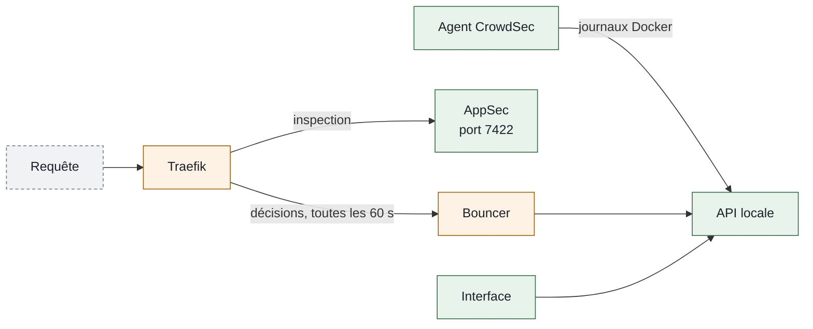

## Accès

<CardGroup cols={2}>
  <Card title="Interface CrowdSec" icon="shield-check" href="https://shield.ims-world.fr">
    Alertes, bouncers, bannissements et débannissements.
  </Card>
</CardGroup>

```bash
# Depuis la VM 104
alias cscli="docker exec -it crowdsec-8bqmp4lkzgfoooqx0wrndfkt cscli"
cscli decisions list
cscli decisions delete --ip <ip>
cscli allowlists list
cscli metrics
cscli bouncers list
```

## Fiche

| Propriété | Valeur |
| --- | --- |
| Domaine | `shield.ims-world.fr` (interface) |
| Accès | Tailnet ; OIDC Authentik, rôle administrateur |
| Hôte | VM 104 |
| Coolify | UUID `8bqmp4lkzgfoooqx0wrndfkt`, chemin `/data/coolify/services/8bqmp4lkzgfoooqx0wrndfkt/` |
| Image | `crowdsecurity/crowdsec:v1.8.1`, `ghcr.io/theduffman85/crowdsec-web-ui:2026.8.3` ; plugin Traefik `crowdsec-bouncer-traefik-plugin` v1.6.0 |
| Données | `config/` (`/etc/crowdsec`), `data/` (base SQLite des alertes et décisions), `webui-data/` |
| Sauvegarde | Avec la VM 104 |
| Supervision | Métriques (port 6060) dans Prometheus, tableau Grafana 19010 |
| Mise en service | 22/08/2026 |

## Fonctionnement



- L'agent lit les journaux des conteneurs par le socket Docker (`source: docker`), un fichier d'acquisition par conteneur dans `/etc/crowdsec/acquis.d/`.
- Le bouncer, plugin de Traefik, applique les décisions à tous les points d'entrée. Mode `stream` : copie locale des décisions, synchronisée toutes les 60 secondes, sans latence par requête.
- `updateMaxFailure: -1` : si l'agent s'arrête, le trafic passe (fail-open, validé par un arrêt de 90 secondes).

## Pare-feu applicatif (AppSec)

| Niveau | Règles | Effet |
| --- | --- | --- |
| En ligne | `appsec-virtual-patching`, `appsec-generic-rules` | Requête malveillante bloquée immédiatement (injections, traversée de chemin, CVE connues) |
| Hors ligne | `appsec-crs` (OWASP CRS) | Alertes journalisées, **sans bannissement** |

Le scénario `crowdsecurity/crowdsec-appsec-outofband` ne bannit plus : il produisait des faux positifs en série sur Grafana, Jellyfin et Patrimo ([incident du 26/08/2026](/history/incidents/2026-08-26-faux-positifs-crowdsec-appsec-outofband)). Le profil correspondant, en tête de `/etc/crowdsec/profiles.yaml`, a `on_success: continue` sans remédiation. Les bannissements pour force brute et balayage restent actifs.

## Listes d'exemption

| Liste | Plage | Raison |
| --- | --- | --- |
| `tailscale` | `100.64.0.0/10` | Ne jamais bloquer l'administration |
| `home-lan` | `192.168.1.0/24` | Requêtes du LAN qui reviennent par la Bbox |

Les événements de ces plages restent journalisés ; seul le bannissement est neutralisé.

## Interface locale

L'interface parle à l'API locale avec un compte machine dédié (`cscli machines add crowdsec-web-ui`). Elle remplace la console en ligne de CrowdSec, qui ne permet pas de gérer les décisions sur l'offre gratuite.

## Données et sauvegarde

Données en bind-mounts sur la VM 104, sauvegardées avec elle. Perdre la base efface l'historique des alertes et les décisions en cours, sans autre conséquence.

## Exploitation

Après une modification du plugin (mode, clé, seuils), recréer Traefik : la relecture à chaud ne suffit pas.

```bash
docker compose -f /data/coolify/proxy/docker-compose.yml up -d --force-recreate
```

## Pièges connus

| Symptôme | Cause | Solution |
| --- | --- | --- |
| Latence, coupures WebSocket | Bouncer en mode `live` | Mode `stream` |
| Site entièrement bloqué quand l'agent s'arrête | `updateMaxFailure` à `0` (valeur par défaut) | `-1` |
| Une acquisition ne lit rien | Ancre `^` dans `container_name_regexp` : les noms Docker commencent par `/` | `".*traefik.*"` |
| Le parseur Authentik échoue | Il attend du syslog, pas des journaux Docker | Ne pas utiliser `firix/authentik` en acquisition Docker |

## Voir aussi

- [Traefik](/reseau/traefik-proxy)
- [Socle commun des hôtes](/infrastructure/socle-commun) (fail2ban sur les hôtes)
