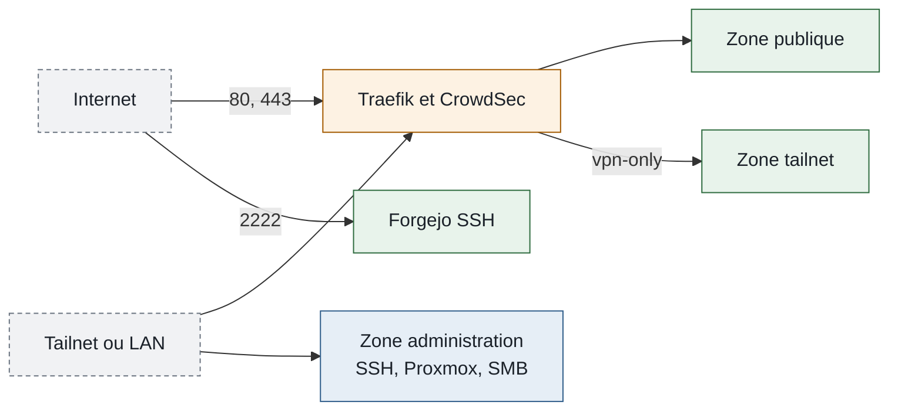

import { ips } from "/snippets/variables.mdx";

## Zones

Le réseau est découpé en trois zones ([ADR-004](/history/adr/adr-004-isolation-reseau-trois-zones)).

| Zone | Joignable depuis | Protection |
| --- | --- | --- |
| Publique | Internet, par les ports 80 et 443 de la Bbox | Traefik, bouncer CrowdSec, TLS, authentification de l'application (SSO, forward-auth ou native) |
| Tailnet | Tailnet et LAN | Routeur dans `vpn-only.yaml` : les autres adresses sont refusées (code 403, page 404 générique) |
| Administration | LAN et tailnet, jamais Internet | Interfaces Proxmox, SSH par clé, SMB ; NFS limité au réseau interne `vmbr1` |



## Services web

| Service | Domaine | Zone | Authentification |
| --- | --- | --- | --- |
| [Authentik](/services/authentik) | `auth.ims-world.fr` | Publique | Native, double facteur |
| [Vaultwarden](/services/vaultwarden) | `vault.ims-world.fr` | Publique | OIDC Authentik ; mot de passe maître pour le déchiffrement ; `/admin` restreint au tailnet |
| [HomeFlix (Jellyfin)](/services/homeflix) | `homeflix.ims-world.fr` | Publique | Native Jellyfin |
| [Vidéoclub (Jellyseerr)](/services/homeflix) | `videoclub.ims-world.fr` | Publique | Comptes Jellyfin |
| [Immich](/services/immich) | `photos.ims-world.fr` | Publique | OIDC Authentik ou native |
| [PhotoPrism](/services/photoprism) | `studio.ims-world.fr` | Publique | OIDC Authentik |
| [Zipline](/services/zipline) | `share.ims-world.fr` | Publique | OIDC Authentik |
| [Forgejo](/services/forgejo) | `forge.ims-world.fr` | Publique | OIDC Authentik |
| [Patrimo](/services/patrimo) | `patrimo.ims-world.fr` | Publique | Compte applicatif |
| [n8n](/services/n8n) | `automation.ims-world.fr` | Publique | Native, double facteur ; webhooks ouverts |
| [Uptime Kuma](/services/uptime-kuma) | `status.ims-world.fr` | Publique | Forward-auth Authentik |
| [IT-Tools](/services/it-tools) | `tools.ims-world.fr` | Publique | Forward-auth Authentik |
| [Stirling PDF](/services/stirling-pdf) | `pdf.ims-world.fr` | Publique | Forward-auth Authentik |
| [Ntfy](/services/ntfy) | `ntfy.ims-world.fr` | Publique | Jeton ou compte ; inscription fermée, accès refusé par défaut |
| [Headscale](/reseau/headscale-headplane) | `vpn.ims-world.fr` | Publique | Clé de machine ou OIDC Authentik |
| [Coolify](/infrastructure/vm-coolify) | `coolify.ims-world.fr` | Tailnet | Native |
| [Headplane](/reseau/headscale-headplane) | `admin.vpn.ims-world.fr/admin` | Tailnet | OIDC Authentik |
| [Grafana](/services/monitoring) | `monitoring.ims-world.fr` | Tailnet | OIDC Authentik |
| [Dozzle](/services/dozzle) | `logs.ims-world.fr` | Tailnet | Forward-auth Authentik |
| [WUD](/services/whatsupdocker) | `wud.ims-world.fr` | Tailnet | Native |
| [Interface CrowdSec](/reseau/crowdsec) | `shield.ims-world.fr` | Tailnet | OIDC Authentik (rôle administrateur) |
| [Termix](/services/termix) | `termix.ims-world.fr` | Tailnet | OIDC Authentik (groupe `admins`) ; compte local de secours avec TOTP |
| [Home Assistant](/infrastructure/vm-home-assistant) | `home.ims-world.fr` | Tailnet | Native |
| [qBittorrent](/services/homeflix) | `qbit.ims-world.fr` | Tailnet | Native |
| [Radarr, Sonarr](/services/homeflix) | `radarr.ims-world.fr`, `sonarr.ims-world.fr` | Tailnet | Formulaire natif |
| [Prowlarr](/services/homeflix) | `prowlarr.ims-world.fr` | Tailnet | Native |

## Accès hors HTTP

| Accès | Adresse | Zone | Authentification |
| --- | --- | --- | --- |
| Git en SSH (Forgejo) | `forge.ims-world.fr:2222` | Publique ([ADR-006](/history/adr/adr-006-exposition-port-ssh-forgejo-bbox)) | Clés SSH des comptes Forgejo |
| SSH des hôtes | Port 22 | Administration | Clé seule ([socle commun](/infrastructure/socle-commun)) |
| Interface Proxmox VE | <code>{ips.pveLan}:8006</code>, <code>{ips.ms01}:8006</code> | Administration | PAM, compte `cmolotkoff` |
| Interface PBS | <code>{ips.pbsLan}:8007</code>, <code>{ips.pbs}:8007</code> | Administration | `cmolotkoff@pbs` |
| Partage SMB | <code>{ips.nasLan}:445</code>, <code>{ips.nas}:445</code> | Administration | Compte Samba `cmolotkoff` |
| NFS | `10.10.10.1:2049` | Réseau interne `vmbr1` ; lecture seule sur le LAN | Adresse source |
| Home Assistant direct | <code>{ips.haLan}</code> (80), Observer (4357) | LAN | Native |

## Flux internes notables

| Source | Destination | Port | Usage |
| --- | --- | --- | --- |
| VM 104 (Termix) | Hôtes gérés | 22 | Compte `termix-usr`, clé acceptée seulement depuis `192.168.1.52` (et `10.0.1.0/24` sur la VM 104 elle-même) |
| VM 104 (Coolify) | Worker 105, VM 104 | 22 | Root par clé, déploiements Coolify |
| VM 104 (Traefik) | Worker 105, Home Assistant | 80 et ports applicatifs | Trafic HTTP sur le LAN |
| Hôtes gérés | VM 104 (Prometheus, Loki) | 9090, 3100 | Agents Alloy |
| Hôtes gérés | VM 104 (Ntfy) | 443 | Alertes fail2ban |

## Droits par groupe Authentik

| Groupe | Rôle |
| --- | --- |
| `authentik Admins`, `admins` | Administration de l'infrastructure et d'Authentik |
| `membres` | Utilisateurs du homelab : applications et tailnet |
| `invites` | Médias et outils partagés |
| `authentik Read-only` | Consultation sans modification |

| Application | Administrateurs | `membres` | `invites` |
| --- | --- | --- | --- |
| Authentik (administration), Proxmox, Coolify, Headplane, Grafana, Dozzle, WUD, Uptime Kuma, Ntfy, Termix | <Icon icon="circle-check" color="#16A34A" /> Oui | <Icon icon="circle-xmark" color="#DC2626" /> Non | <Icon icon="circle-xmark" color="#DC2626" /> Non |
| Enrôlement dans le tailnet (Headscale) | <Icon icon="circle-check" color="#16A34A" /> Oui | <Icon icon="circle-check" color="#16A34A" /> Oui | <Icon icon="circle-xmark" color="#DC2626" /> Non |
| Vaultwarden, Immich, Zipline, PhotoPrism, Patrimo, Forgejo | <Icon icon="circle-check" color="#16A34A" /> Oui | <Icon icon="circle-check" color="#16A34A" /> Oui | <Icon icon="circle-xmark" color="#DC2626" /> Non |
| HomeFlix, Vidéoclub, IT-Tools, Stirling PDF | <Icon icon="circle-check" color="#16A34A" /> Oui | <Icon icon="circle-check" color="#16A34A" /> Oui | <Icon icon="circle-check" color="#16A34A" /> Oui |

## Vérifier l'exposition

Depuis une connexion hors tailnet (partage de connexion du téléphone, par exemple) :

```bash
curl -sI https://qbit.ims-world.fr | head -1    # attendu : HTTP/2 403
curl -sI https://auth.ims-world.fr | head -1    # attendu : 200 ou redirection
```

## Voir aussi

- [Traefik](/reseau/traefik-proxy)
- [Architecture réseau](/reseau/architecture-reseau)
- [Déployer un service](/procedures/deploiement-service)
