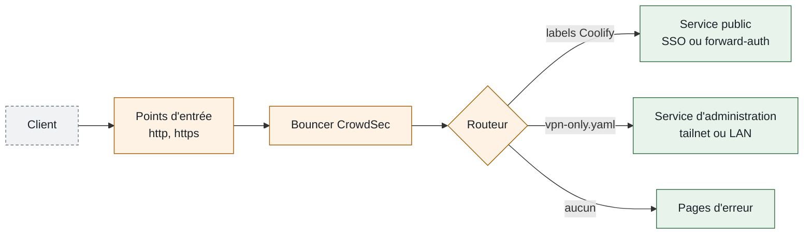

import { ips } from "/snippets/variables.mdx";

## Fiche

| Propriété | Valeur |
| --- | --- |
| Domaine | Tous les sous-domaines de `ims-world.fr` |
| Accès | Ports 80 et 443 redirigés par la Bbox ; tailnet |
| Hôte | VM 104, conteneur `coolify-proxy`, réseau Docker `coolify` |
| Coolify | Proxy du serveur (configuration dans `/data/coolify/proxy/`) |
| Image | `traefik:v3.7.13` |
| Données | `acme.json` (certificats), fichiers dynamiques `/data/coolify/proxy/dynamic/` |
| Sauvegarde | Avec la VM 104 |
| Supervision | Métriques Traefik dans Grafana (tableau « Traefik — Reverse Proxy ») |
| Mise en service | Août 2026 |

## Fonctionnement



Chaque requête passe par le bouncer CrowdSec, appliqué à tous les points d'entrée, puis par un routeur :

| Type de service | Routeur | Exemple |
| --- | --- | --- |
| Public, avec SSO ou forward-auth | Généré par Coolify depuis le champ **Domains** | Authentik, Vaultwarden, Immich |
| Restreint au tailnet | Déclaré dans `vpn-only.yaml`, champ **Domains** vide dans Coolify | Grafana, qBittorrent, Coolify, Headplane |
| Inconnu | `catchall-error-pages` (priorité 1) | Sous-domaine inexistant |

L'exposition de chaque service est recensée dans la [matrice d'exposition](/reseau/matrice-securite-exposition).

## Certificats

Let's Encrypt par défi DNS-01, via l'API OVH. Traefik crée l'enregistrement `_acme-challenge`, attend sa propagation, puis stocke le certificat dans `acme.json`.

```yaml
command:
  - '--certificatesresolvers.letsencrypt.acme.dnschallenge=true'
  - '--certificatesresolvers.letsencrypt.acme.dnschallenge.provider=ovh'
  - '--certificatesresolvers.letsencrypt.acme.dnschallenge.resolvers=8.8.8.8:53'
  - '--certificatesresolvers.letsencrypt.acme.storage=/traefik/acme.json'
environment:
  - OVH_ENDPOINT=ovh-eu
  - OVH_APPLICATION_KEY=<clé>
  - OVH_APPLICATION_SECRET=<secret>
  - OVH_CONSUMER_KEY=<clé-consommateur>
```

Le résolveur conseillé par OVH (`213.251.128.1`) était injoignable lors de la mise en place : seul `8.8.8.8` est utilisé.

## Bouncer CrowdSec

Plugin `crowdsec-bouncer-traefik-plugin` v1.6.0, appliqué aux deux points d'entrée :

```text
--entrypoints.http.http.middlewares=crowdsec-bouncer@file,error-404@file,error-5xx@file
--entrypoints.https.http.middlewares=crowdsec-bouncer@file,error-404@file,error-5xx@file
```

- Mode `stream` : les décisions sont synchronisées toutes les 60 secondes, sans appel par requête.
- `updateMaxFailure: -1` : si CrowdSec s'arrête, le trafic passe (fail-open), validé par un test réel.

Détail dans [CrowdSec](/reseau/crowdsec).

## Services restreints au tailnet

Les routeurs des services d'administration sont centralisés dans `/data/coolify/proxy/dynamic/vpn-only.yaml`, relu à chaud par Traefik ([ADR-009](/history/adr/adr-009-bug-docker-proxy-middleware-vpn-only)) :

```yaml
http:
  middlewares:
    vpn-only:
      ipAllowList:
        sourceRange:
          - "100.64.0.0/10"    # tailnet
          - "192.168.1.0/24"   # LAN
    admin-gzip:
      compress: {}
  routers:
    grafana-admin:
      rule: "Host(`monitoring.ims-world.fr`)"
      entryPoints: [https]
      service: grafana-admin
      middlewares: [vpn-only, admin-gzip]
      tls: {certResolver: letsencrypt}
  services:
    grafana-admin:
      loadBalancer:
        servers:
          - url: "http://grafana-rrw19kmye6gng961igtzqpgw:3000"
```

Routeurs déclarés : Grafana, qBittorrent, Sonarr, Radarr, Prowlarr, Coolify, Headplane, Dozzle, interface CrowdSec, WUD, Termix, Home Assistant. Le fichier fait foi.

Le filtrage suppose que Traefik voie l'IP réelle du client : voir [VM 104](/infrastructure/vm-coolify#réseau-docker-et-ip-source).

## Pages d'erreur

Un conteneur Nginx (`nginx:1.27-alpine`, UUID Coolify `vciwi7dolcl0hw1mffvjcfha`) sert les pages d'erreur. Configuration dans `/data/coolify/proxy/dynamic/error-pages.yaml` :

```yaml
http:
  middlewares:
    error-404:
      errors:
        status: ["404", "403"]
        service: error-pages-svc
        query: "/404.html"
    error-5xx:
      errors:
        status: ["500-599"]
        service: error-pages-svc
        query: "/5xx.html?code={status}"
  routers:
    catchall-error-pages:
      rule: "PathPrefix(`/`)"
      priority: 1
      entryPoints: [http, https]
      service: error-pages-svc
  services:
    error-pages-svc:
      loadBalancer:
        servers:
          - url: "http://vciwi7dolcl0hw1mffvjcfha-nginx:80"
```

**Refus hors tailnet.** Un client hors tailnet qui demande un service restreint reçoit le code HTTP 403 de `vpn-only`, avec le contenu de la page 404 générique : la page n'indique pas que le service existe. Les tests en ligne de commande lisent donc un code 403 (`curl -I`), le navigateur affiche « Page non trouvée ».

## Exploitation

```bash
# Depuis la VM 104
docker logs --tail 100 -f coolify-proxy
docker restart coolify-proxy
# Après une modification du plugin CrowdSec
docker compose -f /data/coolify/proxy/docker-compose.yml up -d --force-recreate
```

## Pièges connus

| Symptôme | Cause | Solution |
| --- | --- | --- |
| Une modification de `/data/coolify/proxy/docker-compose.yml` disparaît | Coolify régénère ce fichier depuis sa base | Modifier la commande dans l'interface Coolify (**Servers → Proxy**) |
| Un service restreint redevient public | Domaine saisi dans le champ **Domains** de Coolify : un second routeur, sans `vpn-only`, est créé | Vider le champ, garder le routeur dans `vpn-only.yaml` |
| Les labels d'un conteneur (forward-auth) n'ont aucun effet | Un routeur du fichier `vpn-only.yaml` porte le même nom d'hôte et prend la priorité | Déclarer le middleware dans `vpn-only.yaml` avec le suffixe `@docker` ([incident du 24/08/2026](/history/incidents/2026-08-24-bypass-sso-dozzle-traefik-file-provider)) |
| Tout le monde est refusé par `vpn-only` | Traefik voit l'IP du pont Docker (`10.0.1.1`) | Vérifier `userland-proxy` et le SNAT Tailscale ([incident du 18/08/2026](/history/incidents/2026-08-18-blocage-traefik-vpn-only-docker-proxy)) |
| Interface Coolify en 502 après une mise à jour | Le proxy a perdu la liaison avec Coolify | `docker restart coolify-proxy` |
| Tester la page 5xx sans couper un service | `docker stop` retire le routeur (on tombe sur le 404) | `docker pause <conteneur>`, puis `docker unpause` |

<Warning>
Les identifiants de l'API OVH sont en clair dans la configuration du proxy, Coolify ne proposant pas de secret à cet endroit. Leur déplacement dans un fichier séparé est suivi dans la [feuille de route](/roadmap).
</Warning>

## Voir aussi

- [Matrice d'exposition](/reseau/matrice-securite-exposition)
- [Restreindre un service au tailnet](/procedures/securiser-service-vpn-only)
- [Forward-auth Authentik](/procedures/securiser-application-authentik-forward-auth)
