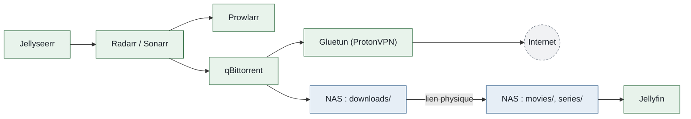

## Rôle

Pile de neuf conteneurs qui va de la demande d'un film à sa lecture. Jellyseerr reçoit la demande, Radarr ou Sonarr cherchent le fichier par Prowlarr, qBittorrent le télécharge à travers le tunnel ProtonVPN de Gluetun, puis Jellyfin le diffuse. Les fichiers terminés sont reliés à la bibliothèque par liens physiques, sans copie.

## Accès

Jellyfin et Jellyseerr sont publics, avec leurs propres comptes. Les quatre outils de gestion ne répondent que depuis le tailnet.

<CardGroup cols={2}>
  <Card title="Jellyfin" icon="play" href="https://homeflix.ims-world.fr">Regarder un film ou une série. Public.</Card>
  <Card title="Jellyseerr" icon="clapperboard" href="https://videoclub.ims-world.fr">Demander un film ou une série. Public.</Card>
</CardGroup>

<CardGroup cols={4}>
  <Card title="Radarr" icon="video" href="https://radarr.ims-world.fr">Films</Card>
  <Card title="Sonarr" icon="tv" href="https://sonarr.ims-world.fr">Séries</Card>
  <Card title="Prowlarr" icon="magnifying-glass" href="https://prowlarr.ims-world.fr">Indexeurs</Card>
  <Card title="qBittorrent" icon="download" href="https://qbit.ims-world.fr">Téléchargements</Card>
</CardGroup>

Journaux de la pile, depuis la VM 104 :

```bash
cd /data/coolify/services/w39uebmcnse7yctsft8hzed8/ && docker compose logs -f --tail=100
```

## Fiche

| Propriété | Valeur |
| --- | --- |
| Domaine | `homeflix`, `videoclub` (publics) ; `radarr`, `sonarr`, `prowlarr`, `qbit` (tailnet) `.ims-world.fr` |
| Accès | Jellyfin : comptes natifs ; Jellyseerr : comptes Jellyfin ; outils : tailnet et formulaires natifs |
| Hôte | VM 104 |
| Coolify | UUID `w39uebmcnse7yctsft8hzed8`, chemin `/data/coolify/services/w39uebmcnse7yctsft8hzed8/` |
| Image | Jellyfin `v10.9.11`, Jellyseerr `v3.4.1`, Gluetun `qmcgaw/gluetun:v3.41.3` ; autres images dans le compose |
| Données | Configurations et bases SQLite sur la VM 104 ; médias sur le NAS (`/mnt/nas-storage/homeflix`) |
| Sauvegarde | Configurations avec la VM 104 ; médias non sauvegardés |
| Supervision | Sondes Uptime Kuma (Jellyfin, Jellyseerr en public ; outils par le réseau Docker) |
| Mise en service | Août 2026 |

## Fonctionnement

Le parcours d'une demande, de Jellyseerr à l'écran :



<CardGroup cols={2}>
  <Card title="Jellyfin" icon="play">Diffusion, transcodage matériel par l'iGPU (Intel Quick Sync).</Card>
  <Card title="Jellyseerr" icon="clapperboard">Demandes de films et séries.</Card>
  <Card title="Radarr, Sonarr" icon="video">Recherche, téléchargement et classement des films et séries.</Card>
  <Card title="Prowlarr" icon="magnifying-glass">Indexeurs, partagés par Radarr et Sonarr.</Card>
  <Card title="qBittorrent" icon="download">Client torrent, dans le réseau de Gluetun (`network_mode: service:gluetun`).</Card>
  <Card title="Gluetun" icon="shield-halved">Tunnel WireGuard ProtonVPN, coupe-circuit, redirection de port.</Card>
  <Card title="Recyclarr" icon="sliders">Profils de qualité TRaSH-Guides, synchronisés chaque jour à 04:00.</Card>
  <Card title="Autoheal" icon="heart-pulse">Redémarre qBittorrent si le tunnel tombe.</Card>
</CardGroup>

Les routeurs de Radarr, Sonarr, Prowlarr et qBittorrent sont dans `vpn-only.yaml`. Celui de qBittorrent pointe vers le conteneur Gluetun (port 8080), qui porte son réseau.

### Transcodage matériel

L'iGPU Iris Xe du MS-01 est attribuée à la VM 104 ([ADR-008](/history/adr/adr-008-passthrough-gpu-igpu-iris-xe)) et transmise au conteneur (`devices: /dev/dri:/dev/dri`). Réglage dans Jellyfin :

<Steps>
  <Step title="Ouvrir le réglage">
    **Tableau de bord → Lecture → Transcodage**.
  </Step>
  <Step title="Choisir l'accélération">
    **Intel QuickSync (QSV)**, périphérique `/dev/dri/renderD128`.
  </Step>
  <Step title="Activer les codecs">
    H.264 et HEVC, en décodage et en encodage.
  </Step>
</Steps>

<Tip>
Mesure à la mise en service : 29,7 fois le temps réel.
</Tip>

## Données et sauvegarde

Les configurations vivent sur la VM 104, les médias sur le disque de 3 To du NAS.

```text
/data/coolify/services/w39uebmcnse7yctsft8hzed8/data/config   configurations et bases (VM 104)
/mnt/nas-storage/homeflix/movies       bibliothèque des films
/mnt/nas-storage/homeflix/series       bibliothèque des séries
/mnt/nas-storage/homeflix/downloads    téléchargements de qBittorrent
```

<Warning>
`downloads/` doit rester sur le même système de fichiers que `movies/` et `series/` : un lien physique ne traverse pas deux systèmes de fichiers. Sinon, Radarr et Sonarr copient les fichiers et l'espace occupé double.
</Warning>

Les configurations sont sauvegardées avec la VM 104. La médiathèque ne l'est pas : elle se retélécharge.

## Exploitation

Opérations courantes, de la plus fréquente à la plus rare.

<AccordionGroup>
  <Accordion title="Supprimer un film ou un épisode" icon="trash">
    Un fichier occupe de l'espace tant que l'un de ses liens existe.

    1. Radarr ou Sonarr : supprimer le fichier (lien dans `movies/` ou `series/`).
    2. qBittorrent : supprimer le torrent en cochant **Supprimer aussi les fichiers** (lien dans `downloads/`).

    Ne jamais supprimer à la main un fichier encore suivi par qBittorrent : le torrent passe en erreur.
  </Accordion>
  <Accordion title="Repérer les doublons et les téléchargements orphelins" icon="clone">
    Depuis ims-ops : `just duplicates`. Le rapport est calculé sur le NAS, sur le disque lui-même, et ne supprime rien. Voir [ims-nas](/infrastructure/ims-nas).
  </Accordion>
  <Accordion title="Débloquer un import manuel (« Unable to parse file »)" icon="file-import">
    Le nom du fichier ne permet pas de déduire la qualité. Dans Radarr ou Sonarr : **Activity → Queue → Manual Import**, choisir la qualité réelle, vérifier que le mode d'import est **Hardlink** (jamais **Copy**), valider.
  </Accordion>
  <Accordion title="Vérifier le port redirigé par ProtonVPN" icon="network-wired">
    ```bash
    GLUETUN=$(docker ps --format '{{.Names}}' | grep "^gluetun" | head -1)
    docker exec "$GLUETUN" cat /tmp/gluetun/forwarded_port
    ```
    Le port doit correspondre au port d'écoute de qBittorrent (**Options → Connexion**).
  </Accordion>
  <Accordion title="Mesurer l'espace réellement occupé" icon="hard-drive">
    `du` sur plusieurs dossiers séparés compte deux fois un fichier présent dans `downloads/` et dans la bibliothèque. Mesurer en une seule commande (`du -sh movies series downloads`) ou lire `df -h`.
  </Accordion>
</AccordionGroup>

## Pièges connus

Chaque piège donne le symptôme observé, sa cause et la correction.

<AccordionGroup>
  <Accordion title="Téléchargements mélangés à la racine de downloads/">
    **Cause** : torrent ajouté sans catégorie.

    **Solution** : une catégorie par usage dans qBittorrent (`movies`, `series`), chacune avec son dossier ; Radarr et Sonarr utilisent la leur.
  </Accordion>
  <Accordion title="Épisode téléchargé mais non importé">
    **Cause** : titre de l'épisode encore « TBA » chez le fournisseur de métadonnées.

    **Solution** : attendre le titre définitif, ou régler **Episode Title Required** dans **Media Management**.
  </Accordion>
  <Accordion title="Jellyfin ne démarre pas : /dev/dri: no such file or directory">
    **Cause** : module `i915` absent après une mise à jour du noyau.

    **Solution** : voir l'[incident du 19/08/2026](/history/incidents/2026-08-19-perte-gpu-passthrough-dev-dri).
  </Accordion>
  <Accordion title="Lecture impossible : Stale file handle">
    **Cause** : montage NFS périmé (avant le retrait de MergerFS).

    **Solution** : redémarrer les conteneurs concernés ; voir le [dépannage](/procedures/depannage-courant).
  </Accordion>
</AccordionGroup>

## Voir aussi

<CardGroup cols={2}>
  <Card title="ims-nas" icon="hard-drive" href="/infrastructure/ims-nas">Partages NFS qui portent la médiathèque.</Card>
  <Card title="Restreindre un service au tailnet" icon="lock" href="/procedures/securiser-service-vpn-only">Procédure appliquée aux outils de gestion.</Card>
</CardGroup>
