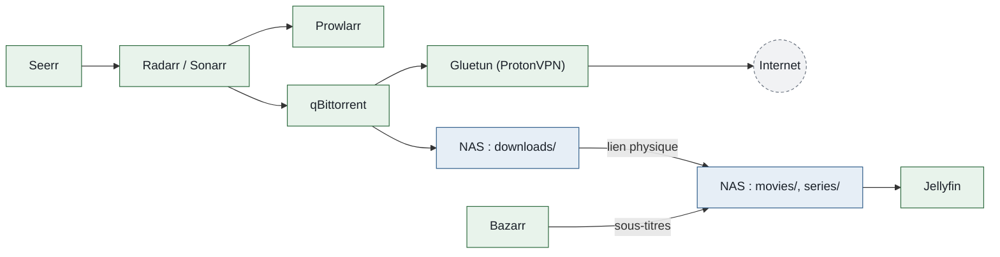

## Rôle

Pile de onze conteneurs qui va de la demande d'un film à sa lecture, sous-titres compris. Seerr reçoit la demande, Radarr ou Sonarr cherchent le fichier par Prowlarr, qBittorrent le télécharge à travers le tunnel ProtonVPN de Gluetun, Bazarr ajoute les sous-titres, puis Jellyfin le diffuse. Les fichiers terminés sont reliés à la bibliothèque par liens physiques, sans copie.

La pile est répartie en deux ressources Coolify, pour que les mises à jour des outils ne coupent pas la lecture :

<CardGroup cols={2}>
  <Card color="#16A34A" title="homeflix-acquisition" icon="download">Gluetun, qBittorrent, Prowlarr, Radarr, Sonarr, Bazarr, Recyclarr, socket-proxy, Autoheal. Aucune exposition publique.</Card>
  <Card color="#16A34A" title="homeflix-lecture" icon="play">Jellyfin et Seerr. Seule ressource exposée publiquement.</Card>
</CardGroup>

## Accès

Jellyfin et Seerr sont publics, avec leurs propres comptes. Les cinq outils de gestion, en orange, ne répondent que depuis le tailnet.

<CardGroup cols={2}>
  <Card color="#16A34A" title="Jellyfin" icon="play" href="https://homeflix.ims-world.fr">Regarder un film ou une série. Public.</Card>
  <Card color="#16A34A" title="Seerr" icon="clapperboard" href="https://videoclub.ims-world.fr">Demander un film ou une série. Public.</Card>
</CardGroup>

<CardGroup cols={3}>
  <Card color="#FF6B00" title="Radarr" icon="video" href="https://radarr.ims-world.fr">Films</Card>
  <Card color="#FF6B00" title="Sonarr" icon="tv" href="https://sonarr.ims-world.fr">Séries</Card>
  <Card color="#FF6B00" title="Prowlarr" icon="magnifying-glass" href="https://prowlarr.ims-world.fr">Indexeurs</Card>
  <Card color="#FF6B00" title="Bazarr" icon="closed-captioning" href="https://bazarr.ims-world.fr">Sous-titres</Card>
  <Card color="#FF6B00" title="qBittorrent" icon="download" href="https://qbit.ims-world.fr">Téléchargements</Card>
</CardGroup>

Journaux, depuis la VM 104 :

```bash
# Acquisition
cd /data/coolify/services/hnvmipjmlpu1cn8zqxmccskr/ && sudo docker compose logs -f --tail=100
# Lecture
cd /data/coolify/services/vbz6zfdlioijpbuegfpjsr69/ && sudo docker compose logs -f --tail=100
```

## Fiche

| Propriété | Valeur |
| --- | --- |
| Domaine | `homeflix`, `videoclub` (publics) ; `radarr`, `sonarr`, `prowlarr`, `bazarr`, `qbit` (tailnet) `.ims-world.fr` |
| Accès | Jellyfin : comptes natifs ; Seerr : comptes Jellyfin ; outils : tailnet et formulaires natifs |
| Hôte | VM 104 |
| Coolify | `homeflix-acquisition` : UUID `hnvmipjmlpu1cn8zqxmccskr` ; `homeflix-lecture` : UUID `vbz6zfdlioijpbuegfpjsr69` ; chemins `/data/coolify/services/<UUID>/` |
| Image | Jellyfin `10.11.11`, Seerr `v3.5.1`, Radarr `6.4.4.10685-ls321`, Sonarr `4.0.20.3014-ls325`, Prowlarr `2.7.0.5723-ls166`, Bazarr `v1.6.2-ls366`, qBittorrent `5.3.0_v2.0.15-ls482`, Gluetun `v3.41.3`, Recyclarr `8.8.1` |
| Données | Configurations et bases SQLite sur la VM 104 ; médias sur le NAS (`/mnt/nas-storage/homeflix`) |
| Sauvegarde | Configurations avec la VM 104 ; médias non sauvegardés |
| Supervision | Sondes Uptime Kuma ; healthchecks Docker et Autoheal ; WUD ; notifications Ntfy sur le topic `homeflix` |
| Mise en service | Août 2026 ; deux ressources depuis le 04/11/2026 |

## Fonctionnement

Le parcours d'une demande, de Seerr à l'écran :



<CardGroup cols={2}>
  <Card color="#16A34A" title="Jellyfin" icon="play">Diffusion, transcodage matériel par l'iGPU (Intel Quick Sync).</Card>
  <Card color="#16A34A" title="Seerr" icon="clapperboard">Demandes de films et séries (successeur de Jellyseerr).</Card>
  <Card color="#16A34A" title="Radarr, Sonarr" icon="video">Recherche, téléchargement et classement des films et séries.</Card>
  <Card color="#16A34A" title="Prowlarr" icon="magnifying-glass">Indexeurs, partagés par Radarr et Sonarr.</Card>
  <Card color="#16A34A" title="Bazarr" icon="closed-captioning">Sous-titres français, puis anglais à défaut ; prévient Jellyfin à chaque ajout.</Card>
  <Card color="#16A34A" title="qBittorrent" icon="download">Client torrent, dans le réseau de Gluetun (`network_mode: service:gluetun`).</Card>
  <Card color="#FF6B00" title="Gluetun" icon="shield-halved">Tunnel WireGuard ProtonVPN, coupe-circuit, redirection de port reportée automatiquement dans qBittorrent.</Card>
  <Card color="#16A34A" title="Recyclarr" icon="sliders">Profils de qualité TRaSH-Guides, synchronisés chaque jour à 04:00.</Card>
  <Card color="#16A34A" title="Autoheal" icon="heart-pulse">Redémarre un conteneur `unhealthy` portant le label `autoheal=true` : qBittorrent, Jellyfin.</Card>
  <Card color="#FF6B00" title="socket-proxy" icon="lock">Seul accès au socket Docker, limité à lister et redémarrer des conteneurs, pour Autoheal.</Card>
</CardGroup>

### Routage

Les deux ressources suivent la [procédure de déploiement](/procedures/deploiement-service) :

- Jellyfin et Seerr : domaine dans le champ **Domains** de Coolify (`https://homeflix.ims-world.fr:8096`, `https://videoclub.ims-world.fr:5055`), aucun label Traefik dans le compose. CrowdSec s'applique par les points d'entrée.
- Outils : champ **Domains** vide, routeurs dans `vpn-only.yaml`. Celui de qBittorrent pointe vers le conteneur Gluetun (port 8080), qui porte son réseau.

Entre les deux ressources, les applications se joignent par le nom de service sur le réseau `coolify` : `radarr:7878`, `sonarr:8989`, `jellyfin:8096`. Dans la ressource d'acquisition, Radarr et Sonarr joignent qBittorrent par `gluetun:8080`.

### Redirection de port

Gluetun ne retient que des serveurs ProtonVPN qui acceptent la redirection de port (`PORT_FORWARD_ONLY=on`). À chaque connexion, il pousse le port attribué dans qBittorrent par son API locale (`VPN_PORT_FORWARDING_UP_COMMAND`). Cette commande exige `WebUI\LocalHostAuth=false` dans `qBittorrent.conf` : seules les requêtes locales sont dispensées d'authentification.

### Sous-titres

Bazarr suit les séries de Sonarr et les films de Radarr, avec le même chemin `/data` : aucune correspondance de chemins à déclarer.

| Réglage | Valeur |
| --- | --- |
| Profil de langues | `FR + EN` : français, puis anglais ; par défaut pour les séries et les films |
| Fournisseurs | OpenSubtitles.com (compte gratuit, quota quotidien) |
| Génération par IA (Whisper) | <Icon icon="circle-minus" color="#64748B" /> Non par choix (charge CPU) |
| Jellyfin | `http://jellyfin:8096`, notification immédiate après chaque ajout |
| Connexion | Formulaire natif, en plus de `vpn-only` |

### Notifications

Radarr, Sonarr et Seerr publient sur le topic Ntfy `homeflix`, séparé des alertes d'infrastructure ([Ntfy](/services/ntfy)).

| Émetteur | Événements |
| --- | --- |
| Radarr | Import d'un film, problème de santé, intervention manuelle requise |
| Sonarr | Import terminé (un message par lot), problème de santé, intervention manuelle requise |
| Seerr | Média disponible |

### Transcodage matériel

L'iGPU Iris Xe du MS-01 est attribuée à la VM 104 ([ADR-008](/history/adr/adr-008-passthrough-gpu-igpu-iris-xe)) et transmise au conteneur (`devices: /dev/dri:/dev/dri`). Réglage dans Jellyfin :

<Steps>
  <Step title="Ouvrir le réglage">
    **Tableau de bord → Lecture → Transcodage**.
  </Step>
  <Step title="Choisir l'accélération">
    **Intel QuickSync (QSV)**, périphérique `/dev/dri/renderD128`.
  </Step>
  <Step title="Activer les codecs">
    H.264 et HEVC, en décodage et en encodage.
  </Step>
</Steps>

<Tip>
Mesure à la mise en service : 29,7 fois le temps réel.
</Tip>

## Données et sauvegarde

Les configurations vivent sur la VM 104, dans le dossier de chaque ressource ; les médias sur le disque de 3 To du NAS.

```text
/data/coolify/services/hnvmipjmlpu1cn8zqxmccskr/config/<service>   configurations de l'acquisition (VM 104)
/data/coolify/services/vbz6zfdlioijpbuegfpjsr69/config/<service>   configurations de Jellyfin et Seerr (VM 104)
/data/coolify/services/vbz6zfdlioijpbuegfpjsr69/cache/jellyfin     cache de Jellyfin (VM 104)
/mnt/nas-storage/homeflix/movies       bibliothèque des films
/mnt/nas-storage/homeflix/series       bibliothèque des séries
/mnt/nas-storage/homeflix/downloads    téléchargements de qBittorrent
```

<Warning>
`downloads/` doit rester sur le même système de fichiers que `movies/` et `series/` : un lien physique ne traverse pas deux systèmes de fichiers. Sinon, Radarr et Sonarr copient les fichiers et l'espace occupé double.
</Warning>

Les configurations sont sauvegardées avec la VM 104. La médiathèque ne l'est pas : elle se retélécharge.

## Exploitation

Opérations courantes, de la plus fréquente à la plus rare.

<AccordionGroup>
  <Accordion title="Supprimer un film ou un épisode" icon="trash">
    Un fichier occupe de l'espace tant que l'un de ses liens existe.

    1. Radarr ou Sonarr : supprimer le fichier (lien dans `movies/` ou `series/`).
    2. qBittorrent : supprimer le torrent en cochant **Supprimer aussi les fichiers** (lien dans `downloads/`).

    Ne jamais supprimer à la main un fichier encore suivi par qBittorrent : le torrent passe en erreur.
  </Accordion>
  <Accordion title="Chercher les sous-titres manquants" icon="closed-captioning">
    Bazarr : **Wanted → Series** ou **Movies**, puis **Search All**. Un titre ajouté avant l'activation du profil par défaut se rattache par **Mass Edit** (profil `FR + EN`).
  </Accordion>
  <Accordion title="Repérer les doublons et les téléchargements orphelins" icon="clone">
    Depuis ims-ops : `just homeflix-doublons`. Le rapport est calculé sur le NAS, sur le disque lui-même, et ne supprime rien. Voir [ims-nas](/infrastructure/ims-nas).
  </Accordion>
  <Accordion title="Débloquer un import manuel (« Unable to parse file »)" icon="file-import">
    Le nom du fichier ne permet pas de déduire la qualité. Dans Radarr ou Sonarr : **Activity → Queue → Manual Import**, choisir la qualité réelle, vérifier que le mode d'import est **Hardlink** (jamais **Copy**), valider.
  </Accordion>
  <Accordion title="Vérifier le port redirigé par ProtonVPN" icon="network-wired">
    ```bash
    sudo sh -c "docker logs gluetun-hnvmipjmlpu1cn8zqxmccskr 2>&1 | grep 'port forwarded is' | tail -1"
    sudo docker exec qbittorrent-hnvmipjmlpu1cn8zqxmccskr grep 'Session\\Port' /config/qBittorrent/qBittorrent.conf
    ```
    Les deux ports doivent être identiques ; l'icône de connexion de qBittorrent est alors verte.
  </Accordion>
  <Accordion title="Mettre à jour une image" icon="arrows-rotate">
    Changer le tag dans le compose de la ressource, puis **Deploy** dans Coolify. Ne pas utiliser la mise à jour intégrée de Radarr, Sonarr ou Prowlarr. Sauvegarder le dossier `config/<service>` avant une version majeure : la base est migrée sans retour possible.
  </Accordion>
  <Accordion title="Mesurer l'espace réellement occupé" icon="hard-drive">
    `du` sur plusieurs dossiers séparés compte deux fois un fichier présent dans `downloads/` et dans la bibliothèque. Mesurer en une seule commande (`du -sh movies series downloads`) ou lire `df -h`.
  </Accordion>
</AccordionGroup>

## Pièges connus

Chaque piège donne le symptôme observé, sa cause et la correction.

<AccordionGroup>
  <Accordion title="qBittorrent « firewalled » : icône en forme de flamme">
    **Cause** : le port attribué par ProtonVPN n'a pas été reporté dans qBittorrent ; `WebUI\LocalHostAuth` est revenu à `true`, ou la commande de Gluetun a échoué.

    **Solution** : vérifier le réglage dans `qBittorrent.conf`, puis redémarrer Gluetun et lire ses journaux `[port forwarding]`.
  </Accordion>
  <Accordion title="Déploiement en échec : « dependency gluetun failed to start », qBittorrent en Created">
    **Cause** : le premier serveur ProtonVPN ne répond pas ; Gluetun en essaie un autre, mais dépasse le délai de démarrage de son healthcheck et Docker abandonne le démarrage de qBittorrent.

    **Solution** : healthcheck de Gluetun redéfini dans le compose avec `start_period: 120s`. Si le cas se présente encore, relancer **Deploy** une fois Gluetun `healthy`.
  </Accordion>
  <Accordion title="Liste des torrents vide après une mise à jour de qBittorrent">
    **Cause** : interface de l'ancienne version gardée en cache par le navigateur ; les compteurs de la colonne de gauche restent justes.

    **Solution** : rechargement forcé de la page, ou suppression des données du site.
  </Accordion>
  <Accordion title="Alerte « Unable to communicate with qBittorrent » juste après un déploiement">
    **Cause** : Radarr et Sonarr démarrent avant qBittorrent, qui attend que Gluetun soit sain ; l'alerte reste affichée jusqu'au prochain contrôle.

    **Solution** : **Settings → Download Clients → Test All Clients**, puis **System → Tasks → Check Health**.
  </Accordion>
  <Accordion title="Téléchargements mélangés à la racine de downloads/">
    **Cause** : torrent ajouté sans catégorie.

    **Solution** : une catégorie par usage dans qBittorrent (`radarr`, `sonarr`), chacune avec son dossier.
  </Accordion>
  <Accordion title="Épisode téléchargé mais non importé">
    **Cause** : titre de l'épisode encore « TBA » chez le fournisseur de métadonnées.

    **Solution** : attendre le titre définitif, ou régler **Episode Title Required** dans **Media Management**.
  </Accordion>
  <Accordion title="Jellyfin ne démarre pas : /dev/dri: no such file or directory">
    **Cause** : module `i915` absent après une mise à jour du noyau.

    **Solution** : voir l'[incident du 19/08/2026](/history/incidents/2026-08-19-perte-gpu-passthrough-dev-dri).
  </Accordion>
  <Accordion title="Jellyfin ne voit plus les films ou les séries">
    **Cause** : montage NFS périmé ou vide.

    **Solution** : le healthcheck de Jellyfin échoue si `/movies` ou `/series` est vide ou ne répond pas en 10 secondes, et Autoheal redémarre le conteneur. Si le problème persiste, vérifier le montage sur la VM 104 ; voir le [dépannage](/procedures/depannage-courant).
  </Accordion>
</AccordionGroup>

## Voir aussi

<CardGroup cols={2}>
  <Card color="#8B5CF6" title="ims-nas" icon="hard-drive" href="/infrastructure/ims-nas">Partages NFS qui portent la médiathèque.</Card>
  <Card color="#FF6B00" title="Restreindre un service au tailnet" icon="lock" href="/procedures/securiser-service-vpn-only">Procédure appliquée aux outils de gestion.</Card>
</CardGroup>
