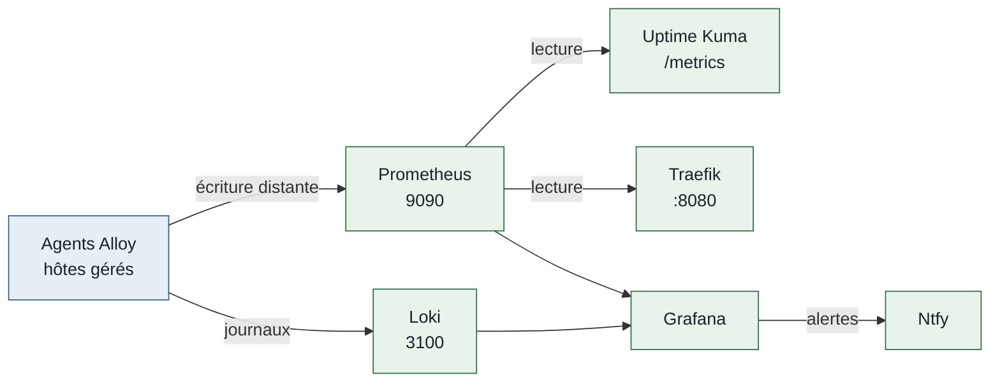

## Accès

Grafana n'est joignable que depuis le tailnet, avec connexion Authentik.

<CardGroup cols={2}>
  <Card title="Grafana" icon="chart-line" href="https://monitoring.ims-world.fr">
    Tableaux de bord, exploration des journaux, règles d'alerte.
  </Card>
</CardGroup>

```bash
# Depuis la VM 104
cd /data/coolify/services/rrw19kmye6gng961igtzqpgw/ && docker compose logs -f --tail=100
# Sur un hôte
sudo systemctl status alloy
```

## Fiche

| Propriété | Valeur |
| --- | --- |
| Domaine | `monitoring.ims-world.fr` |
| Accès | Tailnet ; OIDC Authentik |
| Hôte | VM 104 |
| Coolify | UUID `rrw19kmye6gng961igtzqpgw`, chemin `/data/coolify/services/rrw19kmye6gng961igtzqpgw/` |
| Image | Grafana `13.1.3`, Loki `3.3.2`, Prometheus `v3.1.0` ; agents Alloy `1.18.1` |
| Données | Base Prometheus (rétention 1 an), Loki (30 jours), sur le disque local de la VM 104 |
| Sauvegarde | Avec la VM 104 |
| Supervision | Sonde Uptime Kuma sur Grafana |
| Mise en service | Août 2026 |

## Fonctionnement

Les agents poussent métriques et journaux ; Prometheus lit lui-même quelques sources ; Grafana affiche et alerte.



<CardGroup cols={2}>
  <Card title="Agents Alloy" icon="satellite-dish">
    Envoi par écriture distante. Un agent par hôte géré, installé par ims-ops. Destination `10.10.10.2` pour le NAS, le PBS et la VM 104, `192.168.1.52` pour les autres ; jamais par le tailnet.
  </Card>
  <Card title="Uptime Kuma" icon="heart-pulse">
    Lu par Prometheus sur `/metrics`, avec authentification ; clé dans `config/uptime-kuma-api-key.txt`, montée en lecture seule.
  </Card>
  <Card title="Traefik" icon="route">
    Lu par Prometheus sur `coolify-proxy:8080`.
  </Card>
  <Card title="SMART des disques" icon="hard-drive">
    Fichier texte lu par Alloy, écrit par `smartmon.sh` toutes les 5 minutes sur les deux nœuds.
  </Card>
</CardGroup>

Les collecteurs propres à certains hôtes (Docker, Traefik, SMART, `hwmon` désactivé dans les conteneurs) sont décrits dans le [socle commun](/infrastructure/socle-commun#supervision).

### SMART

```bash
# /etc/cron.d/smartmon (nœuds pve et pve-macmini)
*/5 * * * * root /usr/local/bin/smartmon.sh > /var/lib/node_exporter/textfile_collector/smartmon.prom.$$ && mv /var/lib/node_exporter/textfile_collector/smartmon.prom.$$ /var/lib/node_exporter/textfile_collector/smartmon.prom
```

Le script utilise `smartctl -n standby` : un disque en veille n'est pas réveillé (`smartmon_device_active = 0`), ce qui respecte la mise en veille du HDD après 30 minutes.

## Tableaux de bord

| Tableau | Source | Contenu |
| --- | --- | --- |
| Vue d'ensemble — IMS-WORLD | Maison | État des services, stockage, SMART, certificats à moins de 30 jours, ressources par hôte |
| Gestion des disques | Maison | Capacité, répartition HDD et SSD, tendance sur 90 jours, entrées-sorties, SMART, températures |
| Traefik — Reverse Proxy | Maison | Requêtes, erreurs 4xx et 5xx, connexions, services les plus demandés, latences |
| Uptime Kuma - Overview | Maison | Disponibilité, temps de réponse, certificats, objectifs sur 24 h, 7 et 30 jours |
| Node Exporter Full | Grafana 1860, adapté | Système par hôte (variables `job=integrations/unix`, `host`) |
| Docker monitoring | Grafana 15798, adapté | Ressources par conteneur |
| Logs — Vue d'ensemble | Maison | Journaux filtrables par `$host`, `$job`, `$container`, `$level` |

<Frame caption="Vue d'ensemble — IMS-WORLD">
  
</Frame>

## Alertes

Grafana évalue les règles et envoie les alertes au topic Ntfy `ims-alerts` (point de contact webhook, `POST https://ntfy.ims-world.fr/ims-alerts`, jeton dédié à Grafana).

| Règle | Requête | Seuil | Délai |
| --- | --- | --- | --- |
| Disque SMART dégradé | `smartmon_device_smart_healthy == 0` | — | Immédiat |
| CPU élevé | `100 - (avg by (host) (rate(node_cpu_seconds_total{mode="idle"}[5m])) * 100)` | > 90 % | 5 min |
| RAM élevée | `(1 - node_memory_MemAvailable_bytes / node_memory_MemTotal_bytes) * 100` | > 90 % | 5 min |
| Disque plein | `(1 - node_filesystem_avail_bytes{fstype!~"tmpfs\|overlay"} / node_filesystem_size_bytes) * 100` | > 85 % | 10 min |
| Hôte muet | `time() - timestamp(node_load1)` | > 120 s | 1 min |
| Conteneur en boucle de redémarrage | `changes(container_start_time_seconds{image!="", host="ims-coolify"}[15m])` | > 2 | Immédiat |

Les autres alertes du homelab ne passent pas par Grafana : échecs de sauvegarde (Proxmox VE et PBS), bannissements fail2ban, mises à jour d'images (WUD), indisponibilités (Uptime Kuma). Toutes arrivent sur le même topic Ntfy.

## Données et sauvegarde

Prometheus et Loki sont sur le disque local de la VM 104 et sauvegardés avec elle. Une perte n'efface que l'historique.

## Exploitation

- Ajouter un hôte : le déclarer dans l'inventaire ims-ops, puis `just setup <hôte> alloy`.
- Journaux systemd dans « Logs — Vue d'ensemble » : régler `$container` sur `All`, sinon seules les entrées de conteneurs s'affichent.

## Pièges connus

Chaque piège donne le symptôme observé, sa cause et la correction.

<AccordionGroup>
  <Accordion title="L'export /metrics d'Uptime Kuma s'arrête après la création d'une étiquette">
    **Cause** : défaut d'Uptime Kuma.

    **Solution** : redémarrer le conteneur (voir [Uptime Kuma](/services/uptime-kuma)).
  </Accordion>
  <Accordion title="Noms de services Traefik illisibles">
    **Cause** : Coolify ajoute des empreintes et suffixes (`https-N-<hash>`, `@docker`).

    **Solution** : les tableaux nettoient les libellés avec `label_replace`.
  </Accordion>
  <Accordion title="Erreurs hwmon dans les journaux d'un conteneur LXC">
    **Cause** : capteurs inaccessibles en LXC.

    **Solution** : collecteur désactivé par ims-ops pour le groupe `lxc`.
  </Accordion>
</AccordionGroup>

## Voir aussi

<CardGroup cols={2}>
  <Card title="Dozzle" icon="list" href="/services/dozzle">[ADR-001](/history/adr/adr-001-stack-monitoring-lgtm).</Card>
  <Card title="Ntfy" icon="bell" href="/services/ntfy">Réception des alertes.</Card>
</CardGroup>
