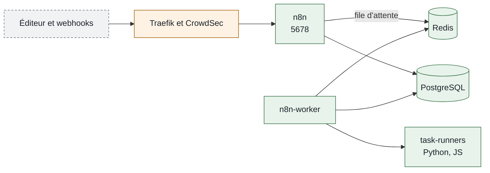

## Accès

<CardGroup cols={2}>
  <Card title="n8n" icon="diagram-project" href="https://automation.ims-world.fr">
    Éditeur de flux, identifiants, exécutions.
  </Card>
</CardGroup>

```bash
# Depuis la VM 104
cd /data/coolify/services/uifode0ypia57wbkyoertbxh/
docker compose ps
docker compose logs -f --tail=50 n8n n8n-worker task-runners
```

## Fiche

| Propriété | Valeur |
| --- | --- |
| Domaine | `automation.ims-world.fr` |
| Accès | Public ; comptes natifs avec double facteur ; `/webhook/*` et `/webhook-test/*` ouverts |
| Hôte | VM 104 |
| Coolify | UUID `uifode0ypia57wbkyoertbxh`, chemin `/data/coolify/services/uifode0ypia57wbkyoertbxh/` (modèle Coolify « n8n queue mode ») |
| Image | `n8nio/n8n:2.10.4`, `n8nio/runners:2.10.4`, `postgres:16-alpine`, `redis:6-alpine` |
| Données | PostgreSQL (flux, identifiants chiffrés, exécutions) ; clé `N8N_ENCRYPTION_KEY` |
| Sauvegarde | Avec la VM 104 ; clé de chiffrement aussi dans Vaultwarden |
| Supervision | Sonde Uptime Kuma |
| Mise en service | 22/09/2026 |

## Fonctionnement



| Conteneur | Rôle |
| --- | --- |
| `n8n` | Interface, API et réception des webhooks ; place les exécutions dans la file |
| `n8n-worker` | Exécute les flux de la file (`EXECUTIONS_MODE=queue`, `OFFLOAD_MANUAL_EXECUTIONS_TO_WORKERS=true`) |
| `task-runners` | Exécution isolée du code Python et JavaScript des nœuds (broker sur le port 5679) |
| `redis` | File d'attente |
| `postgresql` | Base |

**Choix : authentification native.** La connexion OIDC est réservée à l'offre Enterprise de n8n, et un forward-auth bloquerait les webhooks entrants en les redirigeant vers la page de connexion. Le compte propriétaire a un mot de passe fort et le double facteur ; CrowdSec filtre en amont.

## Variables importantes

| Variable Coolify | Rôle | Consigne |
| --- | --- | --- |
| `SERVICE_PASSWORD_ENCRYPTION` | Clé de chiffrement des identifiants (`N8N_ENCRYPTION_KEY`) | Conservée dans Vaultwarden : sans elle, une base restaurée est inutilisable |
| `SERVICE_PASSWORD_N8N` | Jeton interne des task-runners | Généré par Coolify |
| `SERVICE_PASSWORD_POSTGRES`, `SERVICE_USER_POSTGRES` | Accès à la base | Générés par Coolify |
| `GENERIC_TIMEZONE`, `TZ` | Fuseau des déclencheurs planifiés | `UTC` par défaut dans le modèle ; à passer à `Europe/Paris` pour des horaires locaux |

Le compose complet est celui du modèle Coolify, visible dans la ressource.

## Données et sauvegarde

La base est sauvegardée avec la VM 104. Export ponctuel :

```bash
docker exec -t $(docker ps -qf "name=postgresql-uifode0ypia57wbkyoertbxh") pg_dump -U n8n -d n8n -F c > n8n-$(date +%F).dump
```

## Exploitation

Si le volume d'exécutions grossit, activer l'élagage dans les variables Coolify :

```env
EXECUTIONS_DATA_PRUNE=true
EXECUTIONS_DATA_MAX_AGE=168
EXECUTIONS_DATA_PRUNE_MAX_COUNT=50000
```

## Pièges connus

| Symptôme | Cause | Solution |
| --- | --- | --- |
| Déclencheur planifié décalé d'une ou deux heures | Fuseau `UTC` par défaut | `GENERIC_TIMEZONE=Europe/Paris` et `TZ=Europe/Paris` |
| Identifiants illisibles après une restauration | Clé de chiffrement différente | Restaurer `SERVICE_PASSWORD_ENCRYPTION` depuis Vaultwarden |

## Voir aussi

- [Matrice d'exposition](/reseau/matrice-securite-exposition)
