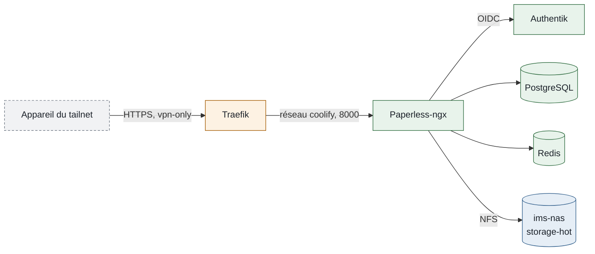

## Accès

Restreint au tailnet, avec connexion Authentik pour les groupes `admins` et `membres`.

<CardGroup cols={2}>
  <Card color="#FF6B00" title="Paperless-ngx" icon="file-lines" href="https://papiers.ims-world.fr">
    Dépôt, recherche et classement des documents.
  </Card>
  <Card color="#FF6B00" title="Application iOS" icon="mobile">
    Swift Paperless, connexion par jeton d'API, Tailscale actif sur le téléphone.
  </Card>
</CardGroup>

```bash
# Depuis la VM 104
cd /data/coolify/services/7pv2enn0rt2yi8uovjzuxolg/ && docker compose logs -f --tail=100
```

## Fiche

| Propriété | Valeur |
| --- | --- |
| Domaine | `papiers.ims-world.fr` |
| Accès | Tailnet ; OIDC Authentik seul (groupes `admins`, `membres`), compte local de secours par `/admin/` ; voir la [matrice](/reseau/matrice-securite-exposition) |
| Hôte | VM 104 |
| Coolify | UUID `7pv2enn0rt2yi8uovjzuxolg`, chemin `/data/coolify/services/7pv2enn0rt2yi8uovjzuxolg/` |
| Image | `ghcr.io/paperless-ngx/paperless-ngx:3.3.4`, `postgres:17-alpine`, `redis:7.4-alpine` |
| Données | Documents sur le SSD du NAS (`/mnt/nas-hot/paperless/media`) ; base, index et file d'attente sur la VM 104 |
| Sauvegarde | Base et index avec la VM 104 ; **documents non sauvegardés** (voir plus bas) |
| Supervision | Sonde Uptime Kuma, WUD |
| Mise en service | 10/11/2026 |

## Fonctionnement

Paperless reçoit les documents par l'interface web ou l'application mobile, les passe à l'OCR (français et anglais), puis les range sur le NAS.



- Ressource Docker Compose dans Coolify, champ **Domains** vide : routeur `paperless` dans `vpn-only.yaml`, enregistrement `papiers.ims-world.fr` dans les `extra_records` de Headscale.
- PostgreSQL et Redis sont propres à la ressource, sans port publié.
- Les fichiers sont rangés par `PAPERLESS_FILENAME_FORMAT` (année, correspondant, date et titre) : ils restent lisibles sur le NAS sans Paperless.
- Tika et Gotenberg (documents Office, e-mails) ne sont pas déployés : seuls les PDF et les images sont acceptés.

## Comptes et droits

Les comptes sont créés par Authentik à la première connexion ; un compte local sert de secours.

<CardGroup cols={2}>
  <Card color="#16A34A" title="Compte SSO" icon="key">Usage quotidien. Créé à la première connexion, rattaché aux groupes Paperless de même nom que ses groupes Authentik.</Card>
  <Card color="#DC2626" title="Superutilisateur local" icon="life-ring">Seulement si Authentik est indisponible, par `https://papiers.ims-world.fr/admin/`. Identifiants dans les variables `SERVICE_USER_PAPERLESS` et `SERVICE_PASSWORD_PAPERLESS` de Coolify.</Card>
</CardGroup>

| Groupe Paperless | Droits |
| --- | --- |
| `admins` | Tous |
| `membres` | Documents, étiquettes, correspondants, types, vues enregistrées, notes, liens de partage, paramètres d'interface : tous droits. Chemins de stockage, champs personnalisés, historique : lecture. Utilisateurs, groupes, configuration, e-mail, workflows : aucun |

- L'application Authentik `paperless` n'est liée qu'aux groupes `admins` et `membres`.
- La synchronisation (`PAPERLESS_SOCIAL_ACCOUNT_SYNC_GROUPS`) ne crée pas les groupes : ils existent dans Paperless avec les noms exacts des groupes Authentik.
- Le statut de superutilisateur ne passe pas par OIDC : il est donné à la main (voir Exploitation). Seul un superutilisateur voit les documents de tous les propriétaires.
- Les documents appartiennent à leur propriétaire : un document n'est visible par un autre membre que s'il est partagé.

## Configuration

Extrait du compose, partie authentification :

```yaml
environment:
  - 'PAPERLESS_URL=https://papiers.ims-world.fr'
  - 'PAPERLESS_OCR_LANGUAGE=fra+eng'
  - 'PAPERLESS_APPS=allauth.socialaccount.providers.openid_connect'
  - 'PAPERLESS_SOCIALACCOUNT_PROVIDERS=${PAPERLESS_SOCIALACCOUNT_PROVIDERS}'   # JSON, secret Coolify
  - 'PAPERLESS_ACCOUNT_ALLOW_SIGNUPS=false'
  - 'PAPERLESS_SOCIALACCOUNT_ALLOW_SIGNUPS=true'
  - 'PAPERLESS_SOCIAL_AUTO_SIGNUP=true'
  - 'PAPERLESS_SOCIAL_ACCOUNT_SYNC_GROUPS=true'
  - 'PAPERLESS_DISABLE_REGULAR_LOGIN=true'
  - 'PAPERLESS_REDIRECT_LOGIN_TO_SSO=true'
```

`PAPERLESS_SOCIALACCOUNT_PROVIDERS` contient l'identifiant et le secret du client, sur une seule ligne :

```json
{"openid_connect":{"OAUTH_PKCE_ENABLED":true,"APPS":[{"provider_id":"authentik","name":"IMS-WORLD","client_id":"<identifiant>","secret":"<secret>","settings":{"server_url":"https://auth.ims-world.fr/application/o/paperless/.well-known/openid-configuration","fetch_userinfo":true}}],"SCOPE":["openid","profile","email"]}}
```

Authentik : fournisseur OAuth2 confidentiel, slug `paperless`, redirection stricte `https://papiers.ims-world.fr/accounts/oidc/authentik/login/callback/`. Les groupes arrivent par la portée `profile`.

## Données et sauvegarde

Les documents sont sur le NAS, le reste sur la VM 104.

| Données | Emplacement | Sauvegarde |
| --- | --- | --- |
| Originaux, archives OCR, miniatures | `/mnt/nas-hot/paperless/media` (SSD du NAS) | <Icon icon="circle-xmark" color="#DC2626" /> Non |
| Base PostgreSQL | Volume `paperless-postgres` (VM 104) | <Icon icon="circle-check" color="#16A34A" /> Avec la VM 104 |
| Index de recherche, classifieur | Volume `paperless-data` (VM 104) | <Icon icon="circle-check" color="#16A34A" /> Avec la VM 104 |
| Dossier de dépôt | `consume/` de la ressource (VM 104) | <Icon icon="circle-check" color="#16A34A" /> Avec la VM 104 |
| Export | `/mnt/nas-storage/paperless-export` (HDD du NAS) | <Icon icon="clock" color="#FF6B00" /> Export non planifié |

<Warning>
Les documents n'ont aucune copie : ne pas détruire de papier ni supprimer d'original ailleurs tant que l'export n'est pas planifié. Voir la [feuille de route](/roadmap).
</Warning>

L'export (`document_exporter`) produit des fichiers et un manifeste lisibles sans Paperless, réimportables par `document_importer`. Le dossier d'export est sur le HDD, un autre disque physique que les documents.

## Exploitation

Opérations courantes, depuis la VM 104.

<AccordionGroup>
  <Accordion title="Donner le statut de superutilisateur à un compte SSO" icon="user-shield">
    ```bash
    docker exec -it paperless-7pv2enn0rt2yi8uovjzuxolg python3 manage.py shell -c "
    from django.contrib.auth.models import User
    u = User.objects.get(username='<utilisateur>')
    u.is_superuser = True; u.is_staff = True; u.save()"
    ```
    Le compte doit s'être connecté une fois par SSO.
  </Accordion>
  <Accordion title="Créer un jeton pour l'application mobile" icon="mobile">
    Dans Paperless, **Mon profil → Jeton d'authentification API**. Le jeton fonctionne malgré `PAPERLESS_DISABLE_REGULAR_LOGIN`. Le ranger dans Vaultwarden.
  </Accordion>
  <Accordion title="Exporter les documents" icon="box-archive">
    ```bash
    docker exec paperless-7pv2enn0rt2yi8uovjzuxolg document_exporter /usr/src/paperless/export
    ```
  </Accordion>
  <Accordion title="Vérifier les variables reçues par le conteneur" icon="magnifying-glass">
    ```bash
    docker exec paperless-7pv2enn0rt2yi8uovjzuxolg printenv PAPERLESS_URL
    docker exec paperless-7pv2enn0rt2yi8uovjzuxolg printenv PAPERLESS_SOCIALACCOUNT_PROVIDERS | python3 -m json.tool
    ```
  </Accordion>
</AccordionGroup>

| Contrôle | Attendu | Dernier test |
| --- | --- | --- |
| Accès hors tailnet | Refusé (403) | 10/11/2026 |
| Accès depuis le tailnet | Redirection vers Authentik | 10/11/2026 |
| Synchronisation des groupes | Compte SSO dans `admins` | 10/11/2026 |
| Connexion de secours | Formulaire `/admin/` | 10/11/2026 |

## Pièges connus

Sans objet.

## Voir aussi

<CardGroup cols={2}>
  <Card color="#64748B" title="Connecter une application à Authentik" icon="key" href="/procedures/integration-service-authentik-oidc">Procédure OIDC générale.</Card>
  <Card color="#8B5CF6" title="Politique de sauvegarde" icon="box-archive" href="/procedures/politique-sauvegardes">Ce qui est sauvegardé, et ce qui ne l'est pas.</Card>
  <Card color="#3B82F6" title="IMS-NAS" icon="hard-drive" href="/infrastructure/ims-nas">Partages NFS et disques.</Card>
  <Card color="#64748B" title="Feuille de route" icon="list-check" href="/roadmap">Export planifié, Tika et Gotenberg, ingestion automatique.</Card>
</CardGroup>
