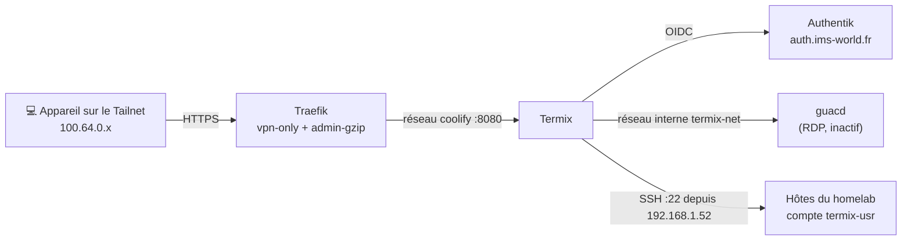

import { ips, domains } from "/snippets/variables.mdx";

<Badge color="green">🟢 Production Active</Badge> <Badge color="green">🟢 Parc Raccordé</Badge>

## Accès rapides & administration

<Tabs>
  <Tab title="🌐 Interface Web">
    <Card title="Termix" icon="terminal" href="https://termix.ims-world.fr">
      Terminal SSH, gestionnaire de fichiers SFTP et vue Proxmox/Docker sur `termix.ims-world.fr`. Accessible uniquement depuis le Tailnet.
    </Card>
  </Tab>
  <Tab title="⚡ Commandes CLI & Maintenance">
    ```bash
    # Se connecter à la VM Coolify
    ssh cmolotkoff@100.64.0.4

    # Accéder au dossier du service Termix
    cd /data/coolify/services/ot8tjxw5ruhoqyis3rkb4ll5/

    # Logs de Termix et de guacd
    docker compose logs -f --tail=100

    # Données persistantes (base chiffrée, plugins, enregistrements)
    ls -la /data/coolify/services/ot8tjxw5ruhoqyis3rkb4ll5/data/
    ```
  </Tab>
</Tabs>

---

## Fiche service

| Propriété | Valeur |
|---|---|
| **Domaine** | `termix.ims-world.fr` |
| **Rôle** | Gestion centralisée des hôtes : terminal SSH, SFTP, Proxmox, Docker, métriques |
| **Version** | `ghcr.io/termix-ssh/termix:26.10.2` + `guacamole/guacd:1.6.0` |
| **Hôte d'orchestration** | VM IMS-Coolify (VM 104) |
| **UUID Coolify** | `ot8tjxw5ruhoqyis3rkb4ll5` |
| **Chemin sur la VM** | `/data/coolify/services/ot8tjxw5ruhoqyis3rkb4ll5/` |
| **Exposition & sécurité** | VPN-Only (`vpn-only.yaml`) + OIDC Authentik natif |
| **Port interne** | `8080` (aucun port publié sur l'hôte) |
| **Statut** | <Badge color="green">🟢 Production Active</Badge> |

<Warning>
  **Termix n'est pas un accès de secours.** Termix et Authentik tournent tous les deux sur la VM 104. Si elle tombe, Termix tombe aussi. L'accès de secours reste le SSH direct via Tailscale, avec ta clé personnelle.
</Warning>

---

## Architecture & flux



### Topologie réseau

- **Double rattachement réseau** : Termix est attaché aux réseaux Docker `coolify` (pour être joint par Traefik) et `termix-net` (pour joindre `guacd`).
- **Isolation de guacd** : Le conteneur `guacd` est uniquement sur `termix-net`. Il n'est jamais joignable par le proxy et n'a aucun port publié.
- **Cloisonnement du stockage** : `guacd` ne voit que deux sous-dossiers des données (`session_recordings` et `rdp-drive`), jamais la base Termix.
- **IP source sortante** : Toutes les connexions sortantes de Termix vers les hôtes partent de la VM 104, donc avec l'IP source `192.168.1.52`.

---

## Sécurité & authentification

L'accès à `termix.ims-world.fr` est sécurisé à deux niveaux :
1. **Isolation réseau (`vpn-only`)** : Routeur `termix-admin` déclaré dans `/data/coolify/proxy/dynamic/vpn-only.yaml`. Depuis le WAN, la réponse est `403 Forbidden`.
2. **Authentification OIDC Authentik** : Gérée nativement par le plugin Single sign-on de Termix. Aucun middleware Forward-Auth n'est utilisé, pour ne pas casser les applications desktop et mobile.

### Comptes

| Compte | Usage | Authentification |
|---|---|---|
| **Compte SSO** | Usage quotidien | Authentik, rôle admin via le groupe `admins` |
| **Admin local de secours** | Uniquement si Authentik est indisponible | Mot de passe + TOTP, stockés dans Vaultwarden (*« Termix — admin de secours »*) |

- L'application Termix dans Authentik est liée au seul groupe `admins`. C'est ce binding qui filtre les utilisateurs autorisés.
- Le champ **Allowed Users** de Termix est vide : tout membre de `admins` peut se connecter.
- **Sign in with SSO automatically** doit rester décoché. Sinon, le formulaire local disparaît (voir [Dépannage](#depannage)).

### Secrets

Les quatre secrets serveur sont saisis dans Coolify (**Configuration → Environment Variables**) et sauvegardés dans Vaultwarden (*« Termix — secrets serveur »*).

| Variable | Rôle | Format |
|---|---|---|
| `JWT_SECRET` | Signature des sessions | 64 caractères hexadécimaux |
| `DATABASE_KEY` | Chiffrement de la base | 64 caractères hexadécimaux |
| `ENCRYPTION_KEY` | Chiffrement des credentials | 64 caractères hexadécimaux |
| `INTERNAL_AUTH_TOKEN` | Communication interne | 64 caractères hexadécimaux |

Génération : `openssl rand -hex 32`.

<Warning>
  **Ne modifie jamais `DATABASE_KEY` ni `ENCRYPTION_KEY` après le premier démarrage.** Termix ne pourrait plus déchiffrer sa base ni les credentials des hôtes. Leur perte équivaut à la perte de toutes les données Termix.
</Warning>

`TERMIX_REQUIRE_EXTERNAL_SECRETS=true` empêche Termix de générer ses propres clés dans le dossier de données : il refuse de démarrer si un secret manque.

### IP client réelle

`TRUSTED_PROXIES=10.0.1.0/24,fdb6:41ac:9c2::/64` (sous-réseaux IPv4 et IPv6 du réseau Docker `coolify`). Le nginx interne de Termix fait confiance à l'en-tête `X-Forwarded-For` envoyé par Traefik. Les journaux d'audit affichent ainsi la vraie IP Tailscale (`100.64.0.x`) de l'appareil.

---

## Plugins

Depuis la version 26.10, chaque fonction de Termix est un plugin. Le registre communautaire est désactivé.

| Statut | Plugins |
|---|---|
| **Activés** | SSH Terminal, File Manager, Session Recording, Docker, Proxmox, Host Metrics, Workspaces, Snippets, Web Endpoint, Single sign-on, TOTP, Homepage (PoC) |
| **Installés, désactivés** | Remote Desktop (en attente de la VM Windows), AI Assistant (en attente du choix de fournisseur) |
| **Supprimés** | Serial, Tmux Monitor, Automations, Fleets, Alerts, Session Sharing, Warpgate, Tailscale, Wake-on-LAN, ACME Certificates, Usage Statistics, LDAP, Passkeys, OPKSSH, HashiCorp Vault, Step CA, Secret Sources, Termix Identity, Tunnels, Network Topology |

### Règles d'usage

- **Docker** : Lecture, logs et console uniquement. Les actions (`stop`, `restart`, `remove`) passent par Coolify, qui doit rester la seule source de vérité des conteneurs.
- **Host Metrics** : Consultation uniquement. Les gestionnaires (services, paquets, firewall, utilisateurs) ne sont pas utilisés : les changements passent par Ansible.
- **Automations, Fleets** : Écartés, pour ne pas créer une seconde source de changement à côté d'Ansible.
- **Session Sharing** : Écarté, aucun partage de session root par lien.
- **AI Assistant** (si activé un jour) : Clé API payante uniquement, **Allow read-only diagnostic commands** décoché, permission `ai.agents` retirée.

### Enregistrement des sessions

- **SSH** : Activé sur tous les hôtes (enregistrement texte, faible volume).
- **RDP** : Désactivé.
- **Rétention** : 30 jours, nettoyage automatique intégré (**Settings → Session Recording → Retention (days)**).
- **Stockage** : `data/plugin-data/session-recording/`.

---

## Configuration

### Docker Compose (Coolify)

Ressource Docker Compose dans Coolify, champ **Domains** vide.

```yaml
services:
  termix:
    image: ghcr.io/termix-ssh/termix:26.10.2
    restart: unless-stopped
    environment:
      PORT: "8080"
      PUID: "1000"
      PGID: "1000"
      TRUSTED_PROXIES: ${TRUSTED_PROXIES:?}
      TERMIX_REQUIRE_EXTERNAL_SECRETS: "true"
      JWT_SECRET: ${JWT_SECRET:?}
      DATABASE_KEY: ${DATABASE_KEY:?}
      ENCRYPTION_KEY: ${ENCRYPTION_KEY:?}
      INTERNAL_AUTH_TOKEN: ${INTERNAL_AUTH_TOKEN:?}
      GUACD_HOST: "guacd"
      GUACD_TUNNEL_HOST: "termix"
      GUACD_RECORDING_PATH: "/termix-data/session_recordings/guacamole"
      GUACD_DRIVE_PATH: "/termix-data/rdp-drive"
    volumes:
      - ./data:/app/data
    depends_on:
      - guacd
    networks:
      termix-net: {}
      coolify: {}

  guacd:
    image: guacamole/guacd:1.6.0
    restart: unless-stopped
    volumes:
      - ./data/session_recordings:/termix-data/session_recordings
      - ./data/rdp-drive:/termix-data/rdp-drive
    networks:
      - termix-net

networks:
  termix-net:
    driver: bridge
  coolify:
    external: true
```

<Info>
  Le conteneur Termix tourne sous l'UID 1000. Son script de démarrage repasse tout `/app/data` à cet utilisateur à chaque lancement : aucune préparation des droits n'est nécessaire.
</Info>

### Traefik (`vpn-only.yaml`)

Dans Coolify : **Proxy → Dynamic configurations → vpn-only.yaml**.

```yaml
http:
  routers:
    termix-admin:
      rule: "Host(`termix.ims-world.fr`)"
      entryPoints: [https]
      service: termix-admin
      middlewares: [vpn-only, admin-gzip]
      tls: {certResolver: letsencrypt}
  services:
    termix-admin:
      loadBalancer:
        servers:
          - url: "http://termix-ot8tjxw5ruhoqyis3rkb4ll5:8080"
```

### DNS split-horizon (Headscale)

Entrée dans `extra_records` (via Headplane) :
```yaml
- name: "termix.ims-world.fr"
  type: "A"
  value: "100.64.0.4"
```

### Authentik

**Provider** (**Applications → Providers → OAuth2/OpenID Provider**) :
- **Name** : `termix`
- **Client type** : `Confidential`
- **Redirect URI** : Strict → `https://termix.ims-world.fr/plugin-api/sso/callback`
- **Scopes** : `openid, email, profile`

**Application** :
- **Nom** : `Termix`
- **Slug** : `termix`
- **Provider** : `termix`
- **Binding** : vers le groupe `admins` uniquement.

**Côté Termix** (**Settings → Single sign-on → Add Provider → OIDC**) :
- **Display Name** : `Authentik`
- **Issuer URL** : `https://auth.ims-world.fr/application/o/termix/`
- **Authorization URL** : `https://auth.ims-world.fr/application/o/authorize/`
- **Token URL** : `https://auth.ims-world.fr/application/o/token/`
- **Scopes** : `openid email profile`
- **Allowed Users** : *(vide)*
- **Admin Group** : `admins`
- **Client ID et Client Secret** : dans Vaultwarden (*« Termix — OIDC Authentik »*).

---

## Validation

| Test | Résultat attendu | Statut |
|---|---|---|
| Accès depuis le WAN (4G, Tailscale coupé) | `403 Forbidden` | ✅ Validé le 19/10/2026 |
| Accès depuis le Tailnet | Page de connexion Termix | ✅ Validé le 19/10/2026 |
| Connexion SSO Authentik | Compte admin via le groupe `admins` | ✅ Validé le 19/10/2026 |
| Connexion admin local de secours | Mot de passe + TOTP | ✅ Validé le 19/10/2026 |

---

## Raccordement des hôtes

Les hôtes sont raccordés à Termix par l'automatisation du dépôt IMS-INFRA : un compte dédié `termix-usr`, une nouvelle clé SSH déployée le 24/10/2026 restreinte à Traefik (`from="192.168.1.52"`), et un sudo sans mot de passe journalisé (`Defaults log_subcmds`) dans Loki via Alloy. Voir [Infrastructure as Code](https://github.com/ims-world/ims-ops).

| Hôte | Statut | Rôle & Remarque |
|---|---|---|
| **pve (MS-01)** | ✅ Raccordé (24/10/2026) | Nœud 1 Leader Cluster Proxmox VE |
| **pve-macmini** | ✅ Raccordé (24/10/2026) | Nœud 2 Cluster Proxmox VE |
| **IMS-Coolify (VM 104)** | ✅ Raccordé (24/10/2026) | Master Coolify / Orchestrateur Docker |
| **IMS-NAS (LXC 100)** | ✅ Raccordé (24/10/2026) | Stockage central NFS/SMB |
| **IMS-PBS (LXC 103)** | ✅ Raccordé (24/10/2026) | Proxmox Backup Server (clé renouvelée) |
| **Coolify Worker (LXC 105)** | ✅ Raccordé (24/10/2026) | Nœud d'exécution Docker distant (Mac Mini) |
| **vm-test (VM 101)** | ✅ Raccordé (24/10/2026) | Banc de test & VM générique |
| **VM HAOS (VM 106)** | ⏳ Non raccordé | Système domotique Appliance (accès exclu pour le moment) |
| **ims-rpi-monitor** | ⏸️ Reporté | Affichage Kiosk 2U (hôte éteint) |
| **VM Windows (VM 102)** | ⏸️ Reportée | RDP ponctuel (allumée à la demande) |

---

## Dépannage

### Boucle de redirection SSO

- **Symptôme** : À la déconnexion, Termix redirige automatiquement vers Authentik, qui renvoie vers Termix, et ainsi de suite. Le formulaire local n'est plus accessible.
- **Cause** : L'option **Sign in with SSO automatically** est cochée, et le compte SSO n'existe pas dans Termix (création automatique désactivée, ou compte jamais créé). Aucun paramètre d'URL ne permet de contourner la redirection.
- **Résolution** :
  1. Dans le compose Coolify, ajoute sous `environment` de `termix` :
     ```yaml
     OIDC_SILENT_LOGIN_DEFAULT: "false"
     ```
  2. Redéploie. Le formulaire local réapparaît.
  3. Connecte-toi avec l'admin local de secours.
  4. Dans **Settings → Single sign-on**, décoche **Sign in with SSO automatically**.
  5. Crée ou relie le compte SSO, puis retire la variable si tu le souhaites.

<Tip>
  Garder `OIDC_SILENT_LOGIN_DEFAULT: "false"` de façon permanente empêche cette situation de se reproduire : la variable prend le dessus sur le réglage de l'interface.
</Tip>

### Erreur de secret au démarrage

- `must contain exactly 64 hexadecimal characters` : La valeur n'a pas été générée avec `openssl rand -hex 32`.
- `must be supplied through ... when TERMIX_REQUIRE_EXTERNAL_SECRETS=true` : Une variable est vide ou absente du compose.

### 403 depuis le Tailnet

Voir [Sécuriser un service avec vpn-only](/procedures/securiser-service-vpn-only), section dépannage. La cause la plus fréquente est l'entrée DNS manquante dans `extra_records`.

---

## Évolutions envisagées

- **OPKSSH** : Remplacer la clé statique par des certificats SSH courts, émis après connexion Authentik.
- **Proxmox Power** (plugin communautaire) : Démarrer la VM Windows à la connexion RDP et l'arrêter quand elle est inactive.
- **Homepage** : PoC en cours, à comparer avec l'item roadmap « Homepage (dashboard unifié) ».
