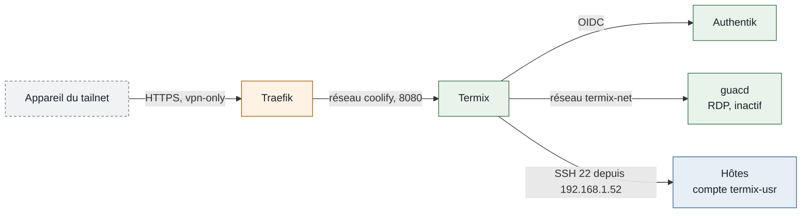

## Accès

Restreint au tailnet, avec connexion Authentik.

<CardGroup cols={2}>
  <Card color="#16A34A" title="Termix" icon="terminal" href="https://termix.ims-world.fr">
    Terminal SSH, fichiers SFTP, vues Proxmox et Docker.
  </Card>
</CardGroup>

```bash
# Depuis la VM 104
cd /data/coolify/services/ot8tjxw5ruhoqyis3rkb4ll5/ && docker compose logs -f --tail=100
```

<Warning>
Termix n'est pas un accès de secours : lui et Authentik tournent sur la VM 104. Si elle tombe, l'accès passe par le SSH direct (tailnet ou LAN) avec la clé personnelle. Voir [Accès de secours](/procedures/commandes-urgence).
</Warning>

## Fiche

| Propriété | Valeur |
| --- | --- |
| Domaine | `termix.ims-world.fr` |
| Accès | Tailnet ; OIDC Authentik (groupe `admins`), compte local de secours avec TOTP |
| Hôte | VM 104 |
| Coolify | UUID `ot8tjxw5ruhoqyis3rkb4ll5`, chemin `/data/coolify/services/ot8tjxw5ruhoqyis3rkb4ll5/` |
| Image | `ghcr.io/termix-ssh/termix:26.10.2`, `guacamole/guacd:1.6.0` |
| Données | `data/` : base chiffrée, plugins, enregistrements de sessions |
| Sauvegarde | Avec la VM 104 ; secrets serveur aussi dans Vaultwarden |
| Supervision | Sonde Uptime Kuma |
| Mise en service | 19/10/2026 |

## Fonctionnement

Termix se connecte aux hôtes depuis la VM 104, avec un compte de service dédié.



- Termix est sur deux réseaux Docker : `coolify` (joint par Traefik) et `termix-net` (vers `guacd`). `guacd` n'est que sur `termix-net`, sans port publié, et ne voit que les dossiers d'enregistrement et de transfert RDP.
- Les connexions vers les hôtes partent de la VM 104, donc de `192.168.1.52`. Vers la VM 104 elle-même, elles partent du réseau Docker `coolify` (`10.0.1.0/24`).
- `TRUSTED_PROXIES=10.0.1.0/24,fdb6:41ac:9c2::/64` : Termix fait confiance à l'en-tête `X-Forwarded-For` de Traefik, et ses journaux d'audit affichent l'IP tailnet réelle.

## Comptes

Deux comptes : l'un pour l'usage quotidien, l'autre pour le cas où Authentik est indisponible.

<CardGroup cols={2}>
  <Card color="#16A34A" title="Compte SSO" icon="key">Usage quotidien. Authentik, administrateur par le groupe `admins`.</Card>
  <Card color="#DC2626" title="Administrateur local" icon="life-ring">Seulement si Authentik est indisponible. Mot de passe et TOTP, dans Vaultwarden (« Termix — admin de secours »).</Card>
</CardGroup>

- L'application Authentik `termix` n'est liée qu'au groupe `admins`. Le champ **Allowed Users** de Termix reste vide.
- **Sign in with SSO automatically** reste décoché, et `OIDC_SILENT_LOGIN_DEFAULT=false` le garantit.

## Raccordement des hôtes

Le compte de service `termix-usr` est déployé par ims-ops sur tout le parc géré, sauf les VM de tiers (voir [Socle commun](/infrastructure/socle-commun#comptes)). Sa clé publique est dans `keys/services/termix-usr.pub` du dépôt ; elle n'est acceptée que depuis `192.168.1.52`, et depuis `10.0.1.0/24` sur la VM 104. Sudo sans mot de passe, chaque commande journalisée et remontée dans Loki.

Les hôtes se déclarent dans Termix par leur **IP LAN** : la clé n'est acceptée que depuis les adresses sources prévues.

| Hôte | Raccordé |
| --- | --- |
| `pve`, `pve-macmini` | <Icon icon="circle-check" color="#16A34A" /> Oui |
| `ims-nas`, `ims-pbs`, `ims-coolify-worker` | <Icon icon="circle-check" color="#16A34A" /> Oui |
| `ims-coolify` | <Icon icon="circle-check" color="#16A34A" /> Oui |
| `lab-elo` | <Icon icon="circle-minus" color="#64748B" /> Non (VM d'un tiers) |
| Home Assistant (VM 106) | <Icon icon="circle-minus" color="#64748B" /> Non (appliance) |
| Windows (VM 102) | <Icon icon="clock" color="#FF6B00" /> En RDP, à raccorder |
| Raspberry Pi | <Icon icon="circle-minus" color="#64748B" /> Non (éteint) |

Renouveler la clé : remplacer `keys/services/termix-usr.pub` dans ims-ops, puis `just setup managed accounts`.

## Plugins

Depuis la version 26.10, chaque fonction est un plugin ; le registre communautaire est désactivé.

| État | Plugins |
| --- | --- |
| Activés | SSH Terminal, File Manager, Session Recording, Docker, Proxmox, Host Metrics, Workspaces, Snippets, Web Endpoint, Single sign-on, TOTP, Homepage (essai) |
| Installés, désactivés | Remote Desktop (attend la VM Windows), AI Assistant |
| Supprimés | Tous les autres (Automations, Fleets, Session Sharing, Tunnels, etc.) |

Règles d'usage :

- **Docker** : lecture, journaux et console seulement ; les actions passent par Coolify, seule source de vérité des conteneurs.
- **Host Metrics** : consultation seulement ; les changements passent par ims-ops.
- **Automations, Fleets, Session Sharing** : écartés, pour ne pas créer une seconde source de changement ni partager une session root par lien.
- **AI Assistant**, s'il est activé : clé API payante, commandes de diagnostic désactivées, permission `ai.agents` retirée.

Enregistrement des sessions : SSH sur tous les hôtes, RDP désactivé, rétention 30 jours (**Settings → Session Recording**).

## Configuration

Ressource Docker Compose dans Coolify, champ **Domains** vide (routeur `termix-admin` dans `vpn-only.yaml`, enregistrement `termix.ims-world.fr` dans les `extra_records`). Extrait :

```yaml
services:
  termix:
    image: ghcr.io/termix-ssh/termix:26.10.2
    environment:
      PORT: "8080"
      TRUSTED_PROXIES: ${TRUSTED_PROXIES:?}
      TERMIX_REQUIRE_EXTERNAL_SECRETS: "true"   # refuse de démarrer sans ses secrets
      JWT_SECRET: ${JWT_SECRET:?}
      DATABASE_KEY: ${DATABASE_KEY:?}
      ENCRYPTION_KEY: ${ENCRYPTION_KEY:?}
      INTERNAL_AUTH_TOKEN: ${INTERNAL_AUTH_TOKEN:?}
      OIDC_SILENT_LOGIN_DEFAULT: "false"
      GUACD_HOST: "guacd"
    volumes:
      - ./data:/app/data
    networks: [termix-net, coolify]
  guacd:
    image: guacamole/guacd:1.6.0
    networks: [termix-net]
```

Les quatre secrets (`openssl rand -hex 32`) sont dans les variables Coolify et dans Vaultwarden (« Termix — secrets serveur »).

<Warning>
Ne jamais modifier `DATABASE_KEY` ni `ENCRYPTION_KEY` après le premier démarrage : Termix ne pourrait plus déchiffrer sa base ni les identifiants des hôtes.
</Warning>

Authentik : fournisseur OAuth2 `termix` confidentiel, redirection stricte `https://termix.ims-world.fr/plugin-api/sso/callback`, portées `openid email profile`. Côté Termix (**Settings → Single sign-on**) : émetteur `https://auth.ims-world.fr/application/o/termix/`, groupe administrateur `admins`. Identifiant et secret dans Vaultwarden (« Termix — OIDC Authentik »).

## Données et sauvegarde

`data/` est sauvegardé avec la VM 104. Une restauration exige les mêmes `DATABASE_KEY` et `ENCRYPTION_KEY`.

## Exploitation

| Contrôle | Attendu | Dernier test |
| --- | --- | --- |
| Accès hors tailnet | Refusé (403) | 19/10/2026 |
| Accès depuis le tailnet | Page de connexion | 19/10/2026 |
| Connexion SSO | Administrateur via `admins` | 19/10/2026 |
| Connexion locale de secours | Mot de passe et TOTP | 19/10/2026 |

## Pièges connus

Chaque piège donne le symptôme observé, sa cause et la correction.

<AccordionGroup>
  <Accordion title="Aucun hôte affiché après connexion">
    **Cause** : les hôtes et leurs identifiants appartiennent à un compte Termix : connexion avec le compte local au lieu du compte SSO.

    **Solution** : se reconnecter avec le compte SSO.
  </Accordion>
  <Accordion title="Boucle de redirection vers Authentik">
    **Cause** : **Sign in with SSO automatically** coché sans compte SSO existant.

    **Solution** : `OIDC_SILENT_LOGIN_DEFAULT=false`, redéployer, se connecter en local, décocher l'option.
  </Accordion>
  <Accordion title="must contain exactly 64 hexadecimal characters">
    **Cause** : secret mal généré.

    **Solution** : `openssl rand -hex 32`.
  </Accordion>
  <Accordion title="must be supplied … when TERMIX_REQUIRE_EXTERNAL_SECRETS=true">
    **Cause** : variable absente.

    **Solution** : la déclarer dans Coolify.
  </Accordion>
  <Accordion title="Connexion refusée par un hôte">
    **Cause** : hôte déclaré par son IP tailnet, ou IP source non prévue.

    **Solution** : déclarer l'hôte par son IP LAN.
  </Accordion>
  <Accordion title="Refus depuis le tailnet">
    **Cause** : enregistrement manquant dans les `extra_records`.

    **Solution** : voir [Restreindre un service au tailnet](/procedures/securiser-service-vpn-only).
  </Accordion>
</AccordionGroup>

## Voir aussi

<CardGroup cols={2}>
  <Card color="#3B82F6" title="Socle commun des hôtes" icon="layer-group" href="/infrastructure/socle-commun">Configuration appliquée à tous les hôtes.</Card>
  <Card color="#64748B" title="Feuille de route" icon="list-check" href="/roadmap">Certificats SSH courts (OPKSSH), démarrage de la VM Windows à la demande.</Card>
</CardGroup>
