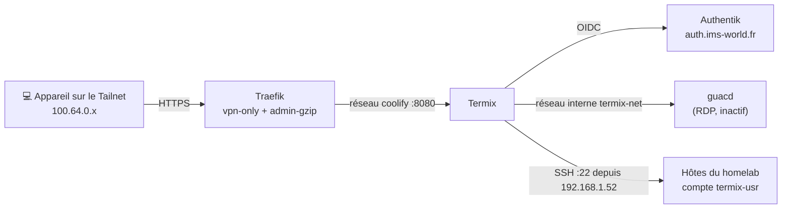

import { ips, domains } from "/snippets/variables.mdx";

<Badge color="orange">🟠 Déploiement en cours — socle opérationnel, hôtes à raccorder</Badge>

## Accès rapides & administration

<Tabs>
  <Tab title="🌐 Interface Web">
    <Card title="Termix" icon="terminal" href="https://termix.ims-world.fr">
      Terminal SSH, gestionnaire de fichiers SFTP et vue Proxmox/Docker sur `termix.ims-world.fr`. Accessible uniquement depuis le Tailnet.
    </Card>
  </Tab>
  <Tab title="⚡ Commandes CLI & Maintenance">
    ```bash
    # Se connecter à la VM Coolify
    ssh cmolotkoff@100.64.0.4

    # Accéder au dossier du service Termix
    cd /data/coolify/services/ot8tjxw5ruhoqyis3rkb4ll5/

    # Logs de Termix et de guacd
    docker compose logs -f --tail=100

    # Données persistantes (base chiffrée, plugins, enregistrements)
    ls -la /data/coolify/services/ot8tjxw5ruhoqyis3rkb4ll5/data/
    ```
  </Tab>
</Tabs>

---

## Fiche service

| Propriété | Valeur |
|---|---|
| **Domaine** | `termix.ims-world.fr` |
| **Rôle** | Gestion centralisée des hôtes : terminal SSH, SFTP, Proxmox, Docker, métriques |
| **Version** | `ghcr.io/termix-ssh/termix:26.10.2` + `guacamole/guacd:1.6.0` |
| **Hôte d'orchestration** | VM IMS-Coolify (VM 104) |
| **UUID Coolify** | `ot8tjxw5ruhoqyis3rkb4ll5` |
| **Chemin sur la VM** | `/data/coolify/services/ot8tjxw5ruhoqyis3rkb4ll5/` |
| **Exposition & sécurité** | VPN-Only (`vpn-only.yaml`) + OIDC Authentik natif |
| **Port interne** | `8080` (aucun port publié sur l'hôte) |
| **Statut** | <Badge color="orange">🟠 Déploiement en cours</Badge> |

<Warning>
  **Termix n'est pas un accès de secours.** Termix et Authentik tournent tous les deux sur la VM 104. Si la VM tombe, Termix tombe également. L'accès de secours reste le SSH direct via Tailscale avec votre clé personnelle.
</Warning>

---

## Architecture & flux



### Topologie réseau

- **Double rattachement réseau** : Termix est attaché aux réseaux Docker `coolify` (pour être joint par Traefik) et `termix-net` (pour communiquer avec `guacd`).
- **Isolation de guacd** : Le conteneur `guacd` réside exclusivement sur `termix-net`. Il n'est jamais joignable par le reverse proxy et ne publie aucun port sur l'hôte.
- **Cloisonnement du stockage** : `guacd` n'a accès qu'aux sous-dossiers `session_recordings` et `rdp-drive`. Il n'a aucun accès à la base de données Termix.
- **IP source sortante** : Toutes les connexions sortantes de Termix vers les hôtes partent de la VM 104 avec l'adresse IP source `192.168.1.52`.

---

## Sécurité & authentification

L'accès à `termix.ims-world.fr` est sécurisé à deux niveaux complémentaires :
1. **Isolation réseau (`vpn-only`)** : Routeur `termix-admin` déclaré dans `/data/coolify/proxy/dynamic/vpn-only.yaml`. Toute tentative d'accès depuis le WAN est rejetée avec une réponse `403 Forbidden`.
2. **Authentification OIDC Authentik** : Gérée nativement par le plugin Single sign-on de Termix. Aucun middleware Forward-Auth n'est utilisé afin de préserver la compatibilité avec les clients desktop et mobile.

### Gestion des comptes

| Compte | Usage | Authentification |
|---|---|---|
| **Compte SSO** | Usage quotidien | Authentik, rôle administrateur via le groupe `admins` |
| **Admin local de secours** | Indisponibilité d'Authentik | Mot de passe + TOTP dans Vaultwarden (*« Termix — admin de secours »*) |

- **Filtrage par groupe** : L'application Termix dans Authentik est liée uniquement au groupe `admins`. Ce binding filtre les utilisateurs autorisés.
- **Allowed Users** : Le champ reste vide dans la configuration Termix. Tout membre de `admins` peut se connecter.
- **Redirection automatique** : L'option **Sign in with SSO automatically** doit rester décochée pour conserver l'accès au formulaire local en cas de secours (voir la section [Dépannage](#depannage)).

### Secrets serveur

Les quatre secrets serveur sont saisis dans Coolify (**Configuration → Environment Variables**) et sauvegardés dans Vaultwarden (*« Termix — secrets serveur »*).

| Variable | Rôle | Format |
|---|---|---|
| `JWT_SECRET` | Signature des sessions | 64 caractères hexadécimaux |
| `DATABASE_KEY` | Chiffrement de la base de données | 64 caractères hexadécimaux |
| `ENCRYPTION_KEY` | Chiffrement des credentials hôtes | 64 caractères hexadécimaux |
| `INTERNAL_AUTH_TOKEN` | Communication interne | 64 caractères hexadécimaux |

Génération des clés : `openssl rand -hex 32`.

<Warning>
  **Ne modifiez jamais `DATABASE_KEY` ni `ENCRYPTION_KEY` après le premier démarrage.** Termix ne pourrait plus déchiffrer sa base ni les credentials des hôtes. La perte de ces clés équivaut à la perte définitive de toutes les données Termix.
</Warning>

La directive `TERMIX_REQUIRE_EXTERNAL_SECRETS=true` empêche Termix de générer ses propres clés dans le dossier de données : il refuse de démarrer si un secret est manquant.

### En-têtes de proxy & IP réelle

`TRUSTED_PROXIES=10.0.1.0/24,fdb6:41ac:9c2::/64` correspond aux sous-réseaux IPv4 et IPv6 du réseau Docker `coolify`. Le serveur Nginx interne de Termix fait ainsi confiance à l'en-tête `X-Forwarded-For` transmis par Traefik. Les journaux d'audit affichent la véritable IP Tailscale (`100.64.0.x`) du client connecté.

---

## Plugins & règles d'usage

Depuis la version 26.10, chaque fonctionnalité de Termix fonctionne sous forme de plugin. Le registre communautaire externe est désactivé.

| Statut | Plugins |
|---|---|
| **Activés** | SSH Terminal, File Manager, Session Recording, Docker, Proxmox, Host Metrics, Workspaces, Snippets, Web Endpoint, Single sign-on, TOTP, Homepage (PoC) |
| **Installés, désactivés** | Remote Desktop (en attente de la VM Windows), AI Assistant (en attente de sélection du fournisseur) |
| **Supprimés** | Serial, Tmux Monitor, Automations, Fleets, Alerts, Session Sharing, Warpgate, Tailscale, Wake-on-LAN, ACME Certificates, Usage Statistics, LDAP, Passkeys, OPKSSH, HashiCorp Vault, Step CA, Secret Sources, Termix Identity, Tunnels, Network Topology |

### Règles d'usage homelab

- **Docker** : Utilisation limitée à la lecture, aux logs et à la console. Les actions de cycle de vie (`stop`, `restart`, `remove`) sont réservées à Coolify, qui demeure la seule source de vérité.
- **Host Metrics** : Consultation uniquement. Les modules de gestion (services, paquets, firewall, utilisateurs) sont proscrits : les modifications d'infrastructure passent par Ansible.
- **Automations & Fleets** : Désactivés pour éviter de doubler Ansible.
- **Session Sharing** : Désactivé afin d'interdire tout partage de session root par lien URL.
- **AI Assistant** (si activé ultérieurement) : Clé API payante requise, option **Allow read-only diagnostic commands** décochée et permission `ai.agents` retirée.

### Enregistrement des sessions

- **SSH** : Activé sur tous les hôtes (enregistrement texte léger).
- **RDP** : Désactivé.
- **Rétention** : 30 jours avec purge automatique (**Settings → Session Recording → Retention (days)**).
- **Stockage** : `data/plugin-data/session-recording/`.

---

## Configuration

### Docker Compose (Coolify)

Ressource Docker Compose déployée dans Coolify, champ **Domains** laissé vide.

```yaml
services:
  termix:
    image: ghcr.io/termix-ssh/termix:26.10.2
    restart: unless-stopped
    environment:
      PORT: "8080"
      PUID: "1000"
      PGID: "1000"
      TRUSTED_PROXIES: ${TRUSTED_PROXIES:?}
      TERMIX_REQUIRE_EXTERNAL_SECRETS: "true"
      JWT_SECRET: ${JWT_SECRET:?}
      DATABASE_KEY: ${DATABASE_KEY:?}
      ENCRYPTION_KEY: ${ENCRYPTION_KEY:?}
      INTERNAL_AUTH_TOKEN: ${INTERNAL_AUTH_TOKEN:?}
      GUACD_HOST: "guacd"
      GUACD_TUNNEL_HOST: "termix"
      GUACD_RECORDING_PATH: "/termix-data/session_recordings/guacamole"
      GUACD_DRIVE_PATH: "/termix-data/rdp-drive"
    volumes:
      - ./data:/app/data
    depends_on:
      - guacd
    networks:
      termix-net: {}
      coolify: {}

  guacd:
    image: guacamole/guacd:1.6.0
    restart: unless-stopped
    volumes:
      - ./data/session_recordings:/termix-data/session_recordings
      - ./data/rdp-drive:/termix-data/rdp-drive
    networks:
      - termix-net

networks:
  termix-net:
    driver: bridge
  coolify:
    external: true
```

<Info>
  Le conteneur Termix tourne sous l'UID 1000. Son script d'initialisation réassigne automatiquement `/app/data` à cet utilisateur à chaque lancement : aucune modification manuelle de droits n'est nécessaire.
</Info>

### Traefik (`vpn-only.yaml`)

Configuration dynamic file provider dans `/data/coolify/proxy/dynamic/vpn-only.yaml` :

```yaml
http:
  routers:
    termix-admin:
      rule: "Host(`termix.ims-world.fr`)"
      entryPoints: [https]
      service: termix-admin
      middlewares: [vpn-only, admin-gzip]
      tls: {certResolver: letsencrypt}
  services:
    termix-admin:
      loadBalancer:
        servers:
          - url: "http://termix-ot8tjxw5ruhoqyis3rkb4ll5:8080"
```

### DNS split-horizon (Headscale)

Entrée déclarée dans `extra_records` via l'interface Headplane :
```yaml
- name: "termix.ims-world.fr"
  type: "A"
  value: "100.64.0.4"
```

### Authentik OIDC

**Provider Authentik** (**Applications → Providers → OAuth2/OpenID Provider**) :
- **Name** : `termix`
- **Client type** : `Confidential`
- **Redirect URI** : Strict → `https://termix.ims-world.fr/plugin-api/sso/callback`
- **Scopes** : `openid`, `email`, `profile`

**Application Authentik** :
- **Name** : `Termix`
- **Slug** : `termix`
- **Provider** : `termix`
- **Binding de groupe** : groupe `admins` uniquement

**Côté Termix** (**Settings → Single sign-on → Add Provider → OIDC**) :
- **Display Name** : `Authentik`
- **Issuer URL** : `https://auth.ims-world.fr/application/o/termix/`
- **Authorization URL** : `https://auth.ims-world.fr/application/o/authorize/`
- **Token URL** : `https://auth.ims-world.fr/application/o/token/`
- **Scopes** : `openid email profile`
- **Allowed Users** : *(laisser vide)*
- **Admin Group** : `admins`
- **Client ID & Client Secret** : stockés dans Vaultwarden (*« Termix — OIDC Authentik »*)

---

## Validation opérationnelle

| Test | Résultat attendu | Statut |
|---|---|---|
| **Accès depuis le WAN** (4G, Tailscale désactivé) | `403 Forbidden` | ✅ Validé le 19/10/2026 |
| **Accès depuis le Tailnet** | Page de connexion Termix | ✅ Validé le 19/10/2026 |
| **Connexion SSO Authentik** | Compte administrateur via groupe `admins` | ✅ Validé le 19/10/2026 |
| **Connexion admin local de secours** | Mot de passe + TOTP | ✅ Validé le 19/10/2026 |

---

## Raccordement des hôtes (à venir)

<Info>
  Cette section décrit l'architecture cible du raccordement des hôtes, en cours de déploiement via Ansible.
</Info>

Chaque hôte reçoit un compte de service dédié `termix-usr`, provisionné automatiquement par le rôle Ansible `termix_access` (`IMS-INFRA/ansible/roles/`).

| Composant | Configuration |
|---|---|
| **Compte système** | `termix-usr`, non root (aucun UID 0) |
| **Paire de clés** | Clé ed25519 dédiée générée et conservée uniquement dans Termix |
| **Restriction authorized_keys** | `from="192.168.1.52",no-agent-forwarding,no-X11-forwarding` |
| **Configuration sshd** | `Match User termix-usr` : authentification par clé publique exclusive |
| **Permissions sudo** | `NOPASSWD: ALL` avec directive `log_subcmds` |
| **Groupes secondaires** | `adm` (lecture de `auth.log`), `docker` sur la VM 104 et le LXC 105 |

### Justification de sécurité & traçabilité

- **Pourquoi sudo sans mot de passe ?** Un mot de passe sudo serait stocké dans Termix pour l'auto-remplissage et n'offrirait aucune protection supplémentaire en cas de compromission du service. La sécurité repose sur la restriction réseau de la clé SSH à l'IP `192.168.1.52`, l'accès limité au Tailnet et le SSO Authentik.
- **Traçabilité centralisée** : Chaque commande sudo est journalisée dans `systemd-journal`, puis expédiée vers Loki via l'agent Alloy. L'audit croise ces logs avec l'enregistrement des sessions Termix.
- **Requête LogQL Grafana** :
  ```logql
  {job="systemd-journal"} |= "termix-usr" != "pvesh"
  ```
  Le filtre `!= "pvesh"` élimine les requêtes de sonde automatique du plugin Proxmox (`sudo -n pvesh` exécuté à chaque intervalle de collecte).

### Périmètre des hôtes à raccorder

| Hôte | IP | Statut |
|---|---|---|
| **pve (MS-01)** | `192.168.1.41` | À raccorder |
| **pve-macmini** | `192.168.1.42` | À raccorder |
| **IMS-NAS (LXC 100)** | `192.168.1.50` | À raccorder |
| **IMS-PBS (LXC 103)** | `192.168.1.51` | 🎯 Hôte pilote |
| **IMS-Coolify (VM 104)** | `192.168.1.52` | À raccorder |
| **Coolify Worker (LXC 105)** | `192.168.1.198` | À raccorder |
| **ims-rpi-monitor** | `100.64.0.12` | Reporté (machine éteinte) |
| **VM Windows (RDP)** | — | Reportée (allumage à la demande) |

---

## Procédure de mise à jour (MAJ)

Cette procédure détaille les étapes pour mettre à jour Termix en toute sécurité sans risquer de corrompre la base de données chiffrée.

### 1. Sauvegarde préventive

1. **Snapshot PBS** : Vérifiez qu'un snapshot récent de la VM 104 est présent sur Proxmox Backup Server.
2. **Sauvegarde des données Termix** :
   ```bash
   ssh cmolotkoff@100.64.0.4
   cd /data/coolify/services/ot8tjxw5ruhoqyis3rkb4ll5/
   sudo tar -czvf /tmp/termix-backup-$(date +%F).tar.gz ./data/
   ```
3. **Vérification des secrets** : Confirmez que `DATABASE_KEY` et `ENCRYPTION_KEY` sont correctement sauvegardés dans Vaultwarden.

### 2. Montée de version dans Coolify

1. Connectez-vous à la console Coolify sur `coolify.ims-world.fr`.
2. Ouvrez le service **Termix** (`ot8tjxw5ruhoqyis3rkb4ll5`).
3. Dans l'onglet **Docker Compose**, modifiez le tag de l'image de Termix (ex: `ghcr.io/termix-ssh/termix:26.x.x`).
4. Vérifiez que la variable `TERMIX_REQUIRE_EXTERNAL_SECRETS="true"` et les 4 secrets d'environnement sont toujours renseignés.
5. Cliquez sur **Deploy**.

### 3. Contrôle post-déploiement

1. **Vérification des logs** :
   ```bash
   docker compose logs -f --tail=100
   ```
   Vérifiez l'absence de messages d'erreur liés aux secrets ou aux plugins.
2. **Accès Web & SSO** : Connectez-vous à `https://termix.ims-world.fr` depuis le Tailnet et validez la session via Authentik.
3. **Test d'administration** : Ouvrez une session SSH vers l'hôte pilote (`IMS-PBS`) pour vérifier le bon déchiffrement des clés et l'enregistrement de la session.

---

## Dépannage

### Boucle de redirection SSO

- **Symptôme** : À la déconnexion, Termix redirige en boucle vers Authentik, rendant le formulaire local inaccessible.
- **Cause** : L'option **Sign in with SSO automatically** est activée alors que le compte SSO n'existe pas encore dans Termix.
- **Résolution** :
  1. Dans le Compose Coolify, ajoutez sous `environment` de `termix` :
     ```yaml
     OIDC_SILENT_LOGIN_DEFAULT: "false"
     ```
  2. Redéployez le conteneur pour faire réapparaître le formulaire local.
  3. Connectez-vous avec l'admin local de secours.
  4. Dans **Settings → Single sign-on**, décochez **Sign in with SSO automatically**.
  5. Créez ou reliez le compte SSO.

<Tip>
  Conserver `OIDC_SILENT_LOGIN_DEFAULT: "false"` de façon permanente prévient définitivement ce blocage : la variable a priorité sur l'interface graphique.
</Tip>

### Erreur de secret au démarrage

- `must contain exactly 64 hexadecimal characters` : La clé n'a pas été générée avec `openssl rand -hex 32`.
- `must be supplied through ... when TERMIX_REQUIRE_EXTERNAL_SECRETS=true` : Une variable est vide ou absente dans Coolify.

### Erreur 403 depuis le Tailnet

Consultez la procédure [Sécuriser un service avec vpn-only](/procedures/securiser-service-vpn-only). La cause principale est généralement une entrée DNS manquante dans `extra_records` sur Headscale.

---

## Évolutions envisagées

- **OPKSSH** : Remplacement de la clé statique par des certificats SSH éphémères émis dynamiquement après authentification Authentik.
- **Proxmox Power** : Démarrage automatique de la VM Windows à l'ouverture d'une session RDP et extinction après inactivité.
- **Homepage** : Évaluation du plugin Homepage Termix en comparaison du chantier roadmap « Homepage (dashboard unifié) ».
